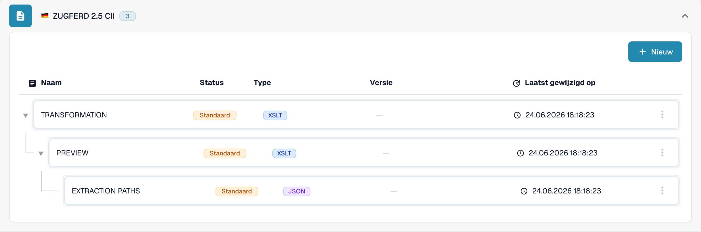

# 🇩🇪 ZUGFERD 2.5

<!-- edocs-country-scope -->


Raadpleeg de landengids voor versiebeperkingen, de daadwerkelijk gebruikte configuratie en de uitlegvideo voor het land. [Duitsland](countries/germany.md). Syntaxis, publicatieversie en profiel zijn verschillende keuzes. Leid geen Factur-X-publicatie af uit de gedeelde 1p0-markering.


| Eigenschap | Waarde |
|------------|--------|
| **Land / Regio** | Duitsland |
| **Documenttypen** | Factuur, creditnota (controleer de daadwerkelijke toewijzing) |
| **Formaat** | CII-XML ingesloten in een PDF/A-3 |
| **Standaard** | ZUGFeRD 2.5 |
| **Gebaseerd op** | EN 16931 |

ZUGFeRD 2.5 en Factur-X 1.09 zijn gelijkwaardige publicaties. Het hybride formaat sluit CII-XML D22B in een PDF/A-3 in; UBL is niet de XML-syntaxis van dit formaat. Raadpleeg de [FeRD-publicatiereferentie](https://www.ferd-net.de/publikationen-produkte/publikationen/detailseite/zugferd-25-english).

De standaard definieert de profielen MINIMUM, BASIC WL, BASIC, EN16931 en EXTENDED. Een profielnaam in de catalogus bewijst geen automatische herkenning of volledige dekking van alle velden. MINIMUM en BASIC WL kunnen regelgegevens weglaten die voor uw integratie nodig zijn.

Deze pagina beschrijft de publicatie van juni 2026. De [latere publicatie Factur-X 1.09.2 / ZUGFeRD 2.5.2](https://fnfe-mpe.org/factur-x/factur-x_en/) moet afzonderlijk worden geïdentificeerd; alleen de familieaanduiding `1p0` is onvoldoende.

## Ondersteuningsstatus

De controle van de ontwikkelcatalogus op 31 oktober 2026, uitsluitend via leesacties, toonde afzonderlijke vermeldingen `ZUGFERD 2.5 CII` en `ZUGFERD 2.5 UBL` voor `INVOICE`. De UBL-vermelding is een DocBits-configuratienaam; deze maakt UBL niet tot een hybride ZUGFeRD-formaat dat aan de standaard voldoet.

| Component | Waargenomen configuratie |
|-----------|--------------------------|
| Voorbeeldweergave | `PREVIEW` (XSLT) |
| Veldextractie | `EXTRACTION_PATHS` (JSON) |
| Transformatie | `TRANSFORMATION` (XSLT) |

Deze vermeldingen bevestigen beschikbare configuratie, geen geslaagde verwerking van ieder bestand of profiel. Controleer de standaardbron of aangepaste bron en de actieve versie in uw organisatie. Achterwaartse compatibiliteit van de standaard garandeert geen ongewijzigde extractie- of transformatieresultaten. Test representatieve facturen en creditnota’s, de benodigde velden en de ERP-export afzonderlijk; wettelijke validatie en eisen van het overdrachtsnetwerk vereisen eigen acceptatietests.

<figure><figcaption>
Nederlandse ontwikkelinterface, uitsluitend gelezen op 31 oktober 2026: de catalogusvermelding voor INVOICE en de beschikbare standaardcomponenten. Deze schermafbeelding toont geen test van bestandsverwerking.
</figcaption></figure>

## Gerelateerd

- [Factur-X 1.09 / ZUGFeRD 2.5](facturx-1-09-zugferd-2-5.md)
- [ZUGFeRD-configuratie](../zugferd/configuration.md)
- [ZUGFeRD veldomapping](../zugferd/README.md)
- [Ondersteunde elektronische documenten](./)
