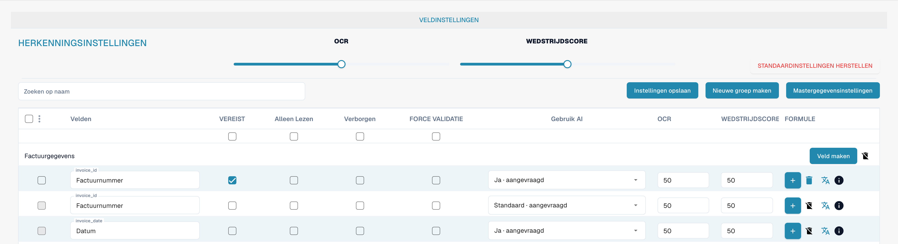

# Velden

Velden bepalen welke gegevens een documenttype verzamelt en hoe deze worden gecontroleerd. Open het documenttype in de instellingen en bekijk de bijbehorende velden.

<figure><figcaption>
Velden van het documenttype Factuur. Wedstrijdscore betekent hier Match Score of overeenkomstscore; FORCE VALIDATIE betekent geforceerde validatie.
</figcaption></figure>

## Eigenschappen en herkenning

* **Verplicht** vereist een waarde voor de validatie.
* **Alleen lezen** voorkomt bewerking; **Verborgen** houdt het veld buiten de normale weergave.
* **Geforceerde validatie** vereist een expliciete controle van het veld. Deze maakt geen vergelijkingsregel of reguliere expressie; stel aangepaste validatieregels afzonderlijk in.
* **OCR** stelt een numerieke drempel voor herkenningsbetrouwbaarheid in. Dit is geen aan/uit-schakelaar voor OCR.
* **Overeenkomstscore** stelt een numerieke overeenkomstsdrempel in. Dit is geen referentietekst of waardenlijst.
* De optie voor **AI** bepaalt de gevraagde extractie voor het veld.

Zoek een veld op naam en controleer de rij voordat u eigenschappen wijzigt. U kunt groepen ordenen, velden toevoegen en opties voor formules of stamgegevens openen. Acties hangen af van het veld en uw rechten; standaardvelden kunnen beperkingen voor verwijdering hebben.

Sla uitsluitend bedoelde wijzigingen op en controleer de validatie met representatieve documenten. De afbeeldingen bewijzen geen opgeslagen wijzigingen.

Zie [Veldeigenschappen](configuring-field-properties-1.md), [Validatie en Match Score](setting-validation-and-match-score.md) en [Velden met extra kosten](new-fields-with-charges.md).
