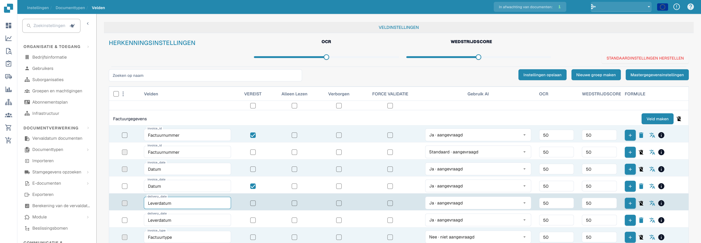
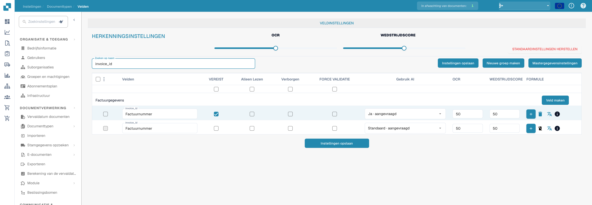

# Veldeigenschappen configureren

Gebruik **Settings → Document Types → Fields** om te bepalen hoe velden zich gedragen voor een documenttype. Selecteer eerst het documenttype; het onderstaande voorbeeld toont **Factuur** in de Engelse interface.

<figure><figcaption>
Veldeigenschappen: verplicht, alleen-lezen, verborgen en geforceerde validatie. Wedstrijdscore betekent hier Match Score of overeenkomstscore; FORCE VALIDATIE betekent geforceerde validatie.
</figcaption></figure>

## Een veld zoeken en de eigenschappen wijzigen

1. Voer in **Zoeken op naam** de veldnaam of het label in. Hiermee wordt de lijst gefilterd; het veld zelf wordt niet gewijzigd.
2. Zoek de rij van het veld. **Factuurnummer** heeft bijvoorbeeld de technische naam `invoice_id`.
3. Pas de bedieningselementen in die rij aan en selecteer vervolgens **Instellingen opslaan**. Dezelfde opslaanknop is beschikbaar boven en onder de tabel.

<figure><figcaption>
Velden gefilterd op invoice_id met OCR- en Match Score-drempels. Wedstrijdscore betekent hier Match Score of overeenkomstscore; FORCE VALIDATIE betekent geforceerde validatie.
</figcaption></figure>

| Bedieningselement | Waarvoor u het gebruikt |
| --- | --- |
| **Verplicht** | Markeer informatie die aanwezig moet zijn voor de validatie. Controleer het validatieresultaat van het document nadat u deze instelling hebt gewijzigd. |
| **Alleen lezen** | Toon een veld zonder dat gebruikers de waarde kunnen bewerken. |
| **Verborgen** | Houd het veld buiten de normale documentweergave. |
| **Force Validation** | Eis dat het veld de validatie doorstaat. Configureer gedetailleerde regels apart; dit selectievakje is geen regeleditor. |
| **Gebruik AI** | Schakel AI-extractie voor dit veld in of uit. De rij toont of extractie is aangevraagd. |
| **OCR** | Voer de OCR-betrouwbaarheidsdrempel van het veld in. Dit is een getal, geen aan/uit-schakelaar en geen taalinstelling. |
| **Match Score** | Voer de matchingdrempel van het veld in. Dit is een getal, geen aan/uit-schakelaar. |

De schuifregelaars **OCR** en **Match Score** onder **Recognition Settings** passen waarden toe op de hele veldenlijst. De selectievakjes direct onder de kolomtitels passen **Verplicht**, **Alleen lezen**, **Verborgen** of **Force Validation** toe op de hele lijst. Controleer de betreffende rijen voordat u **Instellingen opslaan** selecteert. **Restore Defaults** zet de veldconfiguratie terug; gebruik dit alleen als u uw wijzigingen wilt vervangen.

## Overige bedieningselementen in deze weergave

- **Nieuwe groep maken** en **Veld maken** voegen een groep of een veld toe. Zie [Velden toevoegen en bewerken](adding-and-editing-fields.md).
- **Mastergegevensinstellingen** opent de [configuratie van stamgegevens](master-data-settings.md).
- De meest linkse selectievakjes selecteren velden. Het aangrenzende menu biedt **Veldgroep opnieuw toewijzen** voor geselecteerde velden.
- De plusknop **Formule** opent de formule-editor voor dat veld. Het pictogram **info** toont veldinformatie. Het verwijderpictogram is niet beschikbaar voor standaardvelden.

Zie voor meer informatie over validatie en matching [Validatie en Match Score instellen](setting-validation-and-match-score.md).
