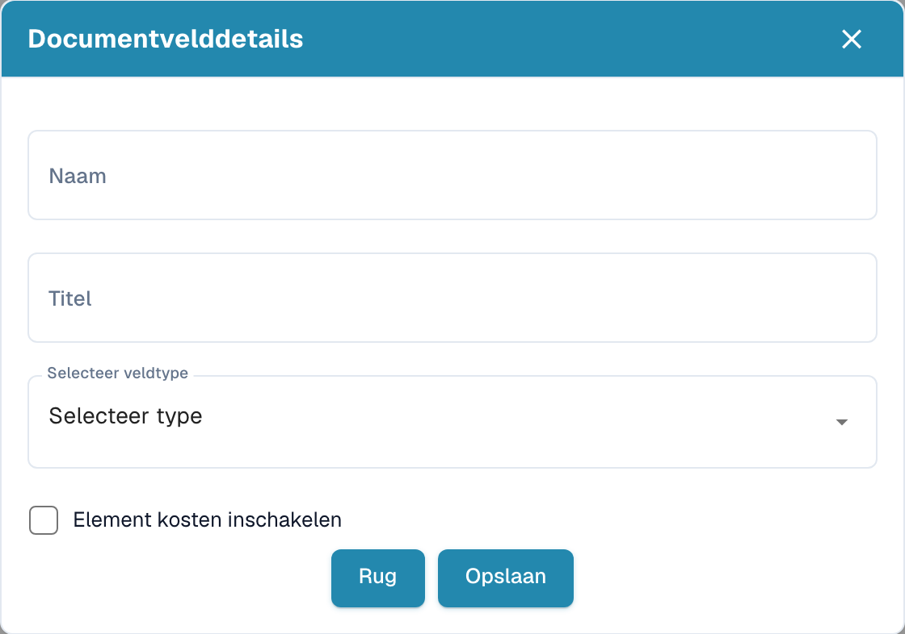
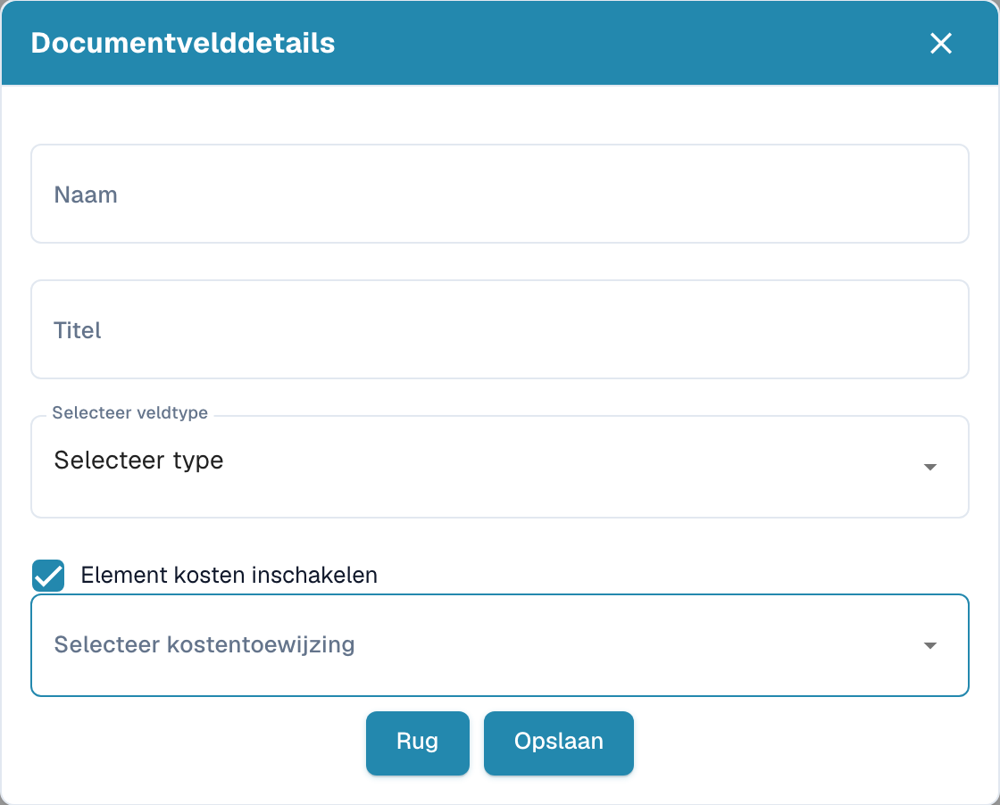

# Velden met extra kosten maken

Open in de instellingen het documenttype en de bijbehorende velden. Kies in de bedoelde groep de optie om een veld te maken.

<figure><figcaption>
Veldgegevens vóór het aanmaken van een nieuw veld. De knop Rug betekent hier Terug.
</figcaption></figure>

1. Voer een technische naam en een leesbare titel in.
2. Selecteer het gegevenstype.
3. Schakel de optie voor extra kosten in om de kostentoewijzing te tonen.
4. Kies de bedoelde toewijzing. De beschikbare opties hangen af van de organisatieconfiguratie.

<figure><figcaption>
Veldconcept met ingeschakelde optie voor extra kosten. De knop Rug betekent hier Terug.
</figcaption></figure>

Het voorbeeld is een niet-opgeslagen concept. Opslaan maakt het veld aan; ga terug als u het niet wilt aanmaken. Controleer daarna verplicht, geforceerde validatie, OCR en Match Score afzonderlijk in de veldlijst.
