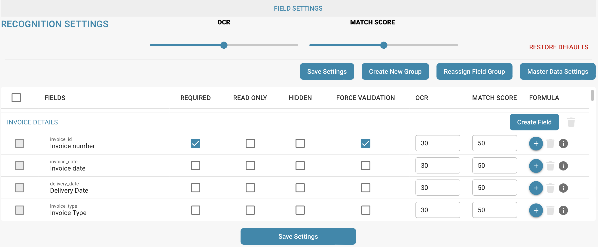

# Doel en gebruik

## Velden correct instellen voor gegevensinvoer, verwerking en opslag

<figure><figcaption></figcaption></figure>

**Waarom dit belangrijk is:**

**Gegevensintegriteit:**

* Een correcte veldconfiguratie helpt te zorgen dat ingevoerde gegevens juist zijn en aan de vereiste normen voldoen.
* Dit voorkomt fouten en onnauwkeurigheden die tot onjuiste analyses of beslissingen kunnen leiden.

**Gegevensconsistentie:**

* Met een consistente veldconfiguratie worden gegevens op uniforme wijze vastgelegd, zodat ze eenvoudiger te vergelijken en analyseren zijn.
* Als een datumveld bijvoorbeeld ten onrechte verschillende datumformaten toestaat, kan dit tot verwarring en inconsistenties leiden.

**Gegevensvalidatie:**

* In de veldconfiguratie kunt u validatieregels instellen om alleen geldige gegevens toe te staan. Dit helpt fouten vroeg te herkennen en de gegevenskwaliteit te verbeteren.

**Efficiënte gegevensverwerking:**

* Een nauwkeurige veldconfiguratie helpt systemen gegevens beter te begrijpen en verwerken. Dit verhoogt de efficiëntie van het extraheren, transformeren en laden van gegevens (ETL).

**Gegevensbeveiliging:**

* Een correcte veldconfiguratie kan ook bijdragen aan de beveiliging van gegevens, bijvoorbeeld door gevoelige informatie te versleutelen of te maskeren.

Een nauwkeurige veldconfiguratie in DocBits ondersteunt gegevenskwaliteit, consistentie, integriteit en beveiliging. Betrouwbare en juiste gegevens helpen organisaties weloverwogen beslissingen te nemen.
