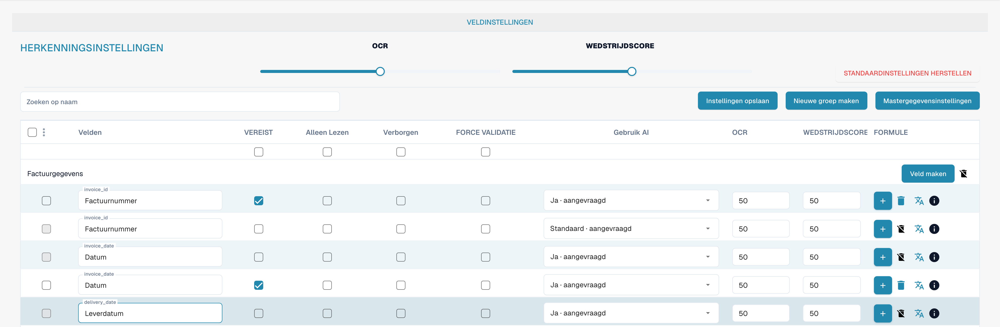
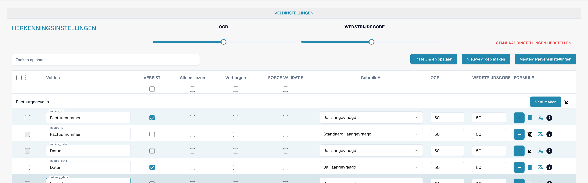
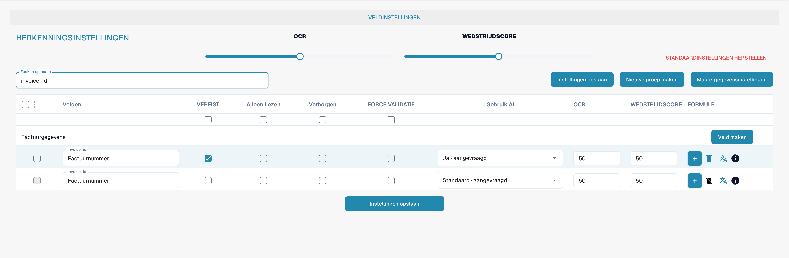

# Validatie en overeenkomstscore

Verplicht, geforceerde validatie, OCR en Match Score zijn verschillende veldeigenschappen. Bekijk de velden van het documenttype om ze te controleren.

<figure><figcaption>
Afzonderlijke kolommen voor geforceerde validatie, OCR en Match Score. Wedstrijdscore betekent hier Match Score of overeenkomstscore; FORCE VALIDATIE betekent geforceerde validatie.
</figcaption></figure>

## Geforceerde validatie

Geforceerde validatie vereist een expliciete controle van het veld. Deze optie maakt op zichzelf geen reguliere expressie of vergelijkingsregel. Aangepaste validatieregels stelt u afzonderlijk in.

<figure><figcaption>
Validatie en herkenning afzonderlijk per veld instellen. Wedstrijdscore betekent hier Match Score of overeenkomstscore; FORCE VALIDATIE betekent geforceerde validatie.
</figcaption></figure>

## OCR en Match Score

OCR bepaalt de herkenningsdrempel van het veld. Match Score is een numerieke drempel voor overeenkomst. Het is geen referentietekst of keuzelijst voor de te vergelijken waarde.

<figure><figcaption>
Gefilterd factuurnummer met geforceerde validatie en Match Score. Wedstrijdscore betekent hier Match Score of overeenkomstscore; FORCE VALIDATIE betekent geforceerde validatie.
</figcaption></figure>

Controleer het gedrag met representatieve documenten voordat u instellingen opslaat. Een verplicht veld vervangt geforceerde validatie niet.

Het productlabel Wedstrijdscore betekent hier de overeenkomstscore (Match Score), geen sportuitslag. FORCE VALIDATIE betekent geforceerde validatie.
