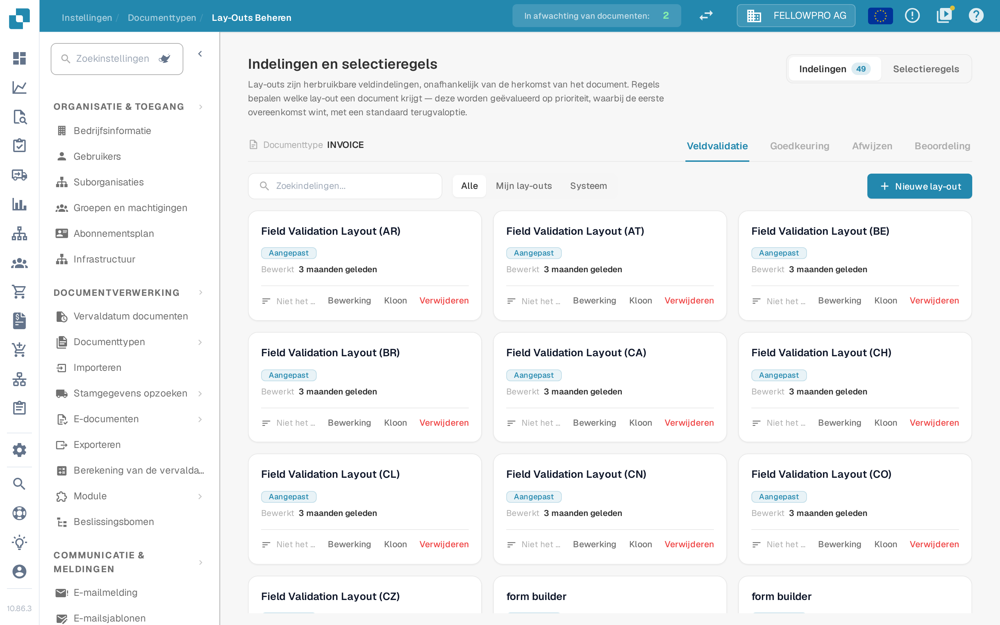

# Lay-outbeheer

<figure><figcaption>Het lay-outbeheer voor documenttype Invoice.</figcaption></figure>

Het **lay-outbeheer** bepaalt hoe een documenttype eruitziet voor de mensen die documenten valideren, goedkeuren, afwijzen en beoordelen: welke velden en groepen op het scherm verschijnen, in welke volgorde en hoe elk veld zich gedraagt. Elk documenttype heeft zijn eigen lay-outs.

De pagina opent als **Indelingen en selectieregels**: lay-outs zijn herbruikbare veldindelingen, onafhankelijk van de herkomst van het document, en regels bepalen welke lay-out een document krijgt.

#### Schermen en lay-outtypen

Validatie, goedkeuring, afwijzing en beoordeling zijn afzonderlijke schermen, en elk scherm heeft eigen lay-outs, eigen regels en een eigen standaardlay-out — een goedkeuringsregel verandert nooit het validatiescherm. Wissel van scherm met de tabbladen **Veldvalidatie**, **Goedkeuring**, **Afwijzen** en **Beoordeling**.

#### Lay-outkaarten

Op het tabblad **Indelingen** is elke lay-out van het gekozen scherm een kaart. Een kaart toont de naam van de lay-out, of deze van uw organisatie is (**Aangepast**) of de standaardlay-out van het systeem, wanneer hij voor het laatst is bewerkt en of een selectieregel hem gebruikt. **Bewerking** opent de lay-out in de Layout Builder, **Kloon** kopieert hem onder een naam die u kiest en **Verwijderen** haalt hem weg — de standaardlay-out van het systeem kunt u alleen bekijken, niet wijzigen of verwijderen. **Nieuwe lay-out** vraagt om een naam en opent de Layout Builder op de nieuwe, lege lay-out. Het filter boven de kaarten schakelt tussen **Alle**, **Mijn lay-outs** en **Systeem**.

#### De Layout Builder

**Bewerking** opent de [Layout Builder](navigating-the-layout-manager.md):

* **Structuur**, **Velden** en **Elementen** aan de linkerkant — de lay-out als boomstructuur, elk veld van het documenttype met een teller van de al geplaatste velden, en de groepen en formulierelementen die u naar het werkvlak sleept.
* Het **werkvlak** in het midden toont de lay-out zoals de gebruiker hem ziet. **Hoofdlay-out** en **Tabel** wisselen tussen de pagina en een regeltabel, **Document** opent het voorbeelddocument ernaast.
* Het paneel **Eigenschappen** aan de rechterkant volgt het geselecteerde element; de instellingen zijn gegroepeerd in weergave, gedrag, waarden en lijsten, automatisering, en randen en tussenruimte.

**Opslaan** in de kopbalk bewaart de lay-out. Voor de overige acties in de kopbalk, zie [Wijzigingen opslaan en toepassen](save-and-apply-changes.md).

#### Welke lay-out een document krijgt

Het tabblad **Selectieregels** van elk scherm bevat de regels die de lay-out kiezen: ze worden geëvalueerd op prioriteit, de eerste overeenkomst wint, en er geldt een standaard terugvaloptie als geen enkele regel past. Zie [Lay-outselectieregels](layout-selection-rules.md).
