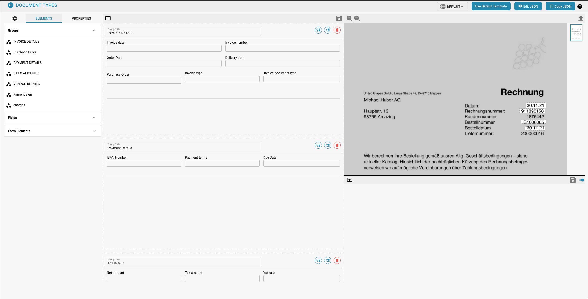

# Lay-outbeheer

<figure><figcaption></figcaption></figure>

#### Overzicht

Met de Layout Manager kunnen beheerders de lay-out van documenttypen visueel configureren en wijzigen door eigenschappen in te stellen voor verschillende gegevensvelden en groepen binnen een document. Deze interface zorgt ervoor dat de extractiemodellen en handmatige gegevensinvoerpunten precies aansluiten op de structuur van het document zoals gescand of geüpload naar Docbits.

#### Belangrijkste onderdelen

1. **Groepen en velden**:
   * **Groepen**: Organisatie-eenheden binnen een documenttype die gerelateerde velden categoriseren (bijvoorbeeld Factuurgegevens, Betalingsgegevens). Deze kunnen worden uitgevouwen of samengevouwen en zo worden gerangschikt dat ze de logische groepering in het daadwerkelijke document weerspiegelen.
   * **Velden**: individuele gegevenspunten binnen elke groep (bijvoorbeeld factuurnummer, betalingsvoorwaarden). Elk veld kan worden aangepast voor de manier waarop gegevens worden vastgelegd, weergegeven en verwerkt.
2. **Properties Panel**:
   * Dit paneel toont de eigenschappen van het geselecteerde veld of de geselecteerde groep, waardoor gedetailleerde configuratie mogelijk is, zoals:
     * **Label**: Het zichtbare label voor het veld in de gebruikersinterface.
     * **Veldnaam**: de technische identificatie die binnen het systeem wordt gebruikt.
     * **Elementbreedte in percentage**: Bepaalt de breedte van het veld in relatie tot de documentindeling.
     * **Tabindex**: regelt de tabvolgorde voor navigatie.
     * **Script uitvoeren bij wijziging**: Of een script moet worden uitgevoerd wanneer de veldwaarde verandert.
     * **Label links weergeven**: Of het label links van het veld of erboven wordt weergegeven.
     * **Is Tekstgebied**: Specificeert of het veld een tekstgebied moet zijn, waarin grotere hoeveelheden tekst kunnen worden geplaatst.
     * **Selecteer modeltype**: Optie om te selecteren welk modeltype de extractie van dit veld afhandelt.
     * **Veldlengte**: Maximale lengte van de gegevens die in dit veld worden geaccepteerd.
     * **Verboden trefwoorden**: trefwoorden die niet zijn toegestaan binnen het veld.
3. **Template Preview**:
   * Toont een realtime voorbeeld van hoe het document eruit zal zien op basis van de huidige lay-outconfiguratie. Dit helpt ervoor te zorgen dat de lay-out overeenkomt met de daadwerkelijke documentstructuur en is van cruciaal belang voor het testen en verfijnen van de documentverwerkingsinstellingen.


