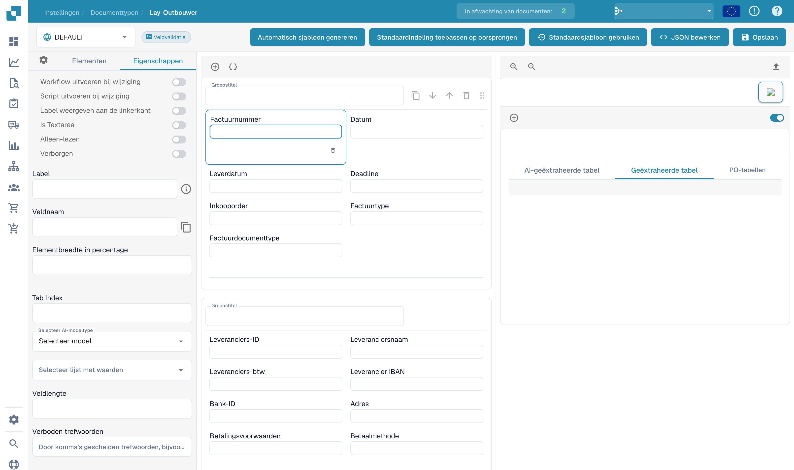

# Veldeigenschappen configureren

Open een bestaande lay-out in de lay-outbouwer en selecteer een veld in het voorbeeld. Het eigenschappenpaneel toont de opties van het geselecteerde element.

<figure><figcaption>
Veldeigenschappen in de lay-outbouwer.
</figcaption></figure>

Controleer label, technische naam, breedtepercentage en tabvolgorde. Afhankelijk van het element kunt u ook alleen-lezen, zichtbaarheid, labelpositie, tekst over meerdere regels of het uitvoeren van een workflow of script bij een waardewijziging instellen.

Selecteer zo nodig het juiste AI-model of de juiste waardenlijst. Lengte en verboden woorden voegen beperkingen toe. Technische namen en geconfigureerde bronnamen veranderen niet met de interfacetaal.

Controleer het voorbeeld na iedere wijziging. Sla bedoelde wijzigingen op en test de validatie met representatieve documenten. Validatieregels en herkenningsdrempels van het documenttype stelt u afzonderlijk in.
