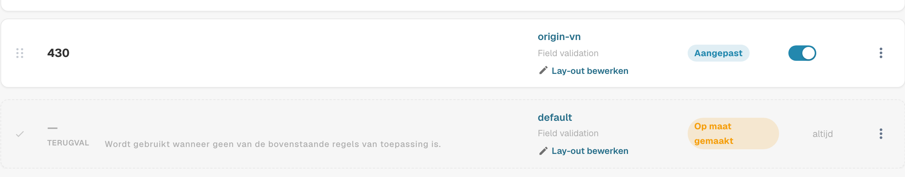
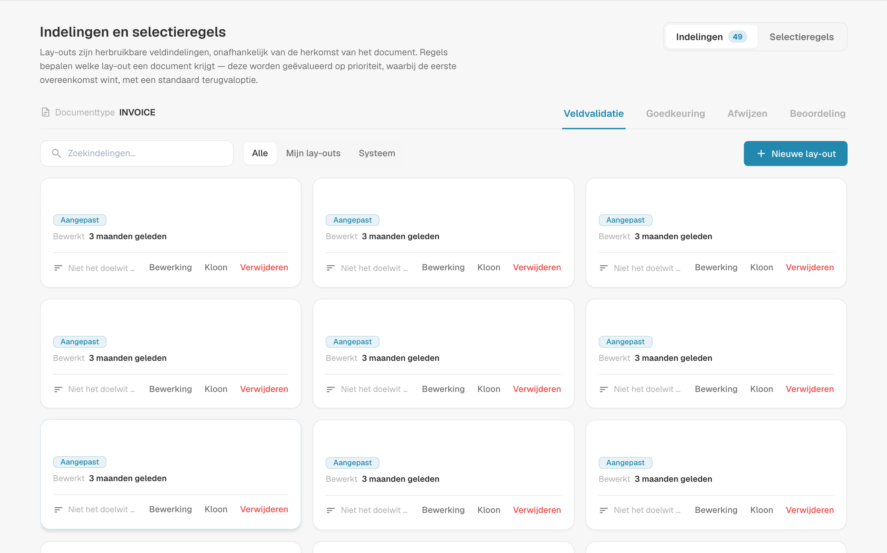
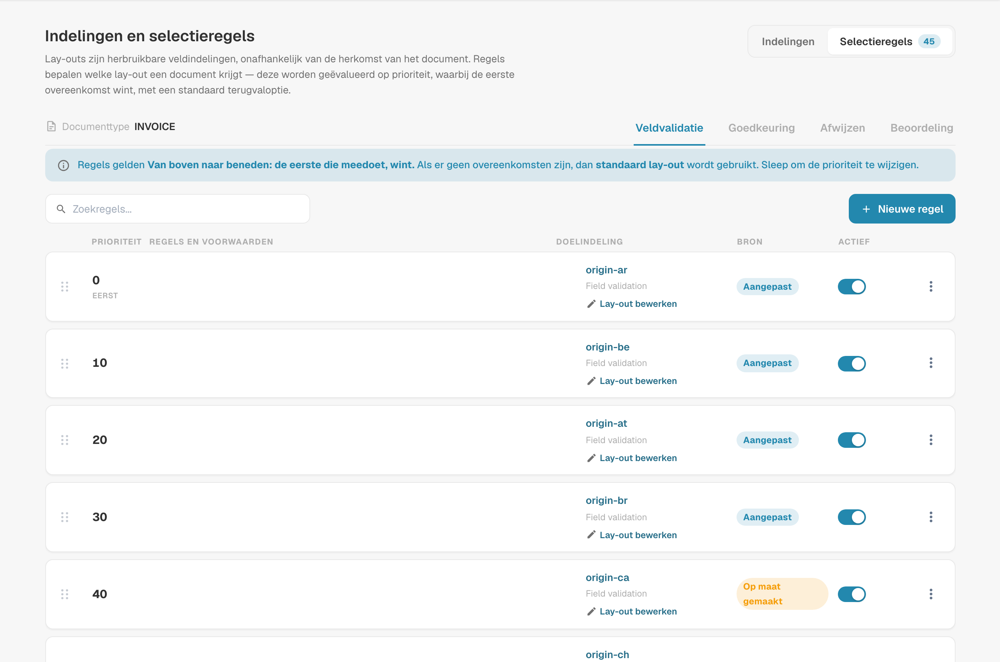
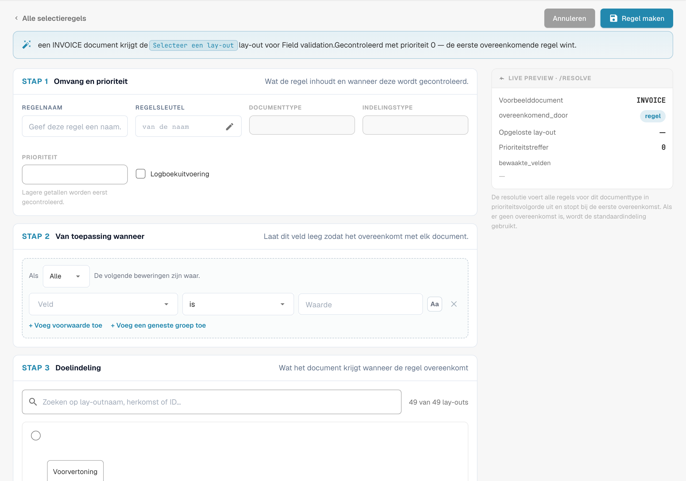
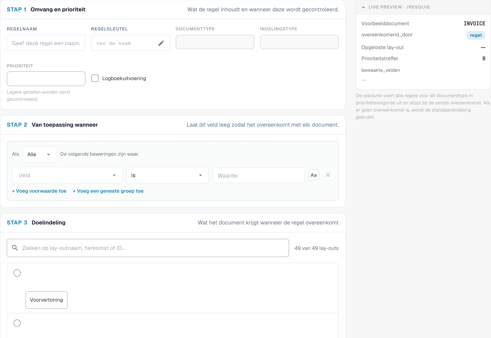

# Lay-outselectieregels

## Overzicht

Een **lay-out** bepaalt welke velden en groepen een gebruiker ziet — en in welke volgorde — op de schermen **Validatie**, **goedkeuring**, **Afwijzen** en **Beoordeling** van een document. U ontwerpt lay-outs in de [Lay-outbouwer](README.md).

Klassiek koos DocBits de lay-out op basis van de **herkomst** van het document: het land of de regio uit de taalinstellingen van het document, zoals `DE` of `US`. Elke herkomst had een eigen kopie van de lay-out, en niets anders kon de keuze beïnvloeden.

Met **lay-outselectieregels** worden lay-outs herbruikbare bouwstenen die los staan van de herkomst, en bepalen **regels** welke lay-out een document krijgt:

> *Wanneer* het document aan een voorwaarde voldoet, *dan* krijgt het deze lay-out. Regels worden van boven naar beneden gecontroleerd; **de eerste overeenkomende regel wint**. Als geen enkele regel overeenkomt, wordt de **standaardlay-out** gebruikt.

De herkomst blijft beschikbaar — als één voorwaarde van vele. Een regel kan evengoed kijken naar de leverancier, het bedrag, de documentstatus, de extractiemethode of een willekeurig headerveld.

### Problemen die ze oplossen

| Vereiste | Klassieke lay-outs op basis van herkomst | Met selectieregels |
| --- | --- | --- |
| Facturen van één leverancier hebben extra velden nodig (project, douanenummer) | onmogelijk zonder nieuwe herkomst | regel *Supplier ID is 20723* → lay-out "Factuur met projectvelden" |
| DE-, AT- en CH-documenten moeten er hetzelfde uitzien | drie kopieën van dezelfde lay-out om te onderhouden | één lay-out, één regel per herkomst (of een ANY-groep) die ernaar verwijst |
| E-facturen hebben een eenvoudiger scherm nodig dan gescande pdf's | niet mogelijk | regel *Extraction Method is ELECTRONIC_DOCUMENT* → lay-out "E-factuur" |
| Facturen met hoge waarde hebben meer velden nodig op het goedkeuringsscherm | niet mogelijk | Approval-regel *Total Amount greater than 10000* → lay-out "Goedkeuring hoge waarde" |
| De tweede goedkeurder moet een ander scherm zien dan de eerste | apart lay-outtype "tweede goedkeuring" | Approval-regel *Document Status is Pending second approval* → lay-out "Tweede goedkeuring" |

## Op regels gebaseerde lay-outs inschakelen

Op regels gebaseerde lay-outs worden **per documenttype** ingeschakeld door een **organisatiebeheerder**.

1. Ga naar **Instellingen → Globale instellingen → Documenttypen**.
2. Klik op het **instellingen**-pictogram (tandwiel) op de kaart van het documenttype.
3. Open **Lay-outs beheren** en zet de schakelaar aan.

<figure><figcaption>
De schakelaar Manage Layouts in de aanvullende instellingen van een documenttype
</figcaption></figure>

De link **Indelingen** op de kaart van het documenttype opent nu **Indelingen en selectieregels**.

### Wat er gebeurt als u het inschakelt

DocBits zet uw bestaande lay-outs op basis van herkomst eenmalig om in regels — voor dit documenttype en voor elk scherm:

* De lay-out van de herkomst **DEFAULT** wordt de **standaardlay-out** (de terugvaloptie).
* Elke lay-out van een specifieke herkomst wordt een regel **"Layout for XX"** met de voorwaarde *Document Origin is XX*, die naar die lay-out verwijst. Deze regels krijgen prioriteiten in stappen van 10 (bijvoorbeeld 2000, 2010, 2020 …), zodat u uw eigen regels ervoor, ertussen of erna kunt plaatsen.

<figure><figcaption>
Terugvallay-out onderaan de lijst met selectieregels. De schermnaam Field validation blijft Engelstalig in het product.
</figcaption></figure>

Er wordt niets verwijderd of gewijzigd aan de lay-outs zelf. Direct na activering krijgt elk document daarom precies de lay-out die het ervoor ook kreeg. Pas wanneer u regels toevoegt of wijzigt, verandert het gedrag.

**Uitschakelen** brengt het documenttype onmiddellijk terug naar selectie op basis van herkomst. De regels blijven bewaard maar worden niet gebruikt, en ze werken weer zodra u de schakelaar opnieuw aanzet.

## Het scherm Layouts & Selection Rules

<figure><figcaption>
Overzicht van lay-outs en selectieregels. De schermnaam Field validation blijft Engelstalig in het product.
</figcaption></figure>

* **Layouts / Selection rules** (rechtsboven) schakelen tussen de lijst met lay-outs en de lijst met regels. De cijfers tonen hoeveel er zijn.
* **Field Validation / Approval / Reject / Review** schakelen het **scherm** om. Elk scherm heeft zijn eigen lay-outs, eigen regels en eigen standaardlay-out — een Approval-regel wijzigt het validatiescherm nooit.
* Op het tabblad **Indelingen** kunt u lay-outs aanmaken, bewerken, klonen en verwijderen. Elke kaart toont of een regel de lay-out gebruikt ("Not targeted by rules" als geen enkele regel dat doet). Filter met **All / My layouts / System**; systeemlay-outs worden met DocBits meegeleverd en kunnen worden bekeken en gekloond, maar niet gewijzigd.


Eerste en tweede goedkeuring delen de **Goedkeuring**-lay-outs en -regels. Om de tweede goedkeuringsfase een eigen scherm te geven, voegt u een Approval-regel toe met de voorwaarde *Document Status is Pending second approval* — zie het [voorbeeld](#verschillende-schermen-voor-eerste-en-tweede-goedkeuring).


## Hoe een lay-out wordt gekozen

Telkens wanneer een document wordt geopend, en opnieuw nadat het is opgeslagen, bepaalt DocBits de lay-out voor het huidige scherm:

1. De **actieve regels** van het scherm worden gecontroleerd in volgorde van **prioriteit** (laagste nummer eerst). **De eerste regel waarvan de voorwaarde waar is, wint**, en de bijbehorende lay-out wordt gebruikt.
2. Als geen enkele regel overeenkomt, wordt de **standaardlay-out** gebruikt.
3. Als er ook geen standaard is, valt DocBits terug op de klassieke keuze op basis van herkomst.

Regels waarvan de lay-out is verwijderd of leeg is, worden overgeslagen.

### Een uitgewerkt voorbeeld

Regels van het scherm **Veldvalidatie**:

| Prioriteit | Regel | Voorwaarde | Lay-out |
| --- | --- | --- | --- |
| 5 | Facturen van voorbeeldleverancier | *Supplier ID is HP0000278* | Factuur met projectvelden |
| 10 | E-facturen | *Extraction Method is ELECTRONIC_DOCUMENT* | E-factuur |
| 2020 | Layout for DE | *Document Origin is DE* | Field Validation Layout (DE) |
| — | Standaardlay-out | — | Field Validation Layout (Base) |

Welke lay-out elk document krijgt:

| Document | Leverancier | Extractie | Herkomst | Lay-out | Omdat |
| --- | --- | --- | --- | --- | --- |
| 1 | HP0000278 | e-factuur | DE | Factuur met projectvelden | prioriteit 5 komt als eerste overeen; latere regels worden niet gecontroleerd |
| 2 | 10040 | e-factuur | DE | E-factuur | prioriteit 5 komt niet overeen, 10 wel |
| 3 | 10040 | gescande pdf | DE | Field Validation Layout (DE) | alleen de herkomstregel komt overeen |
| 4 | 10040 | gescande pdf | US | Field Validation Layout (Base) | geen enkele regel komt overeen → standaard |

**De volgorde is belangrijk**: plaats specifieke regels (één leverancier) boven algemene regels (één land).

### Wanneer een gebruiker een veld wijzigt waar de regels naar kijken

De lay-out wordt altijd gekozen op basis van de **huidige** waarden van het document. Als een gebruiker bijvoorbeeld de leverancier corrigeert op het validatiescherm, kiest DocBits na het opslaan opnieuw een lay-out en kan het scherm naar een andere lay-out overschakelen. Er gaan geen gegevens verloren: een veld dat geen deel uitmaakt van de nieuwe lay-out behoudt zijn waarde; het wordt alleen niet getoond totdat weer een lay-out geldt die het bevat.

## Selectieregels beheren

<figure><figcaption>
Selectieregels met afgeschermde geconfigureerde namen. De schermnaam Field validation blijft Engelstalig in het product.
</figcaption></figure>

Elke rij toont de **prioriteit** (de eerste rij is gemarkeerd met **FIRST**), de **regelnaam en -sleutel** met de bijbehorende **voorwaarden**, de **doellay-out**, de **bron**-badge en een **Actief**-schakelaar.

| Taak | Hoe |
| --- | --- |
| Een regel aanmaken | **Nieuwe regel** |
| Een regel bewerken | Klik op de rij |
| De volgorde wijzigen | Sleep de greep links van een rij omhoog of omlaag. De nieuwe volgorde wordt direct opgeslagen. |
| Een regel uitschakelen | Schakelaar **Actief**. Inactieve regels worden genegeerd. |
| Dupliceren of verwijderen | Menu **⋮** van de rij |
| Een regel zoeken | **Search rules…** |

De **bron**-badge geeft aan waar een regel vandaan komt: **Systeem**-regels worden met DocBits meegeleverd. Een systeemregel bewerken maakt een kopie voor uw organisatie, getoond als **Op maat gemaakt**; het origineel blijft intact en kan worden hersteld. Regels die u zelf aanmaakt zijn **Aangepast**.

### De standaardlay-out

De laatste rij, gemarkeerd met **FALLBACK** en **is_default**, is de standaardlay-out: ze wordt gebruikt wanneer geen enkele regel erboven overeenkomt en heeft geen voorwaarde. Ze wordt aangemaakt wanneer u de functie inschakelt (vanuit de lay-out van de herkomst DEFAULT).


Om een andere terugvallay-out te gebruiken, maakt u een regel **zonder enige voorwaarde** en geeft u die het hoogste prioriteitsnummer, zodat ze als laatste wordt gecontroleerd. Ze komt overeen met elk document waarmee geen eerdere regel overeenkwam, nog voordat de standaard wordt bereikt.


## Een regel aanmaken

Klik op **Nieuwe regel** op het tabblad Selection rules van het scherm dat u wilt wijzigen.

<figure><figcaption>
Bereik, voorwaarden en doellay-out van een selectieregel. De schermnaam Field validation blijft Engelstalig in het product.
</figcaption></figure>

De zin bovenaan vat de regel samen terwijl u hem opbouwt — "When header.supplier_id = HP0000278, an INVOICE document gets the Field Validation Layout (Base) layout for Field validation. Checked at priority 5 — the first matching rule wins."

### Stap 1 — Scope & priority

| Instelling | Wat het doet |
| --- | --- |
| **Regelnaam** | Wordt getoond in de regellijst. Beschrijf de zakelijke aanleiding: "Facturen van voorbeeldleverancier", "E-facturen", "Goedkeuring hoge waarde". |
| **Regelsleutel** | Gegenereerd uit de naam; blijft gelijk wanneer u de regel hernoemt. |
| **Documenttype** / **Indelingstype** | Het documenttype en het scherm waarvoor de regel geldt. Overgenomen van waar u op **Nieuwe regel** klikte. |
| **Prioriteit** | Lagere nummers worden eerst gecontroleerd. Laat tussenruimte (5, 10, 20 …) zodat u later regels kunt invoegen. |

### Stap 2 — Applies when

De voorwaarde waaraan een document moet voldoen. U kunt gebruiken:

* **documentattributen**: Document Origin, Extraction Method, Document Status, Sub Document Type,
* **headervelden**: Supplier ID, Total Amount, Currency, Purchase Order en elk ander veld van het documenttype,
* een **aangepast JSON-pad** (Advanced).

Tabelkolommen zijn niet beschikbaar: de lay-out wordt eenmaal voor het hele document gekozen.

Laat de stap leeg om met elk document op deze prioriteit overeen te komen. Hoe voorwaarden werken — ALL / ANY, geneste groepen, alle operatoren, lege waarden, hoofdletters/kleine letters — wordt uitgelegd op [Regelvoorwaarden (Applies when)](../rule-conditions-applies-when.md).

### Stap 3 — Doellay-out

Klik op de lay-out die het document moet krijgen. De lijst toont uw eigen lay-outs en de systeemlay-outs van het geselecteerde scherm. Een lay-out kan niet worden verwijderd zolang een regel er nog naar verwijst.

### Live voorvertoning · /resolve

Het paneel rechts toont wat de regel doet voor een voorbeelddocument met de waarden van uw voorwaarden:

| Regel | Betekenis |
| --- | --- |
| **Voorbeelddocument** | De waarden die voor de voorvertoning worden gebruikt, afgeleid van uw voorwaarden |
| **matched_by** | `rule` als een regel overeenkwam, anders de standaard |
| **Opgeloste lay-out** | De lay-out die het voorbeelddocument zou krijgen |
| **Prioriteit van de overeenkomende regel** | De prioriteit van de regel die overeenkwam |
| **watched_fields** | De velden waarvan de lay-outkeuze afhangt. Wanneer een gebruiker er één wijzigt, wordt de lay-out opnieuw gekozen. |

Klik op **Regel maken** (of **Regel opslaan** bij het bewerken) om op te slaan. **Annuleren** brengt u terug naar de regellijst.

## Voorbeelden

### Extra velden voor één leverancier

Scherm **Veldvalidatie** · prioriteit **5** · *Supplier ID is HP0000278* · doel *Factuur met projectvelden* (een kloon van uw standaardlay-out met de extra velden voor project en kostenplaats).

### Eén lay-out voor meerdere landen

Scherm **Veldvalidatie** · prioriteit **100** · **Een van de voorwaarden**: *Document Origin is Deutsch*, *Document Origin is Austria*, *Document Origin is Switzerland* · doel *DACH-factuur*. Deactiveer de gemigreerde regels "Layout for AT" en "Layout for CH" als ze naar oudere kopieën verwijzen.

### Een eenvoudiger scherm voor e-facturen

Scherm **Veldvalidatie** · prioriteit **10** · *Extraction Method is ELECTRONIC_DOCUMENT* · doel *E-factuur* (zonder OCR-gerelateerde velden).

### Een strenger goedkeuringsscherm voor hoge bedragen

Scherm **Goedkeuring** · prioriteit **10** · *Total Amount greater than 10000* · doel *Goedkeuring hoge waarde* (met kostenplaats, budgethouder en contractnummer).

### Verschillende schermen voor eerste en tweede goedkeuring

Scherm **Goedkeuring** · prioriteit **5** · *Document Status is Pending second approval* · doel *Second Approval Layout*. Documenten in de eerste goedkeuringsstap komen niet overeen en krijgen de standaardlay-out van Approval.

<figure><figcaption>
Niet-opgeslagen concept van een regel voor lay-outselectie. De schermnaam Field validation blijft Engelstalig in het product.
</figcaption></figure>

### Een speciaal afwijzingsscherm voor sommige leveranciers

Scherm **Afwijzen** · prioriteit **10** · *Supplier ID is one of* `10040, 10041` · doel *Reject with reason codes*.

## Best practices

* **Specifiek vóór algemeen.** Leveranciersregels boven landregels, landregels boven de standaard.
* **Laat prioriteitsruimte** (5, 10, 20 …) zodat nieuwe regels passen zonder hernummering.
* **Baseer voorwaarden op betrouwbare velden.** Leverancier en herkomst worden vroeg ingesteld en veranderen zelden. Voorwaarden op velden die gebruikers vaak bewerken, laten het scherm van lay-out wisselen terwijl ze werken.
* **Kloon, begin niet vanaf nul.** Kloon uw standaardlay-out en pas die aan, zodat alle lay-outs dezelfde basisstructuur behouden.
* **Controleer de live voorvertoning** en open na het wijzigen van regels een echt document van elk soort.
* **Houd een zinvolle standaard aan** voor elk scherm, zodat geen enkel document zonder lay-out eindigt.

## Probleemoplossing

| Symptoom | Wat te controleren |
| --- | --- |
| Een document krijgt de verkeerde lay-out | Een eerdere regel komt als eerste overeen. Bekijk de regels erboven, of de **Prioriteit van de overeenkomende regel** in de voorvertoning. |
| De standaard wordt gebruikt hoewel een regel zou moeten overeenkomen | Is de regel **Actief**? Komt de voorwaarde overeen met de exacte waarde (hoofdletters, spaties)? Staat de regel op het juiste **scherm**-tabblad? |
| De lay-out verandert terwijl een gebruiker werkt | Een veld in **watched_fields** is gewijzigd. Baseer de regel op een stabieler veld. |
| Een lay-out kan niet worden verwijderd | Een regel verwijst er nog naar. Wijs die regel eerst opnieuw toe of verwijder hem. |
| Er wordt helemaal geen lay-out getoond | Geen enkele regel kwam overeen, er is geen standaard en er bestaat geen lay-out op basis van herkomst voor dit scherm. Voeg een regel zonder voorwaarde toe als vangnet. |
| Er veranderde niets na activering | Verwacht: activering reproduceert de vorige keuze op basis van herkomst. Voeg uw eigen regels toe. |
| De tweede goedkeuring toont de lay-out van de eerste goedkeuring | Voeg een Approval-regel toe op *Document Status is Pending second approval* boven de andere Approval-regels. |

## Gerelateerd

* [Regelvoorwaarden (Applies when)](../rule-conditions-applies-when.md)
* [Aangepaste validatieregels](../custom-validation-rules.md)
* [Transformatieregels](../transformation-rules.md)
* [Navigeren in de Lay-outbouwer](navigating-the-layout-manager.md)
