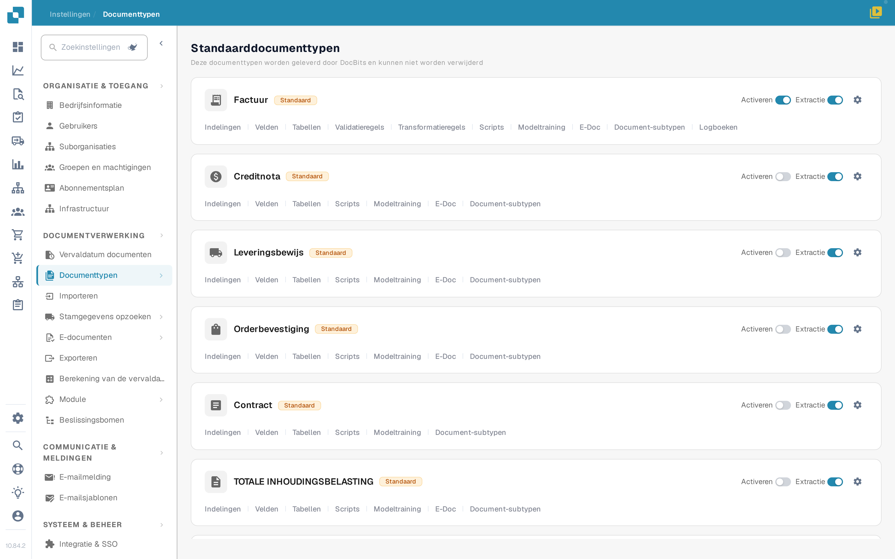
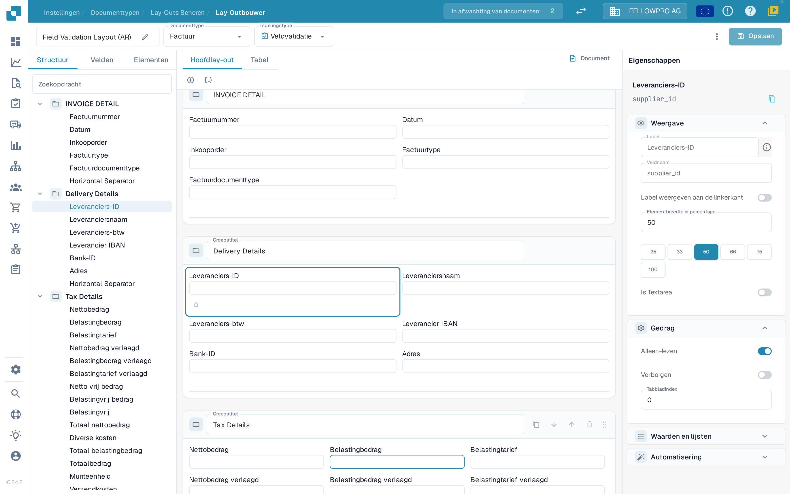
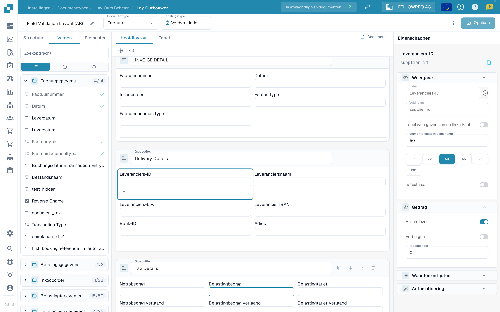
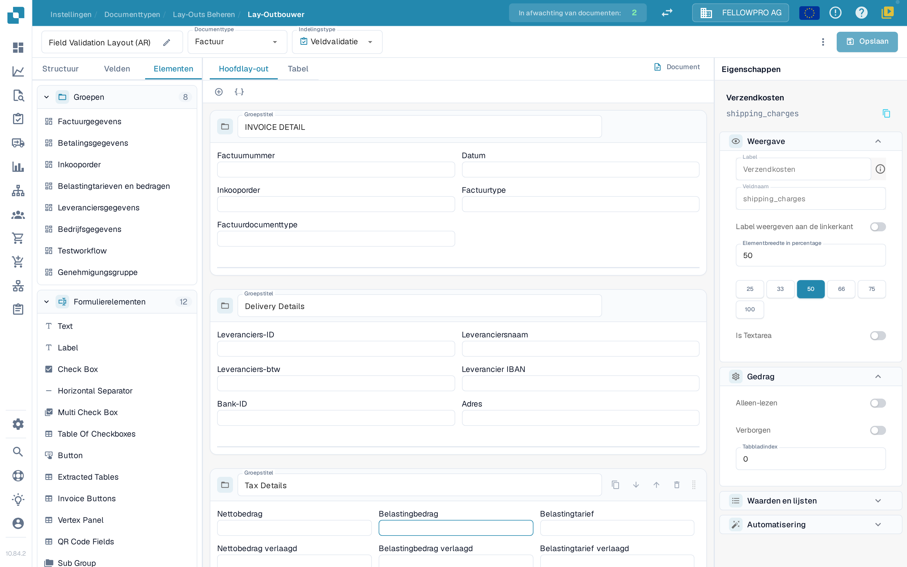

# Navigeren in de Lay-outbeheerder

Gebruik de **Lay-outbeheerder** om de groepen en velden te rangschikken die gebruikers op een document zien. Deze handleiding gebruikt de Nederlandse indeling **Factuur** in een sandbox-organisatie. Alle schermafbeeldingen tonen de Nederlandse interface.

## De Factuur-indeling openen

1. Ga naar **Instellingen → Documenttypen**.
2. Zoek **Factuur** en selecteer **Indelingen** onder de naam van de kaart. De Lay-outbeheerder opent voor dat documenttype.
3. Bovenaan ziet u de naam van de indeling (aan te passen met het potlood), het **Documenttype** en het **Indelingstype**. Met **Indelingstype** schakelt u naar een andere indeling van hetzelfde documenttype.

<figure><figcaption>Open **Indelingen** via de kaart Factuur.</figcaption></figure>

## Werken met de drie tabs van het paneel

Het paneel links heeft drie tabs: **Structuur**, **Velden** en **Elementen**. De Lay-outbeheerder opent op **Velden**.

**Structuur** toont de indeling als een boom, in dezelfde volgorde als de groepen en velden op het document staan. Klap een groep open met het pijltje om de velden erin te zien; de technische veldnaam staat in het paneel **Eigenschappen**. Het zoekveld filtert de boom, en als u een regel selecteert, wordt hetzelfde element op het canvas geselecteerd.

<figure><figcaption>De boom Structuur, het canvas en het paneel Eigenschappen.</figcaption></figure>

**Velden** toont elk veld dat het documenttype aanbiedt, gegroepeerd per groep. De teller naast een groepsnaam laat zien hoeveel velden van die groep al geplaatst zijn, bijvoorbeeld **4/14**. De drie pictogrammen onder het zoekveld filteren de lijst: alle velden, alleen velden die nog niet in de indeling staan, en alleen verborgen velden. Elke regel toont het veldlabel; een groen vinkje rechts markeert de velden die al in de indeling zitten, die grijs worden weergegeven.

<figure><figcaption>Filter de velden en herken geplaatste velden aan het vinkje.</figcaption></figure>

**Elementen** bevat de blokken die u naar het canvas sleept: **Groepen** met de groepen van deze indeling, en **Formulierelementen** met Text, Label, Check Box, Horizontal Separator, Multi Check Box, Table Of Checkboxes, Button, Extracted Tables, Invoice Buttons, Vertex Panel, QR Code Fields en Sub Group.

<figure><figcaption>De paletten Groepen en Formulierelementen.</figcaption></figure>

## Elementen plaatsen en rangschikken

- Sleep een veld uit **Velden**, of een element uit **Elementen**, naar de groep waar het moet staan. Velden die al geplaatst zijn, hebben een vinkje in de tab **Velden**.
- Sleep een veld binnen een groep of naar een andere groep om de volgorde te wijzigen.
- De **+** boven het canvas voegt een lege groep toe; het JSON-pictogram ernaast maakt een groep op basis van een JSON-definitie.
- In de kop van een groep kunt u de naam wijzigen in **Groepstitel**, de JSON kopiëren, de groep omlaag of omhoog verplaatsen of verwijderen. Met de sleepgreep rechts in de kop verplaatst u de groep.
- Selecteer een veld op het canvas om de eigenschappen rechts te openen. De kleine werkbalk onder het geselecteerde veld haalt het veld uit de indeling.

## Het paneel Eigenschappen

Het paneel rechts staat altijd open en volgt het element dat u hebt geselecteerd. De instellingen zijn verdeeld over **Weergave**, **Gedrag**, **Waarden en lijsten** en **Automatisering**. **Weergave** bevat het label, het veldtype en de **Elementbreedte in percentage**, die u kiest uit de waarden 25, 33, 50, 66, 75 en 100 procent. Zie [Eigenschappen van velden configureren](configuring-field-properties.md) voor de afzonderlijke opties.

Instellingen voor validatie, OCR en matching horen bij het veld zelf en niet bij de indeling: die configureert u in de aparte [instellingen van Velden](../fields/configuring-field-properties-1.md).

## Voorbeeld bekijken en opslaan

Het canvas toont de indeling zoals die op het document komt te staan. Met de tabs **Hoofdlay-out** en **Tabel** schakelt u tussen de pagina en een regeltabel, en met **Document** opent u het voorbeelddocument naast het canvas. Zie [Het sjabloonvoorbeeld gebruiken](using-the-template-preview.md).

Selecteer **Opslaan** in de balk bovenaan als u klaar bent. Zie [Wijzigingen opslaan en toepassen](save-and-apply-changes.md) voor de andere acties in die balk, waaronder het genereren van een sjabloon, standaardsjablonen en het toepassen van een indeling op oorsprongen.
