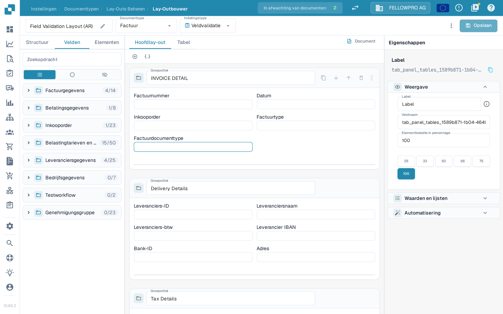
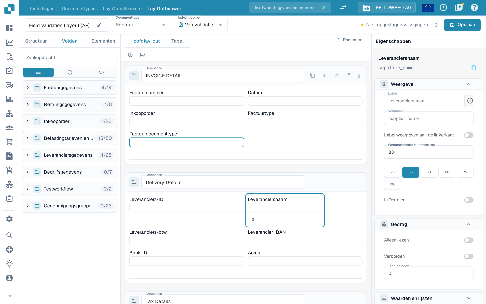
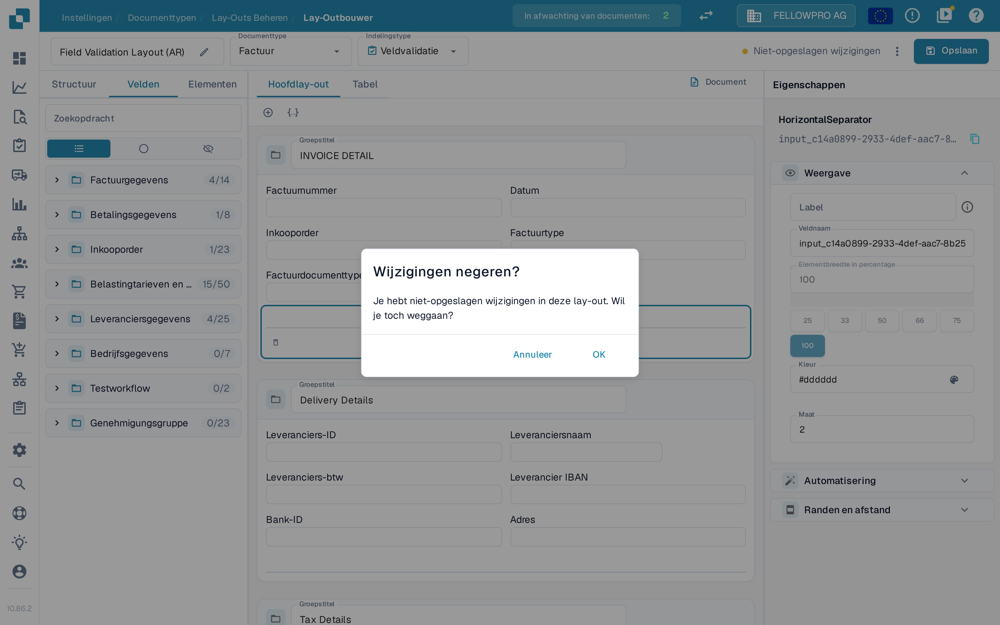
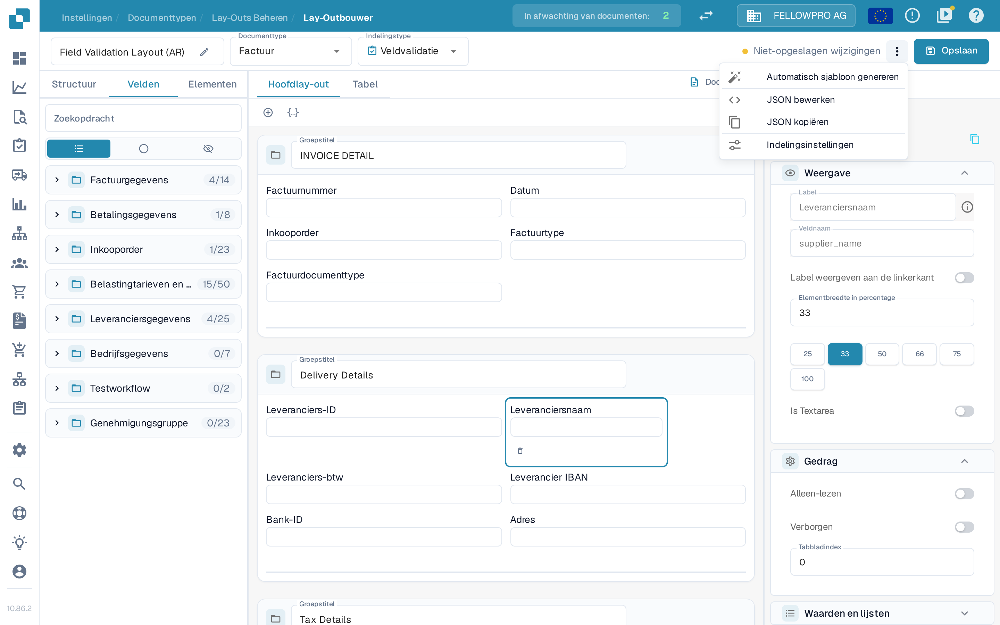

# Wijzigingen opslaan en toepassen

Wijzigingen in de Layout Builder worden pas van kracht wanneer u ze opslaat. Bij het opslaan wordt de lay-out aan het documenttype gekoppeld, zodat nieuwe documenten deze gebruiken.

## Uw wijzigingen opslaan

Nadat u de lay-out hebt bewerkt, selecteert u **Opslaan** rechtsboven in de kopbalk.

<figure><figcaption>De knop **Opslaan** staat rechtsboven in de Layout Builder.</figcaption></figure>

Terwijl u werkt, toont de kopbalk de status van uw wijzigingen:

- Een knop **Opslaan** zonder melding ernaast betekent dat de lay-out ongewijzigd is.
- **Niet-opgeslagen wijzigingen** verschijnt zodra u de lay-out aanpast. Selecteer **Opslaan** om de wijzigingen te bewaren.

<figure><figcaption>De melding **Niet-opgeslagen wijzigingen** verschijnt zolang de lay-out nog niet is opgeslagen.</figcaption></figure>

Na een geslaagde opslag wordt de melding vervangen door het tijdstip waarop de lay-out voor het laatst is opgeslagen. Opnieuw **Opslaan** selecteren kan geen kwaad: als er sinds de laatste keer niets is gewijzigd, wordt er ook niets weggeschreven.

Verlaat u de Layout Builder met niet-opgeslagen wijzigingen, dan vraagt DocBits **Wijzigingen negeren?**. Selecteer **Annuleer** om te blijven en op te slaan, of **OK** om weg te gaan zonder op te slaan.

<figure><figcaption>Bevestiging bij het weggaan met niet-opgeslagen wijzigingen.</figcaption></figure>

## Overige acties in de kopbalk

Het menu met drie puntjes naast **Opslaan** bevat de overige lay-outacties:

- **Automatisch sjabloon genereren** – bouwt automatisch een lay-out op uit de velden van het documenttype.
- **JSON bewerken** – bewerkt de lay-outdefinitie rechtstreeks als JSON.
- **JSON kopiëren** – kopieert de lay-outdefinitie naar het klembord.
- **Indelingsinstellingen** – opent de algemene lay-outinstellingen.

**Automatisch sjabloon genereren** vervangt de bestaande lay-out, dus controleer vooraf welke lay-out geopend is. **JSON bewerken** is bedoeld voor gevorderde gebruikers en gebruikt u alleen als u het formaat van het sjabloon kent.

<figure><figcaption>De acties in het menu met drie puntjes.</figcaption></figure>

## De wijzigingen toepassen

Zodra de lay-out is opgeslagen, gebruikt de documentworkflow hem voor dat documenttype:

- Nieuwe documenten die met dit documenttype worden verwerkt, gebruiken de bijgewerkte lay-out.
- Al verwerkte documenten behouden de lay-out waarmee ze zijn vastgelegd.

## De wijzigingen testen

Open na het opslaan een document van dat documenttype en controleer of de velden en groepen verschijnen zoals bedoeld. Ontbreekt er iets, ga dan terug naar de Layout Builder, pas de lay-out aan en sla opnieuw op.
