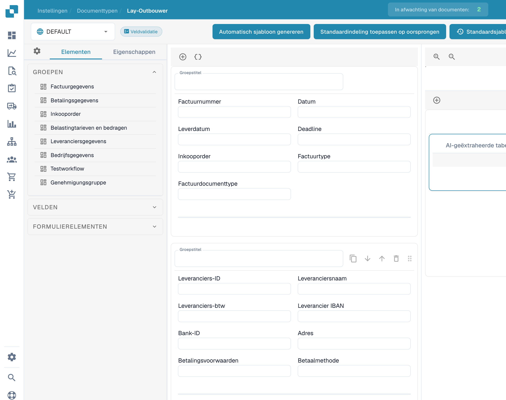

# Het sjabloonvoorbeeld gebruiken

Het voorbeeld in de lay-outbouwer toont de indeling van groepen, velden en tabellen van een bestaande lay-out.

<figure><figcaption>
Voorbeeldweergave van een sjabloon in de lay-outbouwer.
</figcaption></figure>

Open het bedoelde documenttype en de juiste lay-out. Bekijk de beschikbare elementen en selecteer een veld om de eigenschappen te openen en labels, breedten en zichtbaarheid te controleren.

Met de bronselectie kunt u de geconfigureerde context bekijken. Bronnamen blijven ongewijzigd. Het voorbeeld bewijst geen nieuw opgeslagen lay-out of toepassing op andere bronnen.

Sla bedoelde wijzigingen op en controleer de resulterende documentweergave.
