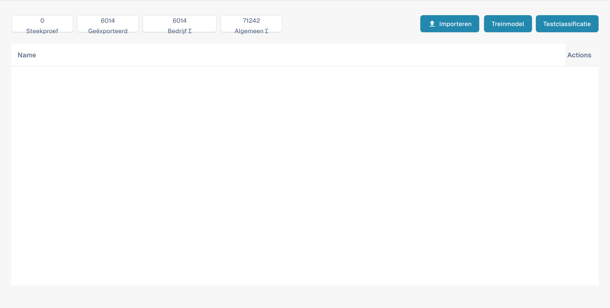

# Modeltraining

Deze weergave dient voor het beheren van voorbeelden en het controleren van classificatie per documenttype. Dit is niet de editor voor extractievelden.

<figure><figcaption>
Overzicht van modeltraining in het Nederlands. Treinmodel is een onjuiste vertaling van Model trainen; Name en Actions blijven Engelstalig.
</figcaption></figure>

## Tellers en acties

Bovenaan staan voorbeelden, geëxporteerde documenten en tellers op organisatie- en algemeen niveau. Houd rekening met dit bereik bij de interpretatie.

* Met import voegt u trainingsvoorbeelden toe.
* De trainingsactie start het trainen van het classificatiemodel.
* Met de classificatietest controleert u de classificatie van nieuwe documenten.

Deze weergave maakt geen velden aan; gebruik daarvoor de veldinstellingen van het documenttype. De afbeeldingen bewijzen geen uitgevoerde training of classificatietest. Sommige productlabels kunnen Engelstalig blijven of onjuist vertaald zijn.

Het productlabel Treinmodel betekent Model trainen. Het gaat om het trainen van het classificatiemodel.
