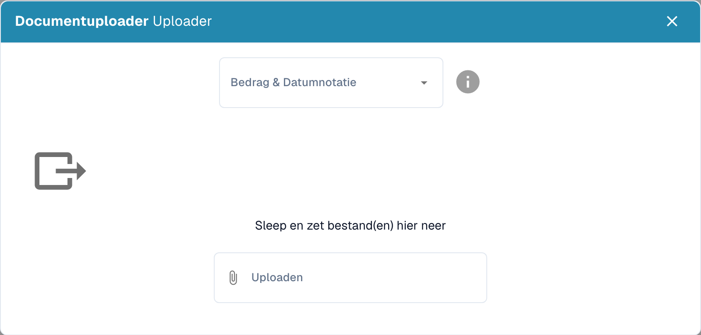

# Gegevens importeren voor modeltraining

Gebruik representatieve voorbeelddocumenten om de classificatie van het documenttype te trainen en te controleren. Kies bestanden in een door de import ondersteund formaat. Gebruik verschillende leveranciers en lay-outs die in uw proces voorkomen.

## Voorbeelden importeren

Open de modeltraining van het bedoelde documenttype en kies import.

<figure><figcaption>
Trainingsgegevens importeren met bedrag- en datumformaat.
</figcaption></figure>

1. Controleer het bedrag- en datumformaat voordat u bestanden toevoegt. Een punt of komma als decimaalteken en de volgorde van dag, maand en jaar beïnvloeden de interpretatie. Gebruik bijvoorbeeld 1.234,56 tegenover 1,234.56 en controleer welke notatie bij de documenten hoort.
2. Selecteer de bedoelde bestanden of sleep ze naar het importgebied.
3. Controleer zo nodig documenttype en subtype, en start uitsluitend de bedoelde import.
4. Controleer de importstatus en eventuele foutmeldingen voordat u de voorbeelden voor training gebruikt.

Open daarna de [modeltraining](README.md), controleer de beschikbare voorbeelden en start de bedoelde trainingsactie. Test de classificatie met andere, representatieve documenten. Een succesvolle import bewijst op zichzelf geen betrouwbare classificatie. De afbeelding toont het importvenster; zij bewijst geen uitgevoerde import of training.
