# Meer Instellingen

## Overzicht

**Meer instellingen** bevat de opties die bij één documenttype horen, bijvoorbeeld de factuur. Een instelling die je hier inschakelt, geldt alleen voor dat documenttype. De pagina bestaat uit uitklapbare kaarten, één per onderwerp. Open een kaart om de instellingen ervan te zien.

<figure>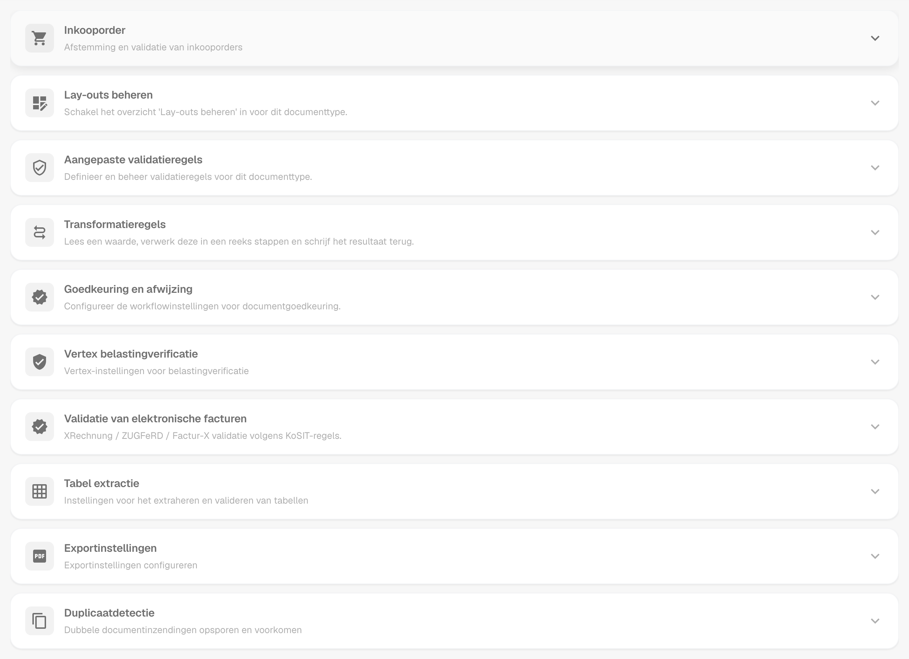<figcaption>
De kaarten van de pagina Meer instellingen, allemaal ingeklapt.
</figcaption></figure>

## Toegang

1. Navigeer naar **Instellingen** → **Globale instellingen** → **Documenttypen**.
2. Selecteer het documenttype en klik op **Meer instellingen**.

De broodkruimel boven aan de pagina toont **Instellingen / Documenttypen / Meer instellingen**. De Settings Assistant rechts op de pagina legt de instellingen van de geopende kaart uit.

| Kaart                                                     | Wat je daar instelt                                                        |
| --------------------------------------------------------- | -------------------------------------------------------------------------- |
| Inkooporder                                               | PO-matching, toleranties, export van PO-regels, leveranciersartikelnummers |
| Lay-outs beheren                                          | Schakelaar voor het overzicht Lay-outs beheren                             |
| Aangepaste validatieregels                                | Je eigen validatieregels voor dit documenttype                             |
| Transformatieregels                                       | Regels die een waarde lezen, stapsgewijs wijzigen en terugschrijven        |
| Goedkeuring en afwijzing                                  | Goedkeuringsworkflow en de formulieren voor beoordeling en afwijzing       |
| [Vertex belastingverificatie](vertex-tax-verification.md) | Het formulier voor de Vertex-belastingverificatie ontwerpen                |
| Validatie van elektronische facturen                      | Validatie van XRechnung-, ZUGFeRD- en Factur-X-facturen                    |
| Tabel extractie                                           | De validatie van geëxtraheerde tabellen overslaan                          |
| Exportinstellingen                                        | Meerdere exporten, PDF-formaat, alternatieve export                        |
| Duplicaatdetectie                                         | Dubbele documenten detecteren en blokkeren                                 |

## Inkooporder

De kaart **Inkooporder** (**Afstemming en validatie van inkooporders**) bepaalt hoe documenten van dit type worden gematcht met inkooporders.

<figure>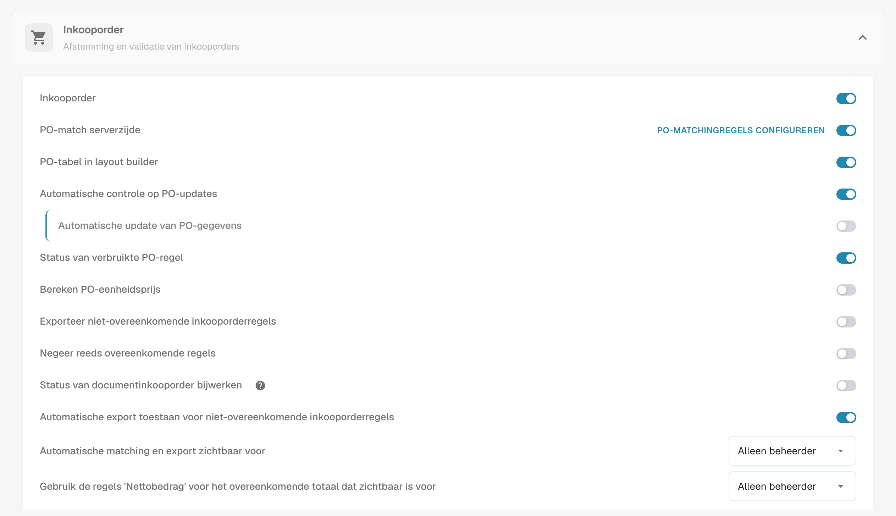<figcaption>
De kaart Inkooporder met zijn opties.
</figcaption></figure>

* [**Inkooporder**](purchase-order/purchase-order.md): Schakelt in of het document wordt verwerkt in het scherm Inkoopordermatching. Je kunt ook specificeren op welke hoeveelheid de matching wordt gebaseerd.
* [**PO-match serverzijde**](purchase-order/purchase-order-matching-rules.md): Matcht met de configureerbare regelset. **PO-matchingregels configureren** opent de [pagina met regels](purchase-order/purchase-order-matching-rules.md).
* [**PO-tabel in layout builder**](purchase-order/po-table-in-layout-builder.md): Maakt het mogelijk om inkoopordertabellen op te nemen in de layout builder voor aangepaste documentlay-outs.
* [**Automatische controle op PO-updates**](purchase-order/auto-check-for-po-updates.md): Toont een visuele indicator in het scherm Inkoopordermatching wanneer een inkooporder is bijgewerkt, zodat gebruikers worden aangespoord te verversen.
* **Automatische update van PO-gegevens**: Werkt de PO-gegevens automatisch bij wanneer nieuwe gegevens beschikbaar zijn. Deze schakelaar hoort bij **Automatische controle op PO-updates**.
* [**Status van verbruikte PO-regel**](purchase-order/consumed-po-line-status.md): Past kleurcodering toe op inkooporderregels in het matchingscherm.
* [**Bereken PO-eenheidsprijs**](purchase-order/calculate-po-unit-price.md): Berekent de PO-eenheidsprijs met behulp van het nettobedrag en de hoeveelheid, in plaats van deze te extraheren.
* [**Exporteer niet-overeenkomende inkooporderregels**](purchase-order/export-not-matched-po-lines.md): Wanneer uitgeschakeld, worden alleen gematchte regels geëxporteerd. Wanneer ingeschakeld, worden alle inkooporderregels geëxporteerd, zelfs als ze niet zijn gematcht.
* **Negeer reeds overeenkomende regels**: Slaat regels over die al zijn gematcht tijdens een nieuw matchingproces.
* [**Status van documentinkooporder bijwerken**](purchase-order/update-document-purchase-order-status.md): Werkt de kolom **PO-status** op het dashboard bij wanneer de status van de inkooporder verandert.
* [**Automatische export toestaan voor niet-overeenkomende inkooporderregels**, **Automatische matching en export zichtbaar voor** en **Gebruik de regels 'Nettobedrag' voor het overeenkomende totaal dat zichtbaar is voor**](purchase-order/auto-match-and-export-options.md): Bepalen wie de snelkoppelingen Auto Match & Export ziet en welke documenten automatisch mogen exporteren.

### De matchingregels als diagram bekijken

De PO-matchingregels zijn meer dan een lijst. DocBits kan de actieve regelset als stroomdiagram tekenen. Je ziet in welke volgorde de regels worden geprobeerd en waar de matching stopt.

1. Schakel in de kaart **Inkooporder** **PO-match serverzijde** in en klik op **PO-matchingregels configureren**.
2. Klik bovenaan de pagina op **Regels weergegeven als diagram**. Het diagram opent in een paneel naast de regels.

<figure>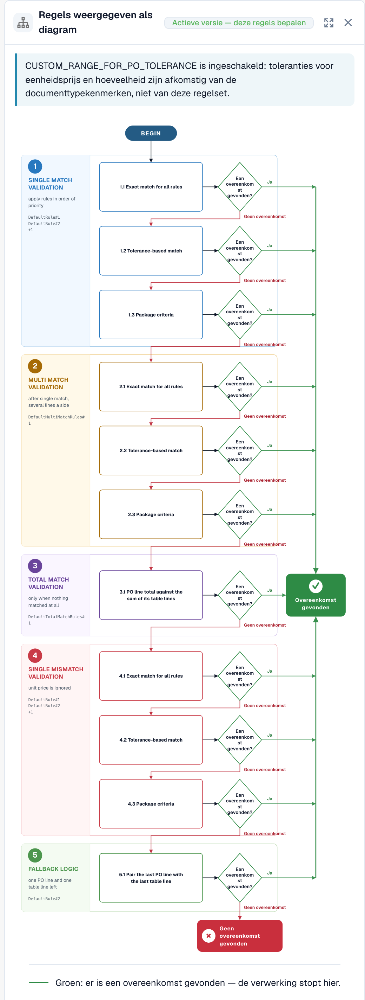<figcaption>
De regelset als diagram. Vijf fasen, van boven naar beneden.
</figcaption></figure>

Lees het diagram van boven naar beneden. DocBits probeert de fasen in deze volgorde: **Single match validation**, **Multi match validation**, **Total match validation**, **Single mismatch validation** en **Fallback logic**. Elke fase probeert maximaal drie passes: **Exact match for all rules**, **Tolerance-based match** en **Package criteria**. Een groene pijl betekent dat er een match is gevonden en de verwerking stopt. Een rode pijl betekent dat er geen match is, dus gaat DocBits verder met de volgende stap. Aan het einde is het resultaat **Overeenkomst gevonden** of **Geen overeenkomst gevonden**.

Onder het diagram toont het paneel **Regels op basis van prioriteit, per fase**. Bij elke regel zie je de kolommen die worden vergeleken, de tolerantie en de opties **Automatische match**, **Handmatige match** en **Terugvaloptie**.

<figure>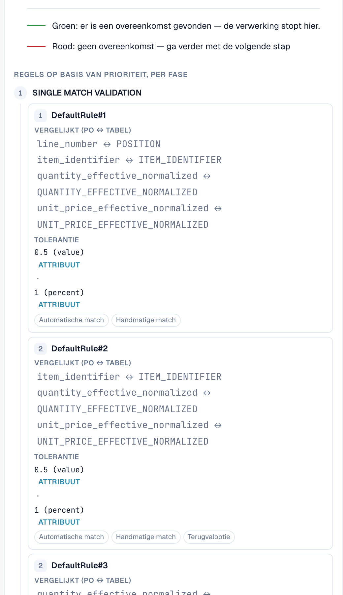<figcaption>
Onder het diagram: de regels van elke fase met de kolommen die ze vergelijken.
</figcaption></figure>

**Voorbeeld.** Een factuurregel heeft artikelnummer 4711, hoeveelheid 10 en eenheidsprijs 10.40. De inkooporderregel heeft artikelnummer 4711, hoeveelheid 10 en eenheidsprijs 10.00. De tolerantie voor de eenheidsprijs is 5 %.

* Pass **1.1 Exact match for all rules** mislukt, omdat 10.40 niet gelijk is aan 10.00. De rode pijl leidt naar de volgende pass.
* Pass **1.2 Tolerance-based match** slaagt. Het verschil is 4 %, wat binnen 5 % valt. De groene pijl leidt naar **Overeenkomst gevonden** en de verwerking stopt.

In het diagram is dit het pad 1.1, dan 1.2, dan **Overeenkomst gevonden**. Voor het pad dat een enkel document heeft afgelegd, zie [Touchless Intelligence: PO-matchingdiagnose](../../../../analytics-dashboard/touchless-intelligence/touchless-po-matching-diagnosis.md). Voor alle details van de regelpagina zie [Regels voor het matchen van inkooporders](purchase-order/purchase-order-matching-rules.md).

### PO-tolerantie-instelling

<figure>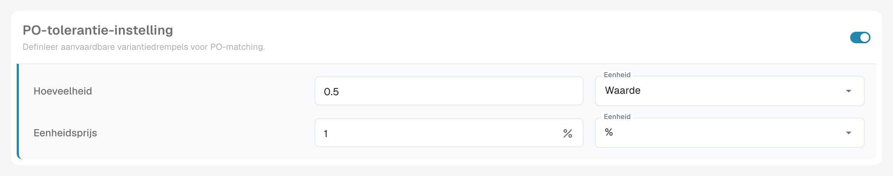<figcaption>
Tolerantie voor hoeveelheid en eenheidsprijs.
</figcaption></figure>

Met de [**PO-tolerantie-instelling**](purchase-order/purchase-order-tolerance-settings-additional-purchase-order-tolerance.md) stel je tolerantieniveaus in voor hoeveelheid en eenheidsprijs, zodat kleine afwijkingen niet als mismatches worden gemarkeerd. Voor elke waarde kies je de hoeveelheid en de eenheid, een absolute **Waarde** of een percentage (**%**). Het blok bevat ook de [**Extra PO-tolerantie-instelling**](purchase-order/purchase-order-tolerance-settings-additional-purchase-order-tolerance.md#instelling-om-extra-aankooporder-tolerantie-instellingen-te-configureren) voor vracht, kosten en belastingen, en de [**PO-uitschakelstatussen**](purchase-order/purchase-order-disable-statuses.md).


Wanneer het attribuut `CUSTOM_RANGE_FOR_PO_TOLERANCE` van het documenttype is ingeschakeld, komen de toleranties voor eenheidsprijs en hoeveelheid uit deze instellingen van het documenttype en niet uit de regelset. Het regeldiagram op de [pagina met PO-matchregels](purchase-order/purchase-order-matching-rules.md) toont in dat geval een opmerking.


### Leveranciersartikelnummerkaart

<figure>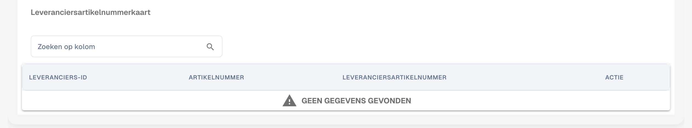<figcaption>
De Leveranciersartikelnummerkaart.
</figcaption></figure>

De [**Leveranciersartikelnummerkaart**](purchase-order/supplier-item-number-map-admin-documentation.md) koppelt artikelnummers van leveranciers aan je interne artikelnummers, zodat regels ook matchen wanneer de leverancier zijn eigen nummers gebruikt. Zoek per kolom om een invoer te vinden.

## Lay-outs beheren, aangepaste validatieregels en transformatieregels

Drie kaarten staan direct onder de kaart Inkooporder:

* **Lay-outs beheren** schakelt het overzicht Lay-outs beheren in voor dit documenttype. Zie de [Layout Manager](../layout-manager/).
* **Aangepaste validatieregels** schakelt je eigen validatieregels in. **Validatieregels beheren** opent ze. Zie [Aangepaste validatieregels](../custom-validation-rules.md).
* **Transformatieregels** schakelt de transformatieregels in. **Transformatieregels beheren** opent ze. Zie [Transformatieregels](../transformation-rules.md).

<figure>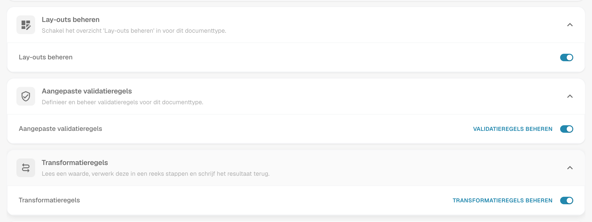<figcaption>
De drie kaarten met hun schakelaars.
</figcaption></figure>

## Goedkeuring en afwijzing

De kaart **Goedkeuring en afwijzing** bevat de goedkeuringsworkflow en de formulieren die gebruikers zien terwijl ze een document beoordelen of afwijzen.

<figure>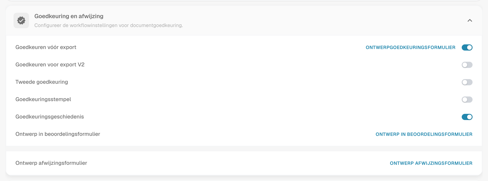<figcaption>
De kaart Goedkeuring en afwijzing.
</figcaption></figure>

* **Goedkeuren vóór export**: Documenten moeten worden goedgekeurd voordat ze kunnen worden geëxporteerd. **Ontwerpgoedkeuringsformulier** opent de **Lay-outbouwer** voor het goedkeuringsscherm.
* **Goedkeuren voor export V2**: Activeert Goedkeuring V2, die dynamische velden ondersteunt in plaats van statische.
* **Tweede goedkeuring**: Voegt een extra laag van goedkeuring toe.
* [**Goedkeuringsstempel**](approval/approval-stamp.md): Voegt een stempel toe aan het document wanneer het is goedgekeurd.
* [**Goedkeuringsgeschiedenis**](approval/approval-history.md): Toont de goedkeuringsgeschiedenis in het goedkeuringsscherm en in de veldvalidatie.
* **Ontwerp in beoordelingsformulier**: Configureert de lay-out van het beoordelingsformulier met de **Lay-outbouwer**.
* **Ontwerp afwijzingsformulier**: Configureert de lay-out van het afwijzingsformulier met de **Lay-outbouwer**.

Voor de **Lay-outbouwer** zie de [Layout Manager](../layout-manager/).

## Vertex belastingverificatie

De kaart **Vertex belastingverificatie** bevat **Ontwerp Vertex Belastingverificatie**. Deze opent de Lay-outbouwer voor het formulier dat gebruikers zien wanneer DocBits de belasting van de verkoper vergelijkt met de belasting die Vertex heeft berekend. Zie [Vertex belastingverificatie](vertex-tax-verification.md) voor de integratie, de tolerantie en het resultaat.

## Validatie van elektronische facturen

De kaart **Validatie van elektronische facturen** schakelt de validatie van binnenkomende e-facturen in en laat je bepalen of de leverancier een bericht krijgt wanneer een factuur wordt afgewezen. Zie [Validatie van elektronische facturen](../../../document-processing/e-documents/validation-rules/).

## Tabel extractie

<figure>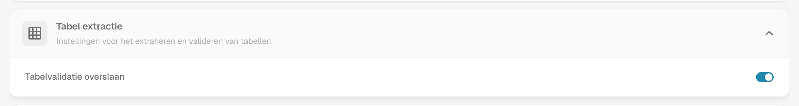<figcaption>
De kaart Tabel extractie.
</figcaption></figure>

* **Tabelvalidatie overslaan**: Omzeilt de standaardvalidatie van tabelgegevens. Gebruik deze optie wanneer flexibele gegevensverwerking nodig is of wanneer bepaalde validatiestappen kunnen worden overgeslagen om de prestaties te verbeteren.

## Exportinstellingen

<figure>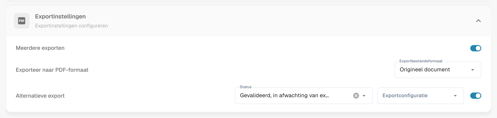<figcaption>
De kaart Exportinstellingen.
</figcaption></figure>

* **Meerdere exporten**: Staat toe dat een document meer dan één keer wordt geëxporteerd.
* **Exporteer naar PDF-formaat**: **Exportbestandsformaat** stelt het PDF-formaat in dat wordt gebruikt bij het exporteren van documenten, bijvoorbeeld **Origineel document**.
* [**Alternatieve export**](purchase-order/alternate-export.md): Stelt een alternatieve export in voor een gekozen documentstatus. Kies de **Status** en de **Exportconfiguratie** die ervoor wordt uitgevoerd en schakel de instelling daarna in.

## Duplicaatdetectie

<figure>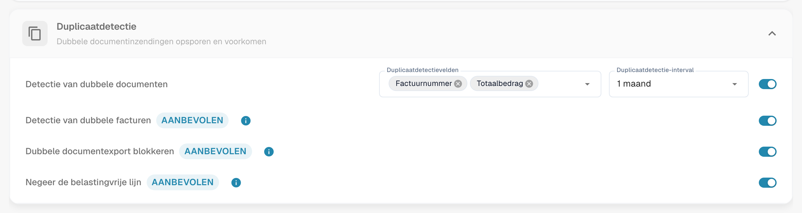<figcaption>
De kaart Duplicaatdetectie.
</figcaption></figure>

De kaart bevat **Detectie van dubbele documenten** met de velden die bepalen wat als duplicaat telt en het interval waarin documenten worden vergeleken, plus de opties **Detectie van dubbele facturen**, **Dubbele documentexport blokkeren** en **Negeer de belastingvrije lijn**. Alle drie dragen het label **Aanbevolen**. Zie [Duplicaatdetectie](duplicate-document-handling.md) voor hoe een gemarkeerd document wordt afgehandeld.
