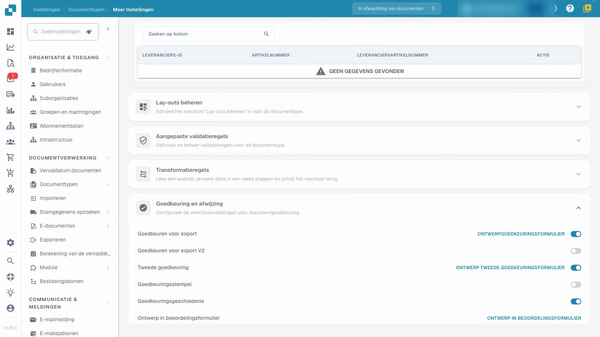
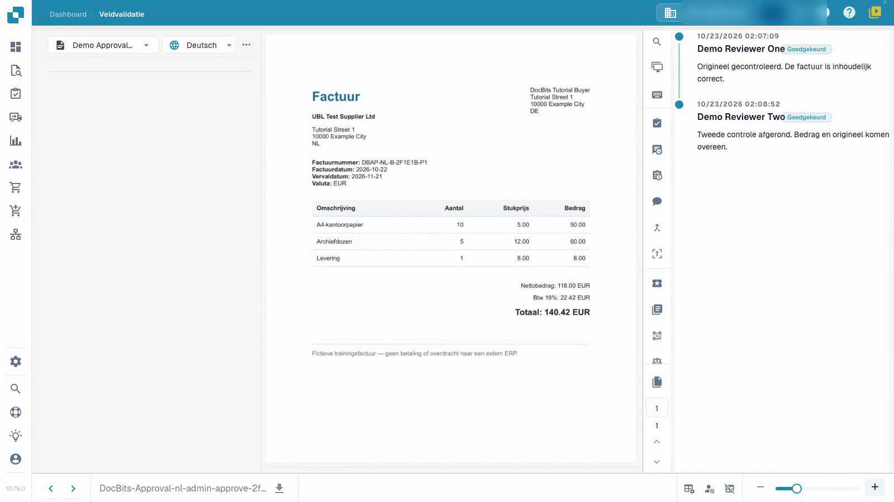

# Factuurgoedkeuringen configureren en testen

Deze video toont de configuratie en het testen van goedkeuringen.


Factuurgoedkeuringen configureren en testen


[Bekijk video met ondertiteling](https://docbits-videos.fra1.cdn.digitaloceanspaces.com/settings-assistant/invoice-approval-admin/v2/nl.html)

De echte applicatie wordt getoond. De namen van opties kunnen per gebruikte versie verschillen.

Configureer goedkeuring voor het documenttype dat door uw proces wordt gebruikt. Identificeer de beoogde beoordelaars en beslis of u een tweede onafhankelijke beoordeling nodig heeft. De video gebruikt een apart testtype, synthetische facturen en tijdelijke gewone beoordelaarsaccounts; de presentator is fictief.

## Configureer het documenttype

Open **Instellingen → Documenttypen**, selecteer het beoogde type en open **Meer instellingen → Goedkeuring en afwijzing**. Kies de instellingen die uw proces nodig heeft en laad de pagina opnieuw om te controleren wat is opgeslagen.

| Instelling | Doel |
| --- | --- |
| Goedkeuren vóór export | Vereis een goedkeuringsbeslissing voordat het document doorgaat naar export. |
| Tweede goedkeuring | Voeg een tweede goedkeuringsfase toe aan het geconfigureerde proces. |
| Goedkeuringsgeschiedenis | Houd de vastgelegde beslissingen beschikbaar voor beoordeling. |
| Goedkeuringsstempel | Configureer een markering op een goedgekeurd document; zie de aparte stempelgids. |

De extra V2-optie en de formuliereditors zijn aparte instellingen. Deze tutorial gebruikt voorbereide standaardformulieren voor goedkeuring.

## Test met de beoogde rollen

1. Plaats de eerste en tweede beoordelaar in aparte groepen en geef hun de bedoelde toegang tot toegewezen documenten. In dit voorbeeld heeft het eerste account goedkeuringstoestemming voor de eerste fase en het tweede account toestemming voor de tweede fase. Een schakelaar alleen wijst geen persoon toe en verleent die rechten niet.
2. Gebruik het eerste gewone account om de toegewezen, reeds gevalideerde factuur te controleren, voeg een notitie toe en geef de eerste goedkeuring. Controleer of het opgeslagen document nog steeds wacht op de tweede goedkeuring. Controleer of dit account de tweede fase niet kan uitvoeren wanneer de machtigingen dit verbieden.
3. Wijs de wachtende factuur toe aan de andere geautoriseerde beoordelaar. Gebruik dat tweede gewone account om het te controleren en de tweede goedkeuring te geven met een aparte notitie.
4. Heropen de geschiedenis en verifieer beide verschillende beoordelaars, tijden en notities. Wijs ook een aparte testfactuur af met een reden en verifieer die beslissing na het opnieuw laden.

<figure><figcaption>
Opgeslagen goedkeuringsinstellingen in eigen testtype.
</figcaption></figure>

<figure><figcaption>
Twee verschillende beoordelaars en beide opgeslagen notities.
</figcaption></figure>

## Verifieer de uitkomst

Houd eerste goedkeuring, openstaande tweede goedkeuring en afwijzing als verschillende uitkomsten. Bevestig dat de factuurwaarden na elke beslissing ongewijzigd blijven. In deze test wacht het afzonderlijke kanaal op het ophalen van de gegevens en is er geen extern ERP-systeem als bestemming. De technische status `pending_data_fetch`, wanneer weergegeven, betekent wachten op het ophalen van gegevens. Goedkeuringsgeschiedenis alleen bewijst geen ERP-overdracht.

Test de geconfigureerde rollen, toewijzing en het volledige beslissingspad voordat u het proces toepast op documenten in de echte bedrijfsomgeving.

## Gerelateerde pagina's

- [Groepen, gebruikers en machtigingen](../../../groups-users-and-permissions/README.md)
- [Goedkeuringsgeschiedenis](approval-history.md)
- [Goedkeuringsstempel](approval-stamp.md)
