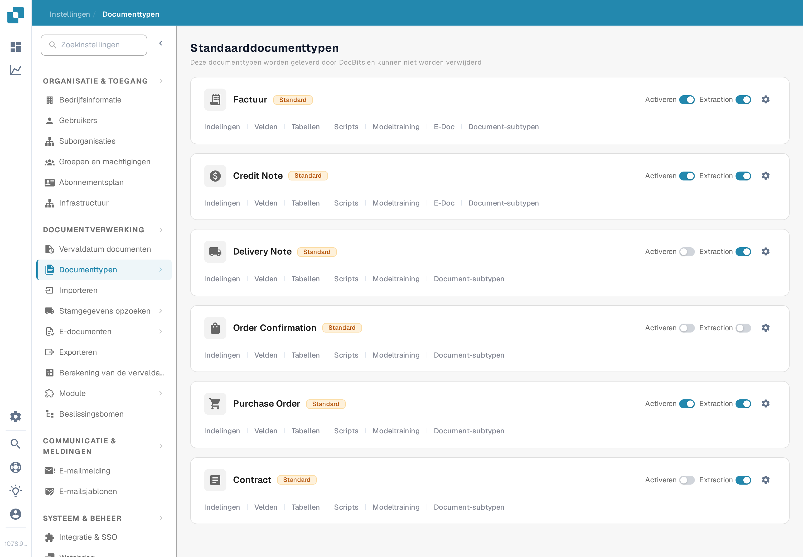
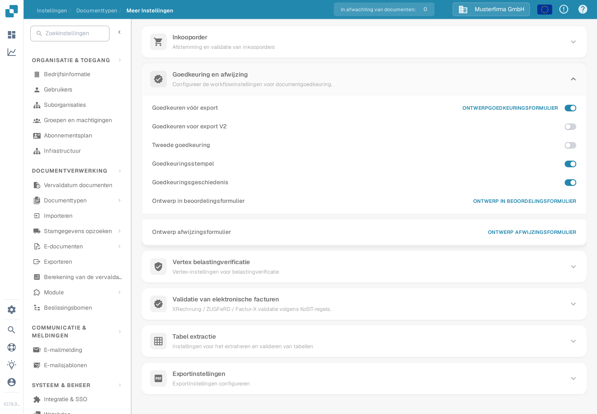

# Goedkeuringsstempel

Een goedkeuringsstempel is een annotatie die tijdens de documentgoedkeuring wordt toegevoegd wanneer de optie voor dat documenttype is ingeschakeld. Dit is handig wanneer een controleur wil zien wie een document heeft goedgekeurd en wanneer. De vorige pagina toonde zes schermafbeeldingen van een oudere interface en behandelde de stempel, de IDM-export en de PDF-downloadopties als al samen geverifieerd. Controleer elk resultaat in je eigen werkproces voordat je erop vertrouwt.

## De optie vinden

1. Open met een beheerdersaccount **Instellingen → Documenttypen**. Zoek het type dat je wilt configureren, bijvoorbeeld **Factuur**, en selecteer het **tandwielpictogram** op die kaart. Het tandwiel opent **Meer Instellingen** voor dat documenttype; **Indelingen** en **Velden** openen andere editors.

   <figure><figcaption>
Open het tandwiel op het betreffende documenttype.
</figcaption></figure>

2. Vouw in **Meer Instellingen** de sectie **Goedkeuring en afwijzing** uit. Zoek de schakelaar **Goedkeuringsstempel** naast **Goedkeuren vóór export**, **Tweede goedkeuring** en **Goedkeuringsgeschiedenis**. De schermafbeelding toont de synthetische organisatie **DocBits Documentation Test A** met de stempel **uit**. Er is geen gestempeld document te zien.

   <figure><figcaption>
Controleer de instelling Goedkeuringsstempel van het geselecteerde documenttype.
</figcaption></figure>

3. Schakel de optie pas in nadat je hebt afgesproken hoe goedkeuringen en exports binnen je organisatie werken. Bewaar een notitie van de vorige instelling, zodat je het effect op een testfactuur kunt verifiëren.

## Een goedkeuring verifiëren

Stuur een synthetische factuur van dit documenttype door de ingestelde goedkeuringsworkflow. Keur het document op het goedkeuringsscherm goed met een gemachtigd testaccount. De huidige DocBits-webclient controleert tijdens de goedkeuring de optie Goedkeuringsstempel en voegt een stempelannotatie met de naam van de goedkeurder en de datum toe. Open het goedgekeurde document opnieuw en bekijk de annotatie en de gedownloade PDF die je werkproces daadwerkelijk gebruikt. Ontbreekt de stempel, controleer dan het documenttype, de goedkeuringsstatus, de instelling en de exportconfiguratie.

De goedkeuringsstempel staat los van **Tweede goedkeuring** en **Goedkeuringsgeschiedenis**. Het inschakelen van de ene optie bewijst niet dat de andere zijn geconfigureerd. De beschikbare downloadacties op het **Dashboard** en het exportformaat naar IDM zijn afhankelijk van de omgeving en zijn voor deze pagina niet geverifieerd; daarom belooft deze handleiding geen specifieke labels in het downloadmenu en geen automatische IDM-uitvoer.

De twee nieuwe schermafbeeldingen zijn visueel gecontroleerd in de Nederlandse Test A Sandbox. Er is geen schakelaar gewijzigd en er is tijdens deze controle geen document goedgekeurd of geëxporteerd; de gestempelde eindtoestand vraagt om een specifieke synthetische goedgekeurde factuur.

## Bevindingen over de app-vertaling

Deze termen staan zo in de Nederlandse interface (Sandbox 10.78.9) en worden letterlijk geciteerd; de documentatie corrigeert ze niet:

- Het menu toont **Instellingen** en de categorie **Documenttypen**; het broodkruimelspoor op de detailpagina is **Instellingen / Documenttypen / Meer Instellingen**.
- De sectie heet **Goedkeuring en afwijzing**; de schakelaar heet **Goedkeuringsstempel**, naast **Goedkeuren vóór export**, **Tweede goedkeuring** en **Goedkeuringsgeschiedenis**.
- **Indelingen** en **Velden** zijn de Nederlandse labels voor de layouts- en veldeditors van een documenttype.
- Op de lijst met documenttypen blijven de labeltekst **Extraction**, de waarde **Standard** en de knop **Activeren** in het Engels staan, terwijl omliggende labels zoals **Indelingen**, **Velden**, **Tabellen**, **Scripts** en **Modeltraining** wel zijn vertaald.
