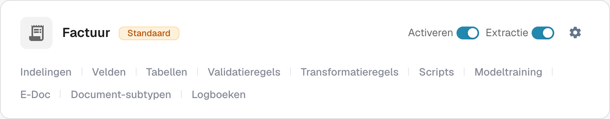
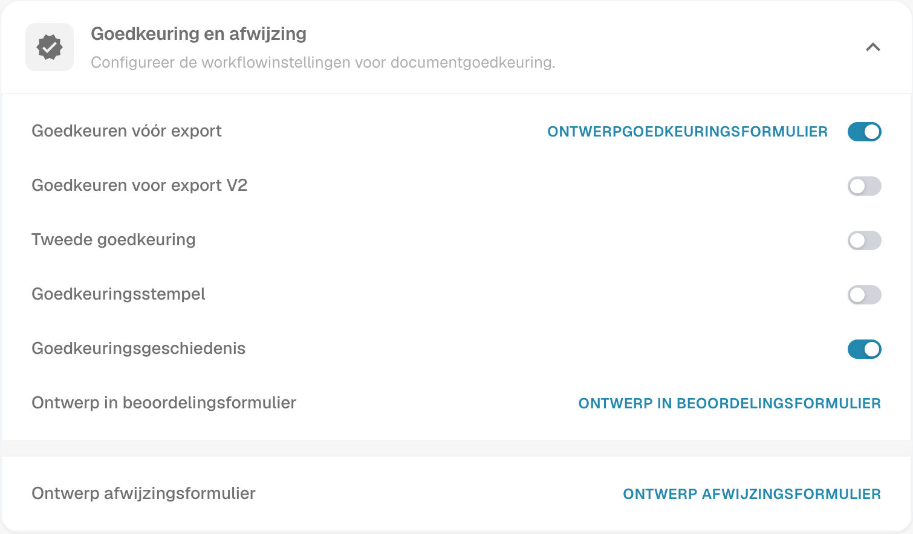

# Goedkeuringsstempel

Een goedkeuringsstempel is een annotatie in het goedkeuringsproces wanneer de optie voor dat documenttype is ingeschakeld. Hiermee kan een controleur nagaan wie een document heeft goedgekeurd en wanneer. Controleer de annotatie en het PDF-resultaat met een testfactuur in het werkproces dat je organisatie daadwerkelijk gebruikt.

## De optie vinden

1. Open met een beheerdersaccount **Documenttypen** in de beheerinstellingen. Zoek het type dat je wilt configureren, bijvoorbeeld **Factuur**, en selecteer het **tandwielpictogram** op die kaart. Het tandwiel opent **Meer instellingen** voor dat documenttype.

   <figure><figcaption>
Echte kaart Factuur in de Nederlandse Dev-interface. Het tandwiel opent Meer instellingen; er is geen instelling gewijzigd.
</figcaption></figure>

   **Activeren** bepaalt de beschikbaarheid van het documenttype en **Extractie** de extractiemodus. De koppelingen onderaan de kaart openen afzonderlijke onderdelen: **Indelingen**, **Velden**, **Tabellen**, **Validatieregels**, **Transformatieregels**, **Scripts**, **Modeltraining**, **E-Doc**, **Document-subtypen** en **Logboeken**. Welke koppelingen beschikbaar zijn, hangt af van de modules en instellingen van het type. Gebruik het tandwiel om de stempelinstelling te vinden.

2. Vouw in **Meer instellingen** de sectie **Goedkeuring en afwijzing** uit. Zoek **Goedkeuringsstempel** naast **Goedkeuren vóór export**, **Tweede goedkeuring** en **Goedkeuringsgeschiedenis**. De afbeelding toont de bestaande stempelinstelling **uitgeschakeld**; in je eigen organisatie kan de toestand anders zijn. Er is geen goedgekeurd document te zien.

   <figure><figcaption>
Echte Nederlandse Dev-weergave van Goedkeuring en afwijzing. De schakelaarstanden zijn alleen gelezen.
</figcaption></figure>

   **Goedkeuren vóór export**, **Goedkeuren voor export V2**, **Tweede goedkeuring** en **Goedkeuringsgeschiedenis** zijn afzonderlijke workflowinstellingen. De ontwerpkoppelingen openen de editors voor de goedkeurings-, beoordelings- of afwijzingsformulieren. Je hoeft deze editors niet te openen om de stempelinstelling te bekijken.

3. Wijzig **Goedkeuringsstempel** pas nadat je binnen de organisatie hebt afgesproken hoe goedkeuringen en exports werken. **Een wijziging van de schakelaar slaat de instelling onmiddellijk op.** Leg de vorige stand vast, zodat je het effect op een testfactuur kunt verifiëren.

## Een goedkeuring verifiëren

Stuur een synthetische factuur van dit documenttype door de ingestelde goedkeuringsworkflow. Keur deze in de goedkeuringsstap van die workflow goed met een gemachtigd testaccount. Open het goedgekeurde document opnieuw en controleer of de annotatie de verwachte naam en datum bevat. Bekijk ook de gedownloade PDF die je werkproces daadwerkelijk gebruikt. Ontbreekt de stempel, controleer dan het documenttype, de goedkeuringsstatus, de instelling en de exportconfiguratie.

De goedkeuringsstempel staat los van **Tweede goedkeuring** en **Goedkeuringsgeschiedenis**. Het inschakelen van de ene optie bewijst niet dat de andere zijn geconfigureerd. De beschikbare downloadacties op het dashboard en het exportformaat naar IDM zijn afhankelijk van de omgeving en zijn voor deze pagina niet geverifieerd; daarom belooft deze handleiding geen specifieke labels in het downloadmenu en geen automatische IDM-uitvoer.

De twee opnamen tonen echte Nederlandse Dev-weergaven. Er is tijdens deze controle geen schakelaar gewijzigd en geen document goedgekeurd of geëxporteerd. Voor de gestempelde eindtoestand is een afzonderlijke synthetische goedgekeurde testfactuur nodig.

## Bevindingen over de app-vertaling

De huidige Nederlandse kaart toont **Standaard**, **Activeren** en **Extractie**. De sectie heet **Goedkeuring en afwijzing** en bevat **Goedkeuringsstempel** en **Goedkeuringsgeschiedenis**, zoals in de afbeeldingen. **ONTWERPGOEDKEURINGSFORMULIER** opent de editor van het goedkeuringsformulier; dit is niet de stempelschakelaar. **ONTWERP IN BEOORDELINGSFORMULIER** en **ONTWERP AFWIJZINGSFORMULIER** openen de andere formuliereditors. De labels zijn overgenomen zoals ze in de interface staan, zodat je het juiste bedieningselement kunt herkennen.
