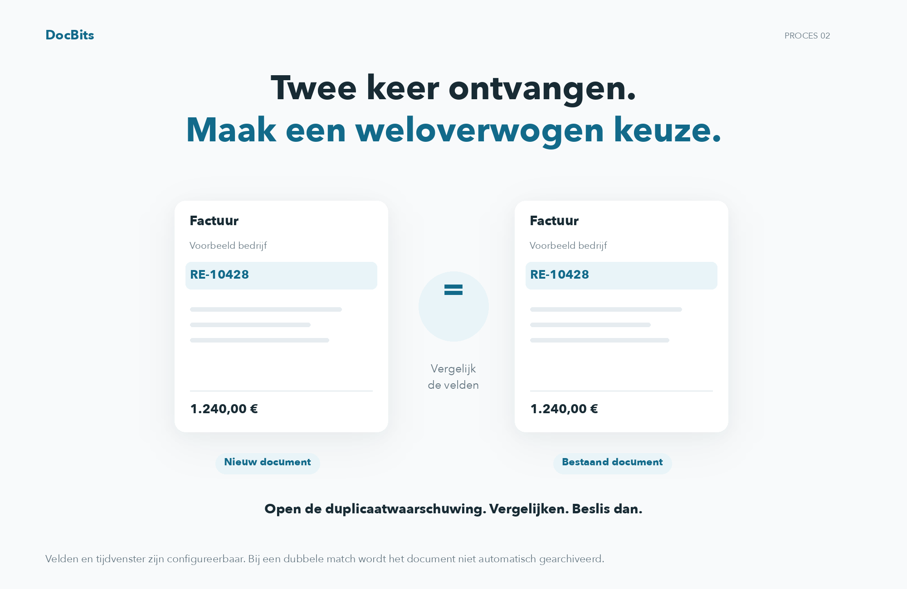
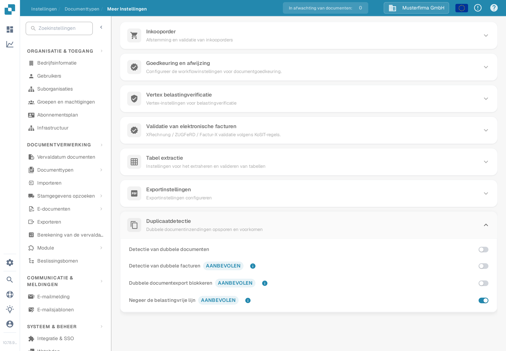
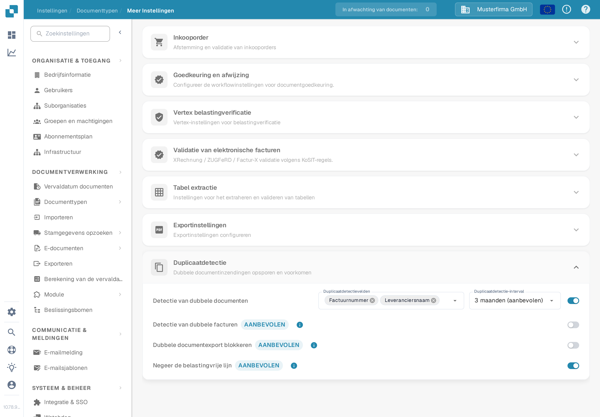
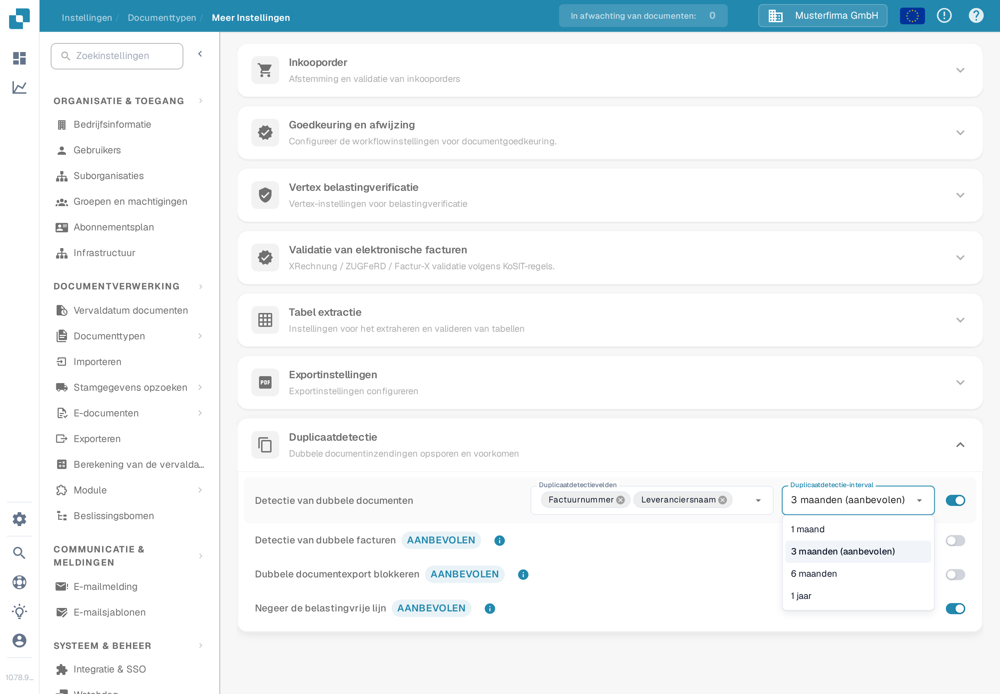

# Duplicaatdetectie

## Detecteer duplicaten en neem een weloverwogen beslissing

<figure><figcaption>
Detecteer duplicaten en neem een weloverwogen beslissing
</figcaption></figure>

DocBits vergelijkt de geconfigureerde velden binnen het geselecteerde tijdvenster. Wanneer er een match wordt gevonden, opent u de duplicaatwaarschuwing en vergelijkt u de documenten voordat u doorgaat of archiveert. Het blokkeren van dubbele exporten is een aparte instelling; een match archiveert niet automatisch een document.

Gebruik **Duplicaatdetectie** om documenten te markeren die binnen een gekozen periode overeenkomen met een ander document op geselecteerde velden. De opties behoren bij elk documenttype.

## De instellingen openen

1. Open **Instellingen → Documenttypen**.
2. Selecteer bij het documenttype dat u wilt configureren **Meer Instellingen**.
3. Open in **Meer Instellingen** het onderdeel **Duplicaatdetectie**.

<figure><figcaption>
De Factuur-instellingen tonen vier aparte schakelaars. De selectors voor velden en interval verschijnen wanneer detectie is ingeschakeld.
</figcaption></figure>

## Kies wat als duplicaat geldt

1. Zet **Detectie van dubbele documenten** aan. De selectors **Duplicaatdetectievelden** en **Duplicaatdetectie-interval** verschijnen.
2. Selecteer de velden die moeten overeenkomen. Voor een factuur kunt u bijvoorbeeld **Factuurnummer** en **Leveranciersnaam** kiezen. Kies velden die documenten in uw eigen proces onderscheiden.
3. Kies een interval: **1 maand**, **3 maanden (aanbevolen)**, **6 maanden** of **1 jaar**. Een langer interval controleert een breder datumbereik en kan langer laden.

Elke wijziging wordt direct bij het uitvoeren opgeslagen; er is geen aparte Save-knop in dit onderdeel. Als u de detectie uitschakelt, worden de selectors voor velden en interval verborgen.

<figure><figcaption>
Schakel de detectie in voordat u de vergelijkingvelden en het tijdsinterval kiest.
</figcaption></figure>

<figure><figcaption>
3 maanden staat in het menu gemarkeerd als aanbevolen interval.
</figcaption></figure>

Voor **Factuur** biedt dit onderdeel ook **Detectie van dubbele facturen**, **Dubbele documentexport blokkeren** en **Negeer de belastingvrije lijn**. Dit zijn aparte schakelaars; schakel alleen het gedrag in dat uw factuurproces nodig heeft. De extra schakelaars worden voor andere documenttypen niet getoond.

## Een gemarkeerd document bekijken

Wanneer DocBits een overeenkomst vindt, toont de regel van het document op het **Dashboard** een duplicaatpictogram. Selecteer het pictogram om de overeenkomende records in het zijpaneel te vergelijken. Het pictogram verschijnt alleen wanneer er een overeenkomst is.

Wanneer u een gemarkeerd document opent, biedt de duplicaatwaarschuwing **Bekijk duplicaat**, **Toch doorgaan** en, als het document nog niet gearchiveerd is, **Archiveren**. Bekijk de overeenkomende records voordat u een actie kiest. Zie [de Dashboard-handleiding](../../dashboard/README.md) voor de documentlijst.
