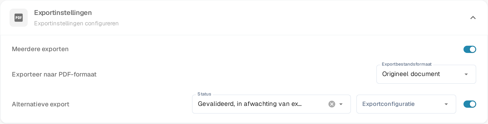

# Alternatieve export

## Overzicht

U kunt een alternatieve exportoptie configureren die verschijnt in de exportdropdown binnen de inkoopordersectie wanneer een document zich in een specifieke status bevindt.\
Deze pagina legt uit hoe u deze optie kunt instellen. De instelling staat in de sectie **Exportinstellingen** van het documenttype.

## Activatiestappen

1. Ga naar **Instellingen** -> **Globale instellingen** -> **Documenttypen**
2.  Zoek de kaart van het documenttype en open de instellingen met het tandwiel (**Meer instellingen**).

    
3.  Open de sectie **Exportinstellingen** en schakel **Alternatieve export** in.

    <figure><figcaption>
De schakelaar <strong>Alternatieve export</strong> in <strong>Exportinstellingen</strong>. Zodra die aan staat verschijnen <strong>Status</strong> en <strong>Exportconfiguratie</strong> ernaast.
</figcaption></figure>

## Hoe in te stellen

Zodra de instelling is ingeschakeld, kunt u een documentstatus kiezen en een vooraf gedefinieerde exportconfiguratie toewijzen.

* **Status** - de documentstatus waarin de extra exportoptie wordt aangeboden.
* **Exportconfiguratie** - de exportconfiguratie die deze optie gebruikt.

Meer informatie over het instellen van exportconfiguraties vindt u [hier](../../../../document-processing/export.md).

U kunt kiezen uit de volgende statussen:

* Geclassificeerd
* In afwachting van bevestiging
* In afwachting van goedkeuring
* In afwachting van tweede goedkeuring
* Gevalideerd, in afwachting van export
* Goedgekeurd in afwachting van export
* Afgewezen
* Afgerond
* Geëxporteerd
* In de wacht
* Werkstroom
* Fout
* In recensie

Na de setup verschijnt er een extra exportoptie in de inkooporder die overeenkomt met de exportopties. Deze optie gebruikt de gespecificeerde exportconfiguratie wanneer het document overeenkomt met de gedefinieerde status.

