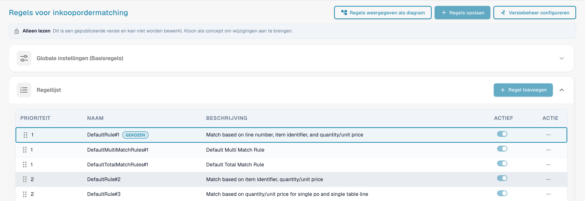
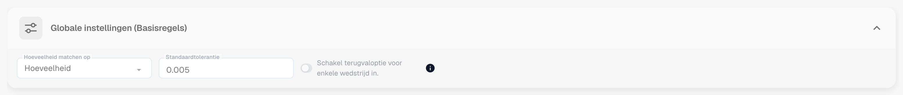
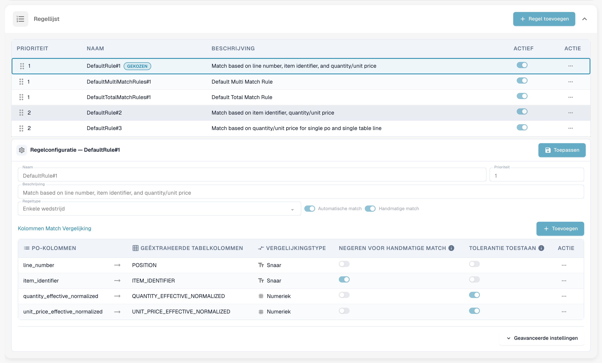
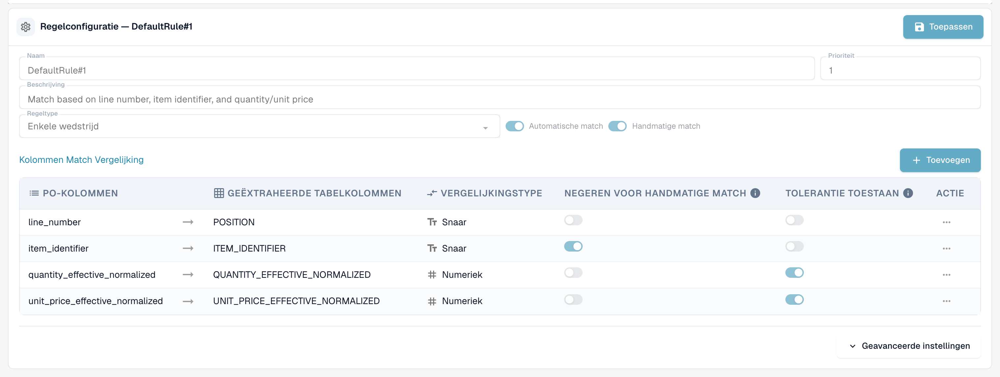
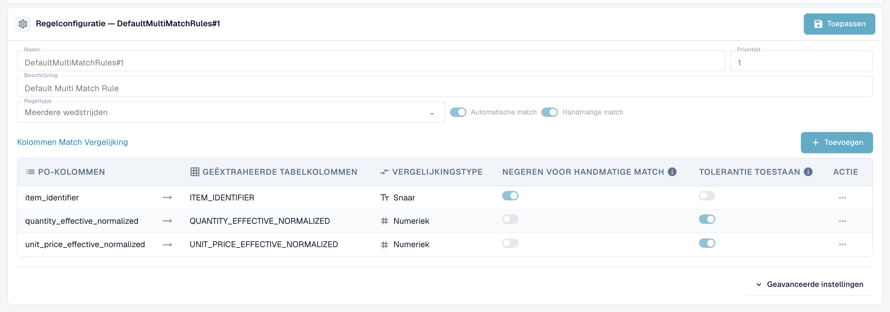
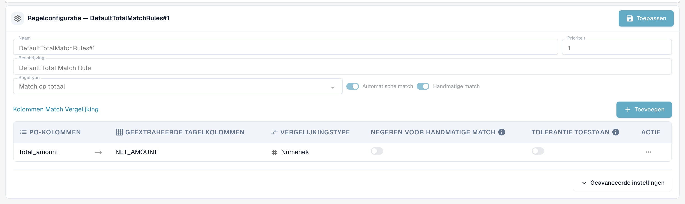
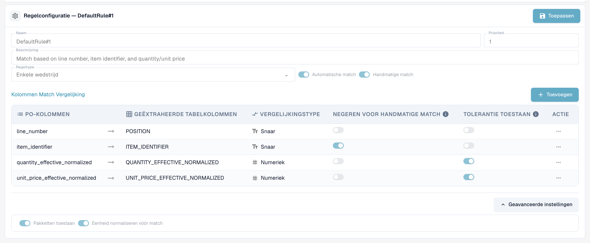
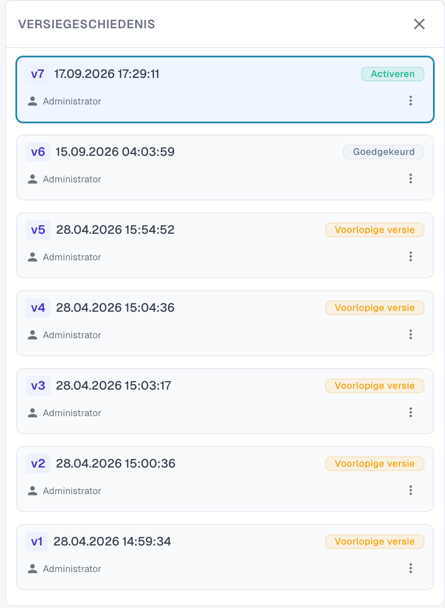

# Regels voor het matchen van inkooporders

## Regels en toleranties voor inkoopordermatching instellen

De rondleiding opent het documenttype factuur, controleert de gepubliceerde regelversie en maakt een inactief concept. Ze behandelt regeltypen, prioriteit binnen de matchfase, vergelijkingskolommen, hoeveelheidsbasis, matchmodi en tolerantieberekeningen. Alleen het tutorialconcept wordt opgeslagen; de actieve versie en globale toleranties blijven behouden. De berekening met vijf procent is een voorbeeld en wijzigt de actieve tolerantie niet.



[Bekijk de video met ondertiteling](https://docbits-videos.fra1.cdn.digitaloceanspaces.com/settings-assistant/po-matching-rules-admin/v3/nl.html)

## Introductie: Inkooporders en beheer van PO-regels

Het matchen van inkooporders (PO) is een cruciaal proces om consistentie te waarborgen tussen inkooporders (PO's) en de bijbehorende binnenkomende facturen of goederenontvangsten. Een robuuste set regels is essentieel om een hoge mate van automatische matching te bereiken, fraude te voorkomen en correcte betalingen te garanderen.

Deze configuratiepagina wordt gebruikt om de regels te definiëren en te beheren die bepalen _hoe_ PO-regelitems worden gematcht met het bijbehorende binnenkomende document (factuur, orderbevestiging).


**Vereiste:** de matchregels worden alleen gebruikt wanneer **PO-match serverzijde** is ingeschakeld voor het documenttype (Instellingen → Documenttypen → Meer instellingen → Inkooporder). Bij een uitgeschakelde schakelaar matcht DocBits met zijn ingebouwde matcher (hoeveelheid, eenheidsprijs, artikelnummer, inkoopordernummer) en negeert de regelset.


***

## Toegang

1. Navigeer naar **Instellingen** → **Globale instellingen** → **Documenttypen**, selecteer het documenttype en klik op **Meer instellingen**.
2. Schakel op de kaart **Inkooporder** **PO-match serverzijde** in.
3. Klik naast de schakelaar op **PO-matchingregels configureren**.

<figure><figcaption>
De kaart Inkooporder. <strong>PO-matchingregels configureren</strong> staat naast <strong>PO-match serverzijde</strong>.
</figcaption></figure>

## De pagina in één oogopslag

<figure><figcaption>
De pagina met PO-matchregels.
</figcaption></figure>

De pagina heeft drie knoppen bovenaan:

* **Regels weergegeven als diagram** opent een stroomdiagram van de actieve regelset. Zie Regelset als diagram.
* **Regels opslaan** slaat je wijzigingen op in het concept dat je bewerkt.
* **Versiebeheer configureren** opent de versiegeschiedenis. Zie Versies en concepten.

Onder de knoppen verschijnt een melding **Alleen lezen** wanneer je naar een gepubliceerde versie kijkt: *Dit is een gepubliceerde versie en kan niet worden bewerkt. Kloon als concept om wijzigingen aan te brengen.* Daaronder staan de kaart **Globale instellingen (Basisregels)** en de **Regellijst**. Selecteer een regel in de lijst om deze te configureren in het gebied **Regelconfiguratie** onder de lijst.

***

## Globale instellingen (Basisregels)

Deze instellingen vormen het kader dat van toepassing is op alle matchregels:

<figure><figcaption>
De kaart Globale instellingen (Basisregels), geopend.
</figcaption></figure>

* **Instelling:** Match hoeveelheid op
  * **Doel:** Bepaalt welke hoeveelheid van de inkooporderregel wordt vergeleken met de documentregel — bijvoorbeeld de bestelde hoeveelheid of de **openstaande factuurhoeveelheid** (besteld minus al gefactureerd), wat de gebruikelijke keuze is voor facturen.
  * **Geldige waarden:** Hoeveelheid of andere beschikbare hoeveelheidvelden in het systeem, afhankelijk van de datastructuur (bijv. een alternatief genormaliseerd hoeveelheidveld).
  * **Afhankelijkheid:** Bepaalt de basis voor alle matchregels die hoeveelheid in hun vergelijkingscriteria opnemen.
* **Instelling:** Standaardtolerantie
  * **Doel:** Bepaalt hoe ver een numerieke waarde op het document mag afwijken van de waarde op de inkooporder en toch als een match wordt beschouwd. Het compenseert afrondingsverschillen. Het is van toepassing op **elke numerieke kolom** waarvoor "Tolerantie toestaan" is ingeschakeld — zowel hoeveelheid als eenheidsprijs.
  * **Geldige waarde:** Een decimaal getal. Of dit wordt gelezen als een **absolute waarde** (0,005 = een afwijking tot 0,005 in de vergeleken hoeveelheid of prijs) of als een **percentage** (0,5 = 0,5 % van de vergeleken waarde) wordt bepaald door het **tolerantietype** van de regelset (`value` of `percent`; nieuwe regelsets gebruiken `value`). Toleranties per item (zie [Tolerantie-instellingen](purchase-order-tolerance-settings-additional-purchase-order-tolerance.md)) overschrijven de standaardtolerantie voor dat item.
  * **Afhankelijkheid:** Van toepassing op regels die numerieke velden gebruiken voor matching en waarvoor de optie "Tolerantie toestaan" is ingeschakeld.
* **Instelling:** Schakel terugvalpositie voor enkele wedstrijd in
  * **Doel:** Wanneer ingeschakeld, wordt een laatste overgebleven niet-gematchte inkooporderregel automatisch gematcht, ook als het pakbonnummer afwijkt. De match wordt voor je controle als mismatch gemarkeerd.
  * **Geldige waarden:** Aan of uit. De standaard is uit.

***

## Regellijst

De Regellijst toont alle beschikbare matchregels en beheert hun uitvoeringsvolgorde.

<figure><figcaption>
De Regellijst. De geselecteerde regel is gemarkeerd met <strong>Gekozen</strong>. Een regel kan worden uitgeschakeld met de schakelaar <strong>Actief</strong>.
</figcaption></figure>

#### Structuur en uitvoering

* **Prioriteit:** Dit numerieke veld (bijv. 1, 2, 3) bepaalt de uitvoeringsvolgorde van de regels. Regels met een lagere prioriteitswaarde worden eerst geprobeerd. Dit stelt beheerders in staat een hiërarchie te structureren, meestal beginnend met de meest specifieke en strenge regels (bijv. matchen op zowel regelnummer als artikelnummer) en terugvallend op bredere of minder restrictieve regels.
* **Naam & beschrijving:** Biedt een duidelijke identificatie en context voor de regel, waarin de primaire criteria worden uitgelegd (bijv. "Standaardregel nr. 1: match op basis van regelnummer, artikel-ID en hoeveelheid").
* **Actief:** Een eenvoudige schakelaar waarmee de regel direct kan worden geactiveerd of gedeactiveerd zonder de configuratie te verwijderen.

**Uitvoeringsstroom:** Het systeem voert de matching uit in een cascaderende volgorde. Als een regel (bijv. prioriteit 1) een regelitem succesvol matcht, stopt het proces voor dat item. Als er geen match wordt gevonden, gaat het systeem door naar de volgende regel in de prioriteitsvolgorde (bijv. prioriteit 2). Elke uitvoering wordt geregistreerd op het document; de **matchgeschiedenis** in het scherm Inkoopordermatching toont welke regel is geprobeerd, welke matchte en welke werden overgeslagen en waarom.

***

## Regelconfiguratie (Detailinstellingen)

Dit gedetailleerde configuratiegebied definieert de specifieke logica en criteria voor een individuele regel.

<figure><figcaption>
Het gebied Regelconfiguratie voor een enkele matchregel. <strong>Toepassen</strong> bewaart je wijzigingen in het concept.
</figcaption></figure>

#### Basisparameters

* **Regeltype:** Specificeert de matchingcardinaliteit.

| Regeltype | Wat het doet | Typisch gebruik |
| --------- | ------------ | --------------- |
| **Enkele wedstrijd** | Eén inkooporderregel naar één documentregel. Elke geconfigureerde kolom moet overeenkomen (binnen tolerantie waar toegestaan). | De standaardsituatie. |
| **Meerdere wedstrijden** | Meerdere inkooporderregels naar één documentregel, of meerdere documentregels naar één inkooporderregel. Hoeveelheden worden **opgeteld**, de eenheidsprijs wordt vergeleken als een **gemiddelde**, de andere kolommen moeten overeenkomen. | Gesplitste leveringen, één factuurregel die meerdere orderregels dekt. |
| **Match op totaal** | Vergelijkt één **bedrag** — meestal het nettobedrag van de documentregel met het **totaal** van de inkooporder — en matcht de hele inkooporder in één keer. | Leveranciers die één totaalbedrag factureren, servicefacturen, facturen met één regel. |

<figure><figcaption>
Een regel voor meerdere wedstrijden vergelijkt artikel-identificatie, opgetelde hoeveelheid en gemiddelde eenheidsprijs.
</figcaption></figure>

<figure><figcaption>
Een regel Match op totaal vergelijkt één bedrag, hier het nettobedrag met het totaal van de inkooporder.
</figcaption></figure>

* **Automatische match:** Indien ingeschakeld probeert het systeem deze regel volledig automatisch toe te passen. Voor automatische verwerking is hoge zekerheid in de criteria vereist.
* **Handmatige match:** Indien ingeschakeld kan deze regel door een gebruiker worden getoond of toegepast tijdens de handmatige afstemmingsstap, waarbij een vooraf gedefinieerde set vergelijkingscriteria wordt aangeboden om uitzonderingen op te lossen.
* **Terugvaloptie:** Een regel die als terugvaloptie is gemarkeerd, wordt in een latere fase uitgevoerd, alleen voor de regelparen die na alle reguliere regels nog niet gematcht zijn. Gebruik dit voor de "lossere" regel die moet opvangen wat de strikte regels hebben gemist.

#### Activatievoorwaarden

Een regel kan **activatievoorwaarden** bevatten — uitdrukkingen die waar moeten zijn voordat de regel überhaupt wordt uitgevoerd. Als een voorwaarde onwaar is, wordt de regel **overgeslagen voor dit document** (de matchgeschiedenis toont dit als "niet uitgevoerd" met de reden). De uitdrukkingen gebruiken het aantal regels dat wordt gematcht:

| Uitdrukking | Betekenis |
| ----------- | --------- |
| `[[count(po_lines)]]` | aantal inkooporderregels dat beschikbaar is voor matching |
| `[[count(table_lines)]]` | aantal regelitems op het document die zijn gemapt voor matching |

Vergelijk ze met `==`, `!=`, `>`, `>=`, `<`, `<=` en combineer meerdere voorwaarden met `&` (en). Voorbeelden:

* `([[count(po_lines)]] > 1) & ([[count(table_lines)]] > 1)` — alleen voor documenten met meerdere regels aan beide zijden (typisch voor een regel voor meerdere wedstrijden).
* `([[count(po_lines)]] == 1) & ([[count(table_lines)]] == 1)` — alleen voor documenten met één regel tegenover een order met één regel.
* `([[count(po_lines)]] >= 1) & ([[count(table_lines)]] >= 1)` — wanneer er iets te matchen is.


Activatievoorwaarden zijn de meest voorkomende reden waarom een regel "niets doet". Een regel Match op totaal met de voorwaarde `[[count(table_lines)]] > 1` wordt nooit uitgevoerd voor een factuur met één regel — en een [transformatieregel](../../transformation-rules.md) die de factuur samenvouwt tot één totaalregel produceert precies zo'n document. Controleer de aantallen in de matchgeschiedenis voordat je de regel zelf wijzigt.


#### Kolomvergelijking (matchcriteria)

Dit is de kerndefinitie van de logica van de regel, waarin wordt gespecificeerd welke velden tussen de documenten moeten overeenkomen.

1. De te vergelijken kolommen definiëren:
   * **PO-kolommen:** Het veld afkomstig uit de inkoopordergegevens (bijv. regelnummer).
   * **Geëxtraheerde tabelkolommen:** Het overeenkomstige veld dat is geëxtraheerd of geparseerd uit het binnenkomende document (factuur/orderbevestiging) (bijv. `POSITION`).
2. **Vergelijkingstype:** Bepaalt de aard van de vereiste match (bijv. Tt voor tekst-/stringvergelijking, die een exacte karakter-voor-karakter overeenkomst vereist; # voor numerieke vergelijking).
3. **Tolerantie toestaan:** Voor numerieke velden (hoeveelheid, prijs) zorgt het inschakelen van deze optie ervoor dat het systeem de eerder gedefinieerde standaardtolerantie toepast. Als dit _niet_ is ingeschakeld voor een numeriek veld, moeten de waarden exact overeenkomen.
4. **Negeren voor handmatige match:** Indien aangevinkt wordt dit criterium versoepeld tijdens handmatige interventie. Dit is nuttig voor velden zoals omschrijvingen of interne referenties die licht kunnen variëren, waardoor de gebruiker kleine niet-kritieke afwijkingen kan negeren.

**Welke kolommen kunnen worden vergeleken**

| Kolom | Documentzijde | Inkooporderzijde | Opmerking |
| ----- | ------------- | ---------------- | --------- |
| Regelnummer | `POSITION` | `line_number` | Tekst, exact. Alleen nuttig wanneer de leverancier de regelnummers van de order op het document afdrukt. |
| Item-identificatie | `ITEM_IDENTIFIER` | `item_identifier` | Tekst, exact. Artikelnummer of leveranciersartikelnummer, ook via de [Leveranciersartikelnummerkaart](supplier-item-number-map-admin-documentation.md). |
| Effective normalized quantity | `QUANTITY_EFFECTIVE_NORMALIZED` | `quantity_effective_normalized` | Numeriek. De hoeveelheid die door **Match hoeveelheid op** wordt geselecteerd, omgezet naar dezelfde eenheid aan beide zijden (omzetting van eenheidscodes, "per"-hoeveelheden). |
| Effectieve genormaliseerde eenheidsprijs | `UNIT_PRICE_EFFECTIVE_NORMALIZED` | `unit_price_effective_normalized` | Numeriek. De eenheidsprijs per afzonderlijke eenheid na kortingen en na **Eenheidsprijs per** — en, als [Bereken PO-eenheidsprijs](calculate-po-unit-price.md) aanstaat, de prijs berekend uit het bedrag en de hoeveelheid van de orderregel. |
| Nettobedrag | `NET_AMOUNT` | `total_amount` | Numeriek. Gebruikt door regels Match op totaal. |

**Voorbeeld: strenge PO-matchregel (`DefaultRule#1`)**

Een typische strenge regel combineert verplichte identiteitscontroles met waardecontroles:

* **Verplichte identiteit:** Regelnummer en Item-identificatie moeten exact overeenkomen (tekstvergelijking, geen tolerantie).
* **Waardecontroles:** Effective normalized quantity en Effective normalized unit price moeten overeenkomen (numerieke vergelijking, tolerantie toegestaan). Alleen als aan alle vier de criteria wordt voldaan (met tolerantie voor waarden) wordt een automatische match uitgevoerd.

***

#### Geavanceerde instellingen

Klik onder de kolomtabel op **Geavanceerde instellingen** om twee extra opties voor de regel te openen.

<figure><figcaption>
Geavanceerde instellingen van een regel.
</figcaption></figure>

* **Pakketten toestaan:** Laat de regel regels matchen waarvan de hoeveelheid en de eenheidsprijs met een pakketgrootte verschillen. De standaard pakketgroottes zijn 10, 20, 100 en 1000. DocBits past de hoeveelheid en de eenheidsprijs van het document dan aan met de pakketgrootte voordat het ze vergelijkt. Dit is de stap **Package criteria** van elke fase in het regeldiagram.
* **Eenheid normaliseren vóór match:** Zet de maateenheid aan beide zijden om naar dezelfde eenheid voordat de hoeveelheid wordt vergeleken. Deze optie is standaard ingeschakeld.

***

## Regelset als diagram

**Regels weergegeven als diagram** opent een paneel naast de regels. Het toont de regels van de actieve versie als stroomdiagram, zodat je kunt zien in welke volgorde DocBits ze probeert en waar de matching stopt.

<figure><figcaption>
De regelset als diagram.
</figcaption></figure>

DocBits doorloopt vijf fasen van boven naar beneden. Elke fase heeft maximaal drie passes: **Exact match for all rules**, **Tolerance-based match** en **Package criteria**. De eerste pass die een match vindt, beëindigt het proces (groene pijl). Als een pass geen match vindt, gaat DocBits verder met de volgende (rode pijl).

| Fase | Wat het doet |
| ---- | ------------ |
| 1. Single match validation | Past de regels voor een enkele match toe in volgorde van prioriteit. |
| 2. Multi match validation | Wordt uitgevoerd na de enkele match, voor meerdere regels aan één zijde. |
| 3. Total match validation | Wordt alleen uitgevoerd wanneer er helemaal niets is gematcht. Vergelijkt het totaal van de inkooporder met de som van de tabelregels. |
| 4. Single mismatch validation | Past de regels voor een enkele match opnieuw toe, waarbij de eenheidsprijs wordt genegeerd. |
| 5. Fallback logic | Koppelt de laatste inkooporderregel aan de laatste tabelregel wanneer aan beide zijden precies één regel over is. |

Onder het diagram toont het paneel de regels van elke fase op prioriteit, met de kolommen die elke regel vergelijkt. Een opmerking bovenaan vertelt je waar de toleranties vandaan komen: uit de regelset of, wanneer `CUSTOM_RANGE_FOR_PO_TOLERANCE` is ingeschakeld, uit de [instellingen van het documenttype](purchase-order-tolerance-settings-additional-purchase-order-tolerance.md).

<figure><figcaption>
Onder het diagram: de regels van elke fase met de kolommen die ze vergelijken, de tolerantie en de opties Automatische match, Handmatige match en Terugvaloptie.
</figcaption></figure>

***

## De standaardregelset

Elke organisatie begint met dezelfde standaardregelset. Dit is een goede referentie bij het opbouwen van je eigen regels:

| Regel | Type / prioriteit | Vergeleken kolommen | Activatievoorwaarde |
| ----- | ----------------- | ------------------- | ------------------- |
| `DefaultRule#1` | enkele wedstrijd, prioriteit 1 | regelnummer, item-identificatie, hoeveelheid (tol.), eenheidsprijs (tol.) | altijd |
| `DefaultMultiMatchRules#1` | meerdere wedstrijden, prioriteit 1, terugvaloptie | item-identificatie, hoeveelheid (tol.), eenheidsprijs (tol.) | `count(po_lines) > 1` en `count(table_lines) > 1` |
| `DefaultTotalMatchRules#1` | match op totaal, prioriteit 1 | nettobedrag ↔ totaal van de inkooporder (geen tolerantie) | `count(po_lines) >= 1` en `count(table_lines) > 1` |
| `DefaultRule#2` | enkele wedstrijd, prioriteit 2, terugvaloptie | item-identificatie, hoeveelheid (tol.), eenheidsprijs (tol.) | altijd |
| `DefaultRule#3` | enkele wedstrijd, prioriteit 2, terugvaloptie | hoeveelheid (tol.), eenheidsprijs (tol.) | `count(po_lines) == 1` en `count(table_lines) == 1` |

Van boven naar beneden gelezen: eerst de strenge regel (regelnummer en artikel moeten op het document staan), dan de terugvalregels zonder regelnummer, en tot slot een laatste redmiddel voor documenten met één regel dat alleen hoeveelheid en prijs vergelijkt.

***

## Impact op het PO-matchingproces

De gedefinieerde regelset bepaalt direct de efficiëntie en integriteit van de PO-matchingworkflow:

* **Prioritering en terugvalopties:** De gedefinieerde prioriteit zorgt ervoor dat het systeem eerst de meest betrouwbare matchmethode probeert. Als de strenge regels met hoge prioriteit falen, valt het systeem terug op bredere regels, met als doel het aantal uitzonderingen dat naar gebruikers wordt gestuurd te minimaliseren.
* **Matchkwaliteit beheersen:** Strengere regels (die meer exacte overeenkomsten en minder tolerantie vereisen) resulteren in minder, maar zeer betrouwbare automatische matches. Lossere regels verhogen het automatische matchpercentage, maar vergroten het risico op valse positieven.
* **Afhandeling van uitzonderingen (handmatige match):** Door regels in te schakelen voor Handmatige match biedt het systeem gestructureerde opties voor gebruikers. Als een transactie niet voldoet aan de automatische matchcriteria, wordt het een uitzondering. De gebruiker kan dan proberen de uitzondering op te lossen door een vooraf gedefinieerde handmatige regel toe te passen, die versoepelde criteria kan hebben (bijv. het negeren van een kleine tekstafwijking volgens de instelling "Negeren voor handmatige match").

## Wat beïnvloedt het resultaat verder

* **Wanneer matching wordt uitgevoerd:** tijdens de documentverwerking, wanneer een gebruiker op **Automatische PO-match** klikt, en **bij elke opslag** waarbij het inkoopordernummer is gewijzigd of nog nooit eerder is opgezocht (bijvoorbeeld wanneer masterdata het na de verwerking invult). Een opslag overschrijft nooit een bestaande match.
* [**Transformatieregels**](../../transformation-rules.md) worden vóór de match uitgevoerd en kunnen de regelitems wijzigen — en daarmee de regelaantallen waar de activatievoorwaarden naar kijken. Een tabelregel die de regels herbouwt behoudt een bestaande match zolang de regels hetzelfde blijven; als hij gematchte regels vervangt, vervalt de match en wordt de naam van de regel als reden getoond.
* [**Bereken PO-eenheidsprijs**](calculate-po-unit-price.md) verandert welke eenheidsprijs de regels aan de inkooporderzijde vergelijken.
* [**Tolerantie-instellingen**](purchase-order-tolerance-settings-additional-purchase-order-tolerance.md) en [**uitgeschakelde statussen**](purchase-order-disable-statuses.md) bepalen hoe strikt de vergelijking is en welke inkooporderregels überhaupt worden aangeboden.

## Probleemoplossing

| Symptoom | Wat te controleren |
| -------- | ------------------ |
| "Geen match" hoewel elke waarde overeenkomt | Open de matchgeschiedenis: welke regel is uitgevoerd, op welke kolom faalde die (de afwijking wordt per kolom getoond), is de regel overgeslagen door een activatievoorwaarde? |
| Eenheidsprijs matcht precies het belastingtarief te weinig | Het totaal van de inkooporder bevat belasting; schakel [Bereken PO-eenheidsprijs](calculate-po-unit-price.md) in (eerst nettobedrag) of vergelijk het nettobedrag van de regel. |
| Een regel Match op totaal wordt nooit uitgevoerd | De activatievoorwaarde vereist meer dan één documentregel. Stel `[[count(table_lines)]] >= 1` in of vouw de regels niet samen met een transformatieregel. |
| De regelset heeft helemaal geen effect | **PO-match serverzijde** is uitgeschakeld voor het documenttype, of de gewijzigde regelset is nog een concept — activeer de versie. |

***

## Versies en concepten

De matchregels hebben versies. Je kunt alleen een **concept** bewerken; een gepubliceerde versie kan alleen worden bekeken. Klik op **Versiebeheer configureren** om de **Versiegeschiedenis** te openen.

<figure><figcaption>
De Versiegeschiedenis met alle versies van de regelset.
</figcaption></figure>

Elke versie toont zijn nummer, de datum en tijd en zijn status, bijvoorbeeld **Voorlopige versie** of **Goedgekeurd**. Het menu bij een versie biedt de acties ervoor. Om de standaardregelset te wijzigen, kloon je deze eerst: open **Versiebeheer configureren** en kies **Klonen als concept** in de kaartopties van de versie. Bewerk het concept, klik bij elke gewijzigde regel op **Toepassen** en op **Regels opslaan**. De gewijzigde regels worden van kracht wanneer de versie wordt geactiveerd.
