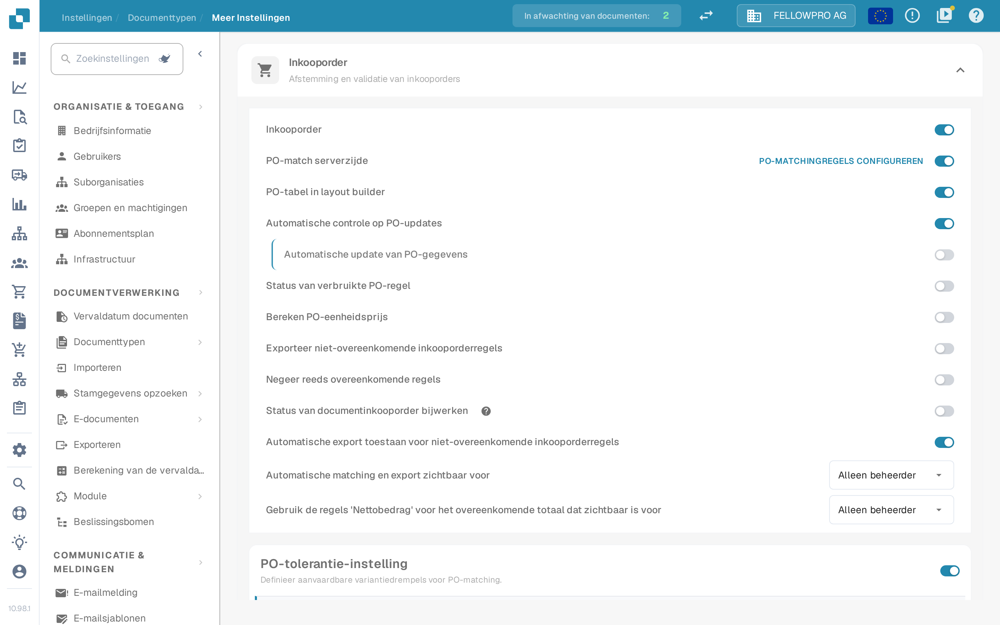

# Inkooporder

## Overzicht

Deze instelling maakt de [**Inkooporder Matching**](../../../../../../end-user-and-partner-section/end-user-section/purchase-order-matching/) sectie mogelijk, die toegankelijk wordt na documentvalidatie.

<mark style="color:red;">**Opmerking**</mark>: Voor het **Factuur** documenttype moeten de volgende aanvullende vereisten worden voldaan:

* De **Inkooporder** instelling moet zijn ingeschakeld (zoals beschreven op deze pagina)
* De factuur moet van het type **Inkoopfactuur** zijn
* Een **Geëxtraheerde Tabel** moet aanwezig zijn

## Activatiestappen 

1. Ga naar **Instellingen** -> **Globale instellingen** -> **Documenttypen**
2.  Zoek de kaart van het documenttype en open de instellingen met het tandwiel (**Meer instellingen**).
3.  Open de sectie **Inkooporder** en schakel **Inkooporder** in.

<figure><figcaption>
De sectie <strong>Inkooporder</strong> in de geavanceerde instellingen. De eerste schakelaar activeert de inkooporderafstemming voor het documenttype, de schakelaars daaronder verfijnen die.
</figcaption></figure>

## **Functionaliteit**

Zodra geactiveerd, wordt de [**Inkooporder Matching**](../../../../../../end-user-and-partner-section/end-user-section/purchase-order-matching/) sectie beschikbaar na documentvalidatie.

### Welke hoeveelheid wordt vergeleken

Welke hoeveelheid van de inkooporder de afstemming vergelijkt, hangt af van **PO-match serverzijde**:

* **PO-match serverzijde uit** – naast de schakelaar **Inkooporder** staat dan een keuzelijst met **Hoeveelheid**, **Ontvangen hoeveelheid** en **Ontvangen levering Open hoeveelheid**. DocBits vergelijkt de gekozen hoeveelheid met de eigen afstemming.
* **PO-match serverzijde aan** – de afstemming gebruikt de regels van het documenttype en de hoeveelheid hoort bij die regels. De link **PO-matchingregels configureren** rechts in de regel opent de regels.


De afbeelding is gemaakt met **PO-match serverzijde** aan; de keuzelijst voor de hoeveelheid staat daarom niet op dat scherm - die wordt in de matchingregels ingesteld.

