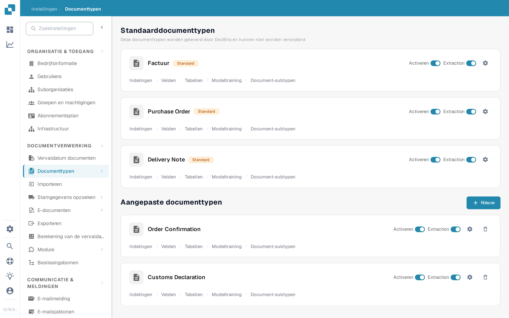
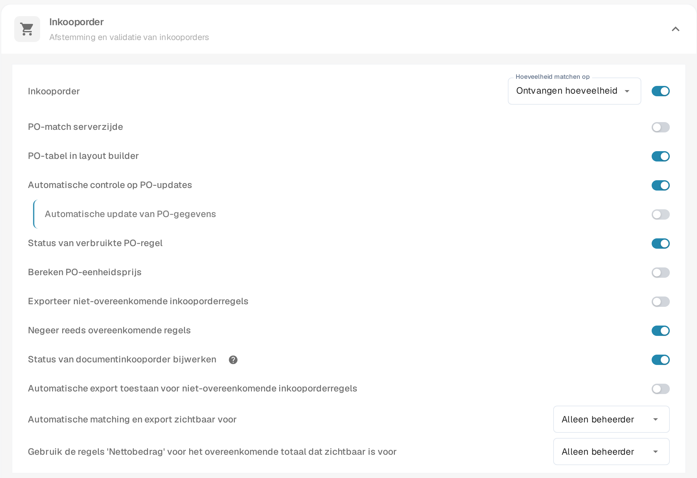
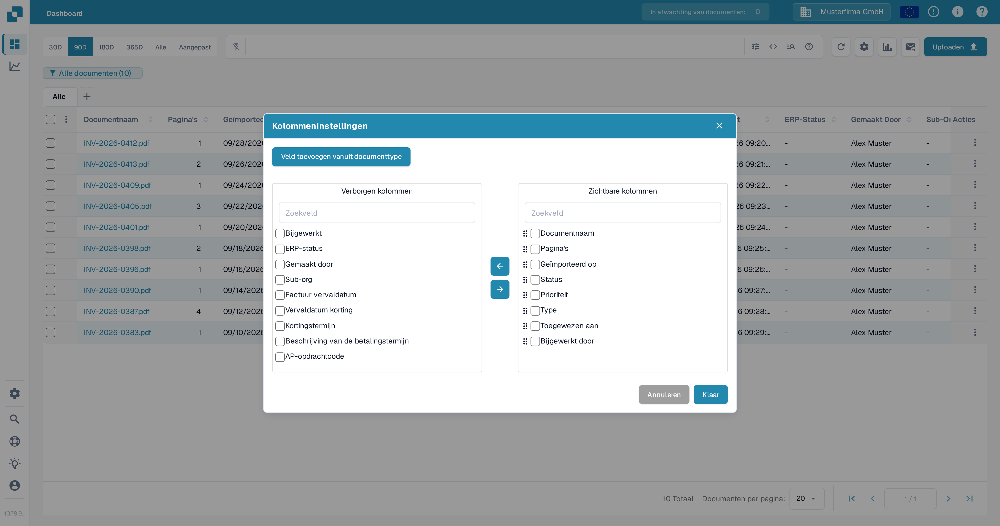
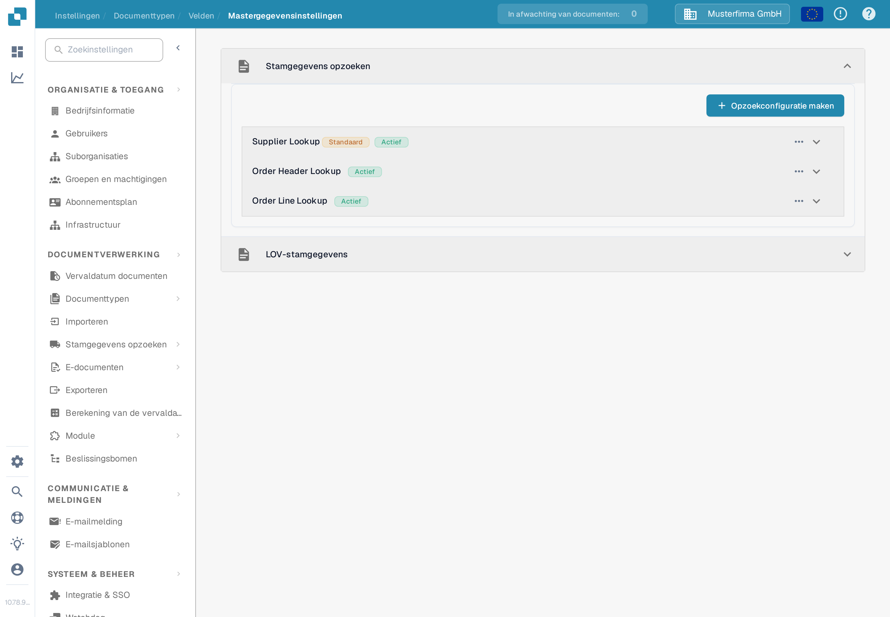

# Status van documentinkooporder bijwerken

Deze instelling is voor documenttypen die inkooporders gebruiken. Hij bepaalt of een document statusupdates van zijn gekoppelde inkooporder kan ontvangen. De schakelaar wordt per documenttype ingesteld. Om een PO-status op het dashboard te zien, moet het betreffende veld ook beschikbaar zijn en als kolom zichtbaar zijn.

Voordat u de instelling wijzigt, kiest u de juiste organisatie en het juiste documenttype. U heeft beheerderstoegang nodig om documenttype-instellingen te bewerken. Een inkooporder moet aan een document zijn gekoppeld voordat een statuswijziging kan worden gecontroleerd.

## De instelling inschakelen

1. Open **Instellingen → Documenttypen**.
2. Zoek het documenttype dat wordt gebruikt voor de aan de PO gekoppelde documenten, zoals **Factuur**, en selecteer het tandwiel op de kaart om **Meer Instellingen** te openen.
3. Vouw **Inkooporder** uit. Zoek **Status van documentinkooporder bijwerken** en zet deze aan. Het help-pictogram ernaast legt de optie in de applicatie uit. Het wijzigen van deze schakelaar verandert de andere PO-instellingen in dezelfde sectie niet.

<figure><figcaption>Open de instellingen van het documenttype dat u gebruikt.</figcaption></figure>

<figure><figcaption>De schakelaar voor statusupdates in de Inkooporder-instellingen.</figcaption></figure>

## Een PO-status op het dashboard tonen

1. Ga terug naar het dashboard en selecteer het tandwiel boven de documenttabel.
2. Open **Kolommeninstellingen** in het menu Geavanceerde instellingen.
3. Selecteer **Veld toevoegen vanuit documenttype**, kies het documenttype en zoek naar **PO Status**. Als dat veld beschikbaar is, selecteert u het, voegt het met de pijlknop aan **Zichtbare kolommen** toe en sluit het venster.

Het kolomvenster bevat **Verborgen kolommen** en **Zichtbare kolommen**. Gebruik de pijlen om een geselecteerde kolom ertussen te verplaatsen. Zie [Documentkolommen wijzigen](../../../../../../end-user-and-partner-section/end-user-section/dashboard/change-document-columns.md) voor de volledige kolomgids. Als **PO Status** ontbreekt voor het geselecteerde type, vraag dan een beheerder om het veld en de lookup-configuratie te controleren; de weergaveschakelaar alleen maakt een ontbrekend veld niet aan.

<figure><figcaption>Kies welke kolommen op het dashboard verschijnen.</figcaption></figure>

## De inkooporder-lookup controleren

In **Instellingen → Documenttypen → Velden → Mastergegevensinstellingen** vouwt u **Stamgegevens opzoeken** en vervolgens **Order Header Lookup** uit. Controleer of de vereiste PO-veldtoewijzing bestaat en of de betreffende lookup **Automatische Trigger** heeft wanneer een automatische lookup nodig is. De onderstaande schermafbeelding toont de configuratielijst; de rode kruisen betekenen dat Automatische Trigger voor die voorbeeldrijen is uitgeschakeld. Hij toont geen bijgewerkte PO-status.

<figure><figcaption>Controleer de werkelijke lookup-rijen voor het documenttype.</figcaption></figure>

Voor hulp bij het instellen van een lookup, zie [Fuzzy Data Configuration with Master Data](../../../../../setup/document-types/fuzzy-data-configuration-with-master-data.md).

## Controleren met een bekend document

Gebruik een document dat al aan een testinkooporder is gekoppeld. Wijzig de status van die inkooporder via uw normale proces, ververs het dashboard en controleer het document en het zichtbare PO-statusveld. Als de status niet wordt bijgewerkt, controleer dan de PO-koppeling van het document, de lookup-configuratie en of het betreffende veld aan het dashboard is toegevoegd. Leid een geslaagde update niet alleen af van de schakelaar.

## Gevonden app-vertalingen

Deze termen verschijnen onvertaald of inconsistent in de Nederlandse interface (versie 10.78.9.5); ze worden citaat-voor-citaat vermeld en gemeld, niet in de documentatie gecorrigeerd:

1. Op de pagina Documenttypen blijven de typenamen **Purchase Order**, **Delivery Note**, **Order Confirmation**, **Customs Declaration** en **Freight Letter**, evenals de kolomkop **Extraction**, in het Engels.
2. In de Inkooporder-instellingen heet de schakelaar **Status van documentinkooporder bijwerken**; de oude documentatiepagina gebruikte bovendien een andere, niet-bestaande menustructuur (**Algemene Instellingen**).
3. In Stamgegevens opzoeken luidt het labelsuffix van de standaardlookup **StandaardActief** (zonder spatie); de oude documentatie noemde **Auto Trigger** zonder dat dit label in de NL-interface voorkomt.
4. In Stamgegevens opzoeken blijven de lookup-namen **Supplier Lookup**, **Order Header Lookup** en **Order Line Lookup**, de tabelkop **Actions** en de waarde **No Match** onvertaald, en de standaardwaarde wordt als **StandaardActief** weergegeven.
