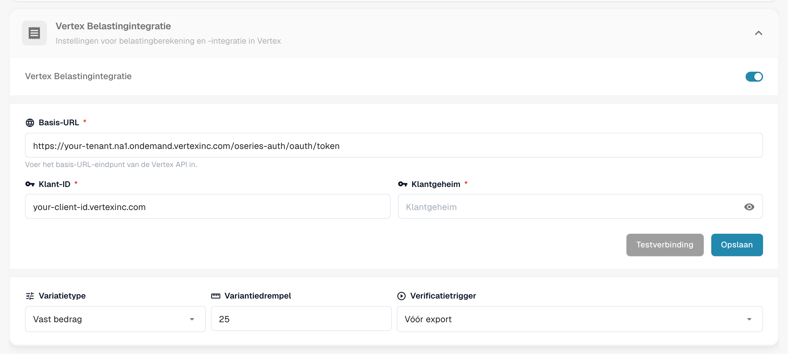
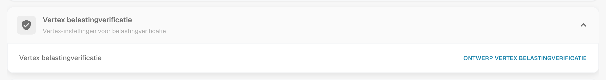
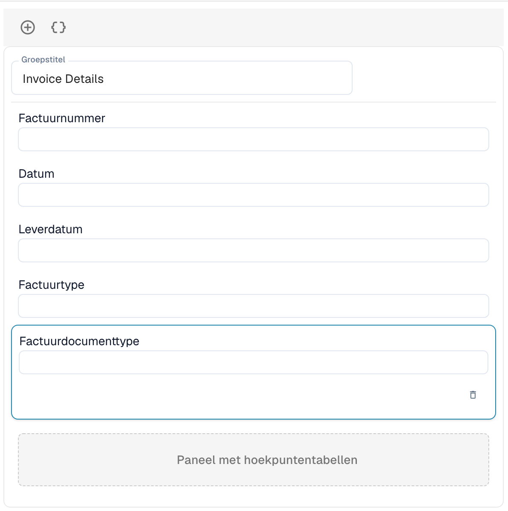

# Vertex belastingverificatie

De Vertex belastingverificatie vergelijkt de belasting die een leverancier op een factuur in rekening heeft gebracht met de belasting die Vertex voor dezelfde regels berekent. DocBits vraagt Vertex om de berekening, toont beide bedragen aan de gebruiker en stopt het document wanneer de belasting van de verkoper te hoog is.

## Hoe het werkt

1. Het document bereikt het triggerpunt. Je kiest het in de module-instellingen: **Vóór export** (standaard) of **Voor goedkeuring**.
2. DocBits stuurt de factuurregels naar Vertex en ontvangt de berekende belasting.
3. DocBits schrijft het resultaat terug naar het document: het **Vertex belastingbedrag** en het **Vertex-belastingtarief** per regel, en de totalen in de kop **Verkopersbelasting** (de belasting die op de factuur in rekening is gebracht), **Vertex-belasting**, het subtotaal en de **Variantie**.
4. DocBits vergelijkt de belasting van de verkoper met de Vertex-belasting:

| Situatie | Resultaat |
| -------- | --------- |
| De belasting van de verkoper is hoger dan de Vertex-belasting met **meer dan de variantiedrempel** | Het document wordt afgewezen. De status wordt **Vertex-belasting afgewezen**. |
| De belasting van de verkoper is hoger, maar **binnen de drempel** | Het document wordt geaccepteerd. |
| De belasting van de verkoper is gelijk aan de Vertex-belasting | Het document wordt geaccepteerd. |
| De belasting van de verkoper is **lager** dan de Vertex-belasting | Het document wordt geaccepteerd en het ontbrekende bedrag wordt toegerekend. |

Het resultaatbericht noemt de bedragen, bijvoorbeeld: *Rejected: vendor tax $380.00 exceeds Vertex calculated tax $140.00 by $240.00 (171.4%), above configured threshold of $25.00.*

Gebruikers openen het resultaat via het Vertex-pictogram in de dashboardrij van het document. Het scherm **Vertex belastingverificatie** toont een banner (**Verificatie mislukt** met het bericht, of **Verificatie succesvol**), de velden van de lay-out die je hebt ontworpen en de Vertex-tabellen met de belasting per regel.


De verificatie wordt alleen uitgevoerd voor documenttypen die een exportconfiguratie van het type **Vertex** hebben. Zonder deze configuratie gaat het document verder zonder verificatie.


## De integratie instellen

Open **Instellingen** → **Module** → **Bestellen & Financiering** en ga naar de kaart **Vertex Belastingintegratie**. De pagina bevat ook de instellingen voor PO-matching en automatische boekhouding.

<figure><figcaption>
De kaart Vertex Belastingintegratie. Tenant- en clientwaarden zijn in deze schermafbeelding vervangen door tijdelijke aanduidingen.
</figcaption></figure>

1. Schakel **Vertex Belastingintegratie** in. De functie vereist het Vertex-belastingabonnement.
2. Voer de **Basis-URL** van je Vertex-tokenendpoint, je **Klant-ID** en je **Klantgeheim** in.
3. Klik op **Testverbinding** en daarna op **Opslaan**.
4. Stel de tolerantie en de trigger in:
   * **Variatietype:** **Vast bedrag** of **Percentage**.
   * **Variantiedrempel:** De afwijking die nog wordt geaccepteerd. De standaard is een vast bedrag van 25. In de percentagemodus voer je de waarde in als decimaal getal, bijvoorbeeld 0,05 voor 5 %.
   * **Verificatietrigger:** **Vóór export** of **Voor goedkeuring**. Bij **Voor goedkeuring** wordt de controle uitgevoerd terwijl het document wordt verwerkt, voordat het naar goedkeuring gaat. Als de controle zelf mislukt, krijgt het document de status **Exportfout**.

Voeg daarna een exportconfiguratie van het type **Vertex** toe voor het documenttype (**Instellingen** → **Exporteren**). Deze gebruikt een TOML-mappingbestand.

## Het verificatieformulier ontwerpen

De velden die gebruikers op het verificatiescherm zien, worden per documenttype ontworpen.

1. Open **Instellingen** → **Globale instellingen** → **Documenttypen**, selecteer het documenttype en klik op **Meer instellingen**.
2. Open de kaart **Vertex belastingverificatie** en klik op **Ontwerp Vertex Belastingverificatie**.

<figure><figcaption>
De kaart Vertex belastingverificatie.
</figcaption></figure>

De Lay-outbouwer opent met het lay-outtype **Vertex belastingverificatie**. Sleep groepen en velden naar het formulier, bijvoorbeeld **Factuurgegevens** met factuurnummer, datum en leveringsdatum. Het **Paneel met hoekpuntentabellen** toont de belastingvergelijking en de factuurregels met de Vertex-belasting per regel. Het maakt deel uit van de lay-out.

<figure><figcaption>
Een lay-out voor Vertex belastingverificatie met de groep Factuurgegevens en het Paneel met hoekpuntentabellen.
</figcaption></figure>

Voor hoe de Lay-outbouwer werkt zie de [Layout Manager](../layout-manager/README.md).
