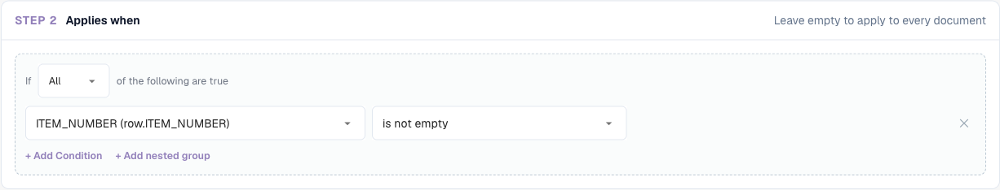

# Regelvoorwaarden (Applies when)

## Overzicht

Elke regel in de regelfuncties van DocBits heeft een sectie **Applies when**. Die bepaalt **voor welke documenten (en, bij tabelregels, voor welke rijen) de regel überhaupt iets doet**. De eigenlijke taak van de regel — een validatiefout tonen, een waarde wijzigen, een lay-out kiezen — gebeurt alleen als de voorwaarde waar is.

Dezelfde voorwaardenbouwer wordt gebruikt in alle drie de regelfuncties:

| Functie | Label in de bouwer | Als de voorwaarde waar is… | Als de voorwaarde onwaar is… | Als de voorwaarde leeg is gelaten… |
| --- | --- | --- | --- | --- |
| [Aangepaste validatieregels](custom-validation-rules.md) | Stap 2 **Applies when** | wordt de controle uit stap 3 uitgevoerd | wordt de regel overgeslagen — geen fout, geen waarschuwing | wordt de controle op elk document uitgevoerd |
| [Transformatieregels](transformation-rules.md) | Stap 2 **When it runs** → **Only when…** | wijzigt de pipeline de waarde | blijft de waarde ongewijzigd | kies **Always**: de regel wordt op elk document uitgevoerd |
| [Lay-outselectieregels](layout-manager/layout-selection-rules.md) | Stap 2 **Applies when** | krijgt het document de lay-out van deze regel (de eerste overeenkomst wint) | probeert DocBits de volgende regel | komt de regel overeen met elk document op zijn prioriteit |

Leer het hier één keer en u kunt het overal gebruiken.


Een voorwaarde bepaalt alleen **of** een regel van toepassing is. Ze wijzigt nooit gegevens en toont zelf nooit een melding. "De btw-identificatie van de leverancier moet zijn ingevuld" is de **controle** van een validatieregel; "alleen voor Duitse facturen" is de **voorwaarde** ervan.


## Een voorwaarde lezen

Een voorwaarde leest als een zin. De onderstaande bouwer zegt:

> **Als ALL** van het volgende waar is: de Document Origin **is** Deutsch, het Total Amount is **greater than** 250, en (**ANY** van: de Currency **is** EUR, de Currency **is empty**).

<figure><figcaption>
Twee voorwaarden gecombineerd met ALL, plus een geneste groep gecombineerd met ANY
</figcaption></figure>

Met die voorwaarde is de regel van toepassing op:

| Document | Herkomst | Totaalbedrag | Valuta | Van toepassing? | Waarom |
| --- | --- | --- | --- | --- | --- |
| A | DE | 469.18 | EUR | **ja** | alle drie de delen zijn waar |
| B | DE | 469.18 | *(leeg)* | **ja** | de ANY-groep is waar omdat de valuta leeg is |
| C | DE | 120.00 | EUR | nee | 120 is niet groter dan 250 |
| D | DE | 469.18 | USD | nee | geen van beide regels van de ANY-groep is waar |
| E | AT | 469.18 | EUR | nee | de herkomst is niet DE |

## De bouwstenen

### Voorwaarderegels

Elke regel heeft vier delen:

| Onderdeel | Wat het is |
| --- | --- |
| **Field** | De waarde die wordt gecontroleerd: een documentattribuut, een headerveld, een tabelkolom of een JSON-pad. Zie [Velden die u kunt gebruiken](#velden-die-u-kunt-gebruiken). |
| **Operator** | Hoe de waarde wordt vergeleken — *is*, *contains*, *greater than*, *is empty* … Zie [Operatoren](#operatoren). |
| **Value** | Waarmee het veld wordt vergeleken. Verborgen bij *is empty* / *is not empty*. Bij velden met een vaste waardelijst (herkomst, status, valuta…) kiest u de waarde uit een keuzelijst. |
| **Aa** | Hoofdletters en kleine letters negeren. Alleen beschikbaar voor tekstvergelijkingen. Als deze optie aan staat, komt `gmbh` overeen met `GmbH`. |

Klik op **✕** om een regel te verwijderen.

### ALL en ANY

De keuzelijst aan het begin van een groep bepaalt hoe de regels worden gecombineerd:

* **All** of the following are true — elke regel moet waar zijn (AND).
* **ANY** of the following are true — minstens één regel moet waar zijn (OR).

### Geneste groepen

Klik op **+ Add nested group** om een groep in een groep te plaatsen. Een geneste groep telt als één regel van de bovenliggende groep, zodat u AND en OR kunt combineren:

* *ALL of*: herkomst is DE, **ANY of** (valuta is EUR, valuta is leeg)
* *ANY of*: leverancier is 10040, **ALL of** (leverancier is 20723, totaalbedrag groter dan 1000)

Groepen kunnen zo diep worden genest als nodig. Houd het leesbaar: twee niveaus volstaan voor vrijwel elke bedrijfsregel.

### Een lege voorwaarde

Als u geen regels toevoegt, heeft de regel geen voorwaarde en is hij **altijd van toepassing** (bij lay-outregels: hij komt overeen met elk document op zijn prioriteit). Dit is de juiste keuze voor regels die overal moeten draaien, zoals "factuurnummer trimmen" of "hoeveelheid moet positief zijn".

## Velden die u kunt gebruiken

Open de keuzelijst met velden om elk veld te zien, gegroepeerd naar herkomst. Typ om de lijst te filteren.

<figure><figcaption>
De veldkiezer: eerst de documentattributen, daarna de headervelden van het documenttype
</figcaption></figure>

### Documentattributen (`doc.`)

Informatie die DocBits over het document zelf kent, los van de geëxtraheerde velden:

| Veld in de kiezer | Sleutel | Voorbeeldwaarden | Typisch gebruik |
| --- | --- | --- | --- |
| **Document Origin** | `doc.doc_origin` | `DE`, `AT`, `US` (getoond als Deutsch, Austria, United States) | landspecifieke regels en lay-outs |
| **Extraction Method** | `doc.extraction_method` | `ELECTRONIC_DOCUMENT`, `FELLOW_KV2`, `MANUAL` | e-facturen (XRechnung, ZUGFeRD) anders behandelen dan gescande pdf's |
| **Document Status** | `doc.status` | Ready for validation, Pending Approval, Pending second approval … | lay-outs per workflowfase, regels die alleen vóór de goedkeuring gelden |
| **Sub Document Type** | `doc.sub_doc_type` | uw subtypen, bijv. creditnota | regels voor slechts één subtype |

### Headervelden (`header.`)

Elk veld van het documenttype, bijvoorbeeld **Invoice Number** (`header.invoice_id`), **Supplier ID** (`header.supplier_id`), **Total Amount** (`header.total_amount`), **Currency** (`header.currency`), **Supplier Tax ID** (`header.supplier_tax_id`), **Purchase Order** (`header.purchase_order`). De kiezer toont het label en, tussen haakjes, de technische sleutel. De gebruikte waarde is de huidige waarde van het veld — inclusief correcties die een gebruiker heeft aangebracht.

### Tabelkolommen (`row.`)

Kolommen van de huidige tabelrij, bijvoorbeeld `row.QUANTITY` of `row.ITEM_NUMBER`. Ze verschijnen in de kiezer als **Table columns** en alleen in regels die **eenmaal per rij** draaien:

* validatieregels met het niveau **Table line**
* transformatieregels met de scope **Table column**

In deze regels wordt de voorwaarde **voor elke rij afzonderlijk** gecontroleerd. Een rij die niet overeenkomt, wordt overgeslagen; de andere rijen worden nog steeds verwerkt.

<figure><figcaption>
Een voorwaarde per rij: alleen rijen met een artikelnummer worden gecontroleerd
</figcaption></figure>

Regels die eenmaal per document draaien (headerregels, regels voor hele tabellen, lay-outregels) kunnen geen `row.`-velden gebruiken — er is geen enkele rij waarnaar ze zouden kunnen kijken.

### Aangepast JSON-pad (Advanced)

Onderaan de kiezer verandert **Advanced → Custom JSON path…** het veld in een vrij tekstvak met de markering `$path`. Hiermee leest u een waarde overal in de geëxtraheerde gegevens van het document, ook als het geen veld van het documenttype is.

<figure><figcaption>
Een JSON-padvoorwaarde op het importkanaal van het document
</figcaption></figure>

* Het pad begint met `$` en gebruikt `.naam` voor sleutels en `[0]` voor posities in een lijst, bijvoorbeeld `$.metadata.import_channel` of `$.shipping.addresses[0].country`.
* Het moet eindigen op één enkele waarde. Een pad dat eindigt op een lijst of een object telt als leeg.
* JSON-padregels bieden de operatoren *is*, *is not*, *matches*, *is empty* en *is not empty*.

Gebruik JSON-paden spaarzaam. Ze hangen af van de interne structuur van de geëxtraheerde gegevens; een veld van het documenttype is eenvoudiger te begrijpen en te onderhouden.

### Waar elk soort veld kan worden gebruikt

| | Validatie: headerveld | Validatie: tabelregel | Validatie: hele tabel | Transformatie: header / routering / tabelrijen | Transformatie: tabelkolom | Lay-outselectie |
| --- | --- | --- | --- | --- | --- | --- |
| `doc.` documentattributen | ✓ | ✓ | ✓ | ✓ | ✓ | ✓ |
| `header.` headervelden | ✓ | ✓ | ✓ | ✓ | ✓ | ✓ |
| `row.` tabelkolommen | – | ✓ | – | – | ✓ | – |
| `$` JSON-pad | ✓ | ✓ | ✓ | ✓ | ✓ | ✓ |

## Operatoren

<figure><figcaption>
De operatoren die voor een tekstveld worden aangeboden
</figcaption></figure>

| Operator | Waar wanneer… | Waarde | Voorbeeld |
| --- | --- | --- | --- |
| **is** | het veld gelijk is aan de waarde | één waarde | Supplier ID **is** `20723` |
| **is not** | het veld niet gelijk is aan de waarde | één waarde | Currency **is not** `EUR` |
| **is one of** | het veld gelijk is aan een waarde uit een lijst | waarden gescheiden door komma's | Supplier ID **is one of** `10040, 10041, 20723` |
| **contains** | de waarde ergens in het veld voorkomt | tekst | Supplier Name **contains** `GmbH` |
| **starts with** | het veld begint met de waarde | tekst | Invoice Number **starts with** `GS-` |
| **ends with** | het veld eindigt op de waarde | tekst | Purchase Order **ends with** `-IT` |
| **matches** | een reguliere expressie een overeenkomst in het veld vindt | reguliere expressie | Invoice Number **matches** `^INV-\d{6}$` |
| **is empty** | het veld geen waarde heeft (ontbreekt, of alleen spaties) | – | Purchase Order **is empty** |
| **is not empty** | het veld een waarde heeft | – | Purchase Order **is not empty** |
| **greater than** / **less than** | het veld een getal is boven / onder de waarde | getal | Total Amount **greater than** `10000` |
| **greater or equal** / **less or equal** | hetzelfde, inclusief de waarde zelf | getal | Total Amount **less or equal** `250` |

### Welke operatoren een veld aanbiedt

De lijst past zich aan het type van het veld aan:

| Veldtype | Operatoren |
| --- | --- |
| Tekst | alle operatoren |
| Getal en bedrag (Total Amount, Quantity …) | is, is not, greater than, less than, greater or equal, less or equal, is empty, is not empty |
| Velden met een vaste lijst (Document Origin, Status, Currency …) | is, is not, is one of, is empty, is not empty |
| Datum (Invoice Date, Due Date …) | is, is not, is empty, is not empty |
| Ja/Nee | is, is not, is empty, is not empty |
| Aangepast JSON-pad | is, is not, matches, is empty, is not empty |


**Datums kunnen in een voorwaarde niet worden vergeleken met *before* of *after*.** "Vervaldatum na factuurdatum" of "factuurdatum ouder dan 90 dagen" hoort in de **controle** van een validatieregel (**Compare fields**), niet in *Applies when*.


## Hoe waarden worden vergeleken

Wie deze regels kent, voorkomt de meeste verrassingen:

1. **Getallen worden als getallen vergeleken.** Als beide zijden op getallen lijken, zijn `250`, `250.00` en `250,00` gelijk. Bedragen in lokale notatie zoals `1.234,56` worden begrepen.
2. **Al het andere wordt als tekst vergeleken, na verwijdering van voorloop- en volgspaties.** `" EUR "` is `EUR`.
3. **Hoofdletters en kleine letters tellen mee**, tenzij **Aa** (hoofdlettergevoeligheid negeren) aan staat.
4. **Leeg is bijzonder.** Een veld dat ontbreekt of leeg is:
   * is waar voor **is empty** en **is not**,
   * is onwaar voor **is**, **is one of**, **contains**, **starts with**, **ends with**, **matches** en alle getalsvergelijkingen.


Vanwege regel 4 is *Currency **is not** EUR* ook waar voor documenten **zonder** valuta. Wilt u dat niet, voeg dan een tweede regel toe: *Currency **is not empty***.



Vanwege regel 1 worden waarden die op getallen lijken numeriek vergeleken, ook als het codes zijn: `007` **is** `7` is waar. Gebruik voor codes waarbij voorloopnullen ertoe doen **matches** met een patroon zoals `^007$`.


## Voorbeelden

**Alleen Duitse documenten** — `Document Origin` **is** `Deutsch`.

**Alleen e-facturen** — `Extraction Method` **is** `ELECTRONIC_DOCUMENT`. Gebruik **is not** om ze uit te sluiten, bijvoorbeeld voor een regel die OCR-fouten herstelt.

**Een groep leveranciers** — `Supplier ID` **is one of** `10040, 10041, 20723`.


Bij velden waarvan de waarde uit een keuzelijst wordt gekozen (herkomst, status, valuta) laat **is one of** u slechts één item kiezen. Om er meerdere te accepteren, maakt u een **ANY**-groep met één **is**-regel per waarde.


**Facturen met hoge waarde van één leverancier** — **All of**: `Supplier ID` **is** `20723`, `Total Amount` **greater than** `10000`.

**Facturen zonder inkooporder** — `Purchase Order` **is empty**. Een typische voorwaarde voor een regel "kostenplaats verplicht".

**Alles behalve creditnota's** — `Invoice Type` **is not** `credit_note` (gebruik de waarden die uw organisatie in het veld opslaat).

**Facturen die per e-mail binnenkwamen** — Aangepast JSON-pad `$.metadata.import_channel` **is** `EMAIL`.

**Alleen artikelregels** (regels voor tabelregels / tabelkolommen) — `row.ITEM_NUMBER` **is not empty**. Vracht- of kortingsregels zonder artikelnummer worden overgeslagen.

**Tweede goedkeuringsfase** (lay-outregels op het Approval-scherm) — `Document Status` **is** `Pending second approval`.

**EUR of ontbrekende valuta** — **All of**: `Document Origin` **is** `Deutsch`, **ANY of** (`Currency` **is** `EUR`, `Currency` **is empty**). Dit is de voorwaarde die bovenaan deze pagina wordt getoond.

## Een voorwaarde testen en debuggen

Elke functie laat u een voorwaarde uitproberen voordat u erop vertrouwt:

* **Validatieregels** — **Test rule** voert de regel uit op een echt document. "*Rule skipped — scope not matched*" betekent dat de voorwaarde voor dat document onwaar was. Zie [Regel testen](custom-validation-rules.md#regel-testen).
* **Transformatieregels** — de **Live preview** heeft **Condition values**: typ een waarde voor elk veld van de voorwaarde en zie "*Conditions match — rule runs*" of "*Conditions do not match — rule is skipped*".
* **Lay-outselectieregels** — het paneel **Live preview · /resolve** toont welke regel overeenkwam voor een voorbeelddocument.

### Het voorwaardespoor in de logboeken lezen

Schakel **Log execution** in bij een regel. Elke evaluatie wordt dan weggeschreven naar **Document Types → (documenttype) → Logs**. Open een item: onder **Log details** wordt elke voorwaarderegel getoond met de waarde die de regel verwachtte, de waarde die het document daadwerkelijk had en of de regel slaagde.

<figure><figcaption>
Het logitem verklaart waarom de regel werd overgeslagen: de regel verwachtte <code>abcd</code>, het document had <code>911892112</code>
</figcaption></figure>

De logboeken kunnen worden doorzocht op **Rule key**, **Rule ID** of **Document**, en worden gefilterd op regeltype, uitkomst en datum. Schakel **Log execution** weer uit als u klaar bent — het schrijft één item per evaluatie, en regels draaien bij elke opslag.

## Veelgemaakte fouten

| Symptoom | Oorzaak | Oplossing |
| --- | --- | --- |
| De regel is nooit van toepassing | De waarde verschilt in hoofdletters of spelling (`Gmbh` vs `GmbH`) | Schakel **Aa** in, of kopieer de waarde exact uit het document |
| De regel is van toepassing op documenten zonder het veld | **is not** is waar voor lege velden | Voeg *veld* **is not empty** toe |
| *greater than* komt nooit overeen | Het veld is geen getal, of het is een datum | Gebruik een getalveld; vergelijk datums in een validatiecontrole |
| De regel is van toepassing op te veel documenten | Regels zijn gecombineerd met **ANY** in plaats van **All** | Controleer de keuzelijst van elke groep |
| Tabelkolommen ontbreken in de kiezer | De regel draait eenmaal per document | Gebruik het niveau **Table line** (validatie) of de scope **Table column** (transformatie) |
| De voorwaarde werkte in de voorvertoning maar niet op het document | De voorvertoning gebruikte waarden die u had getypt | Test met **Test rule** op een echt document, of controleer het logspoor |
