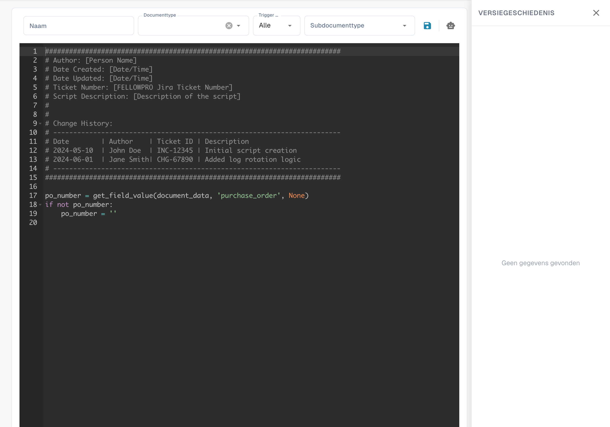

# Scripts maken en bewerken


DocBits-scripthandleiding: workflows automatiseren met Python-code


## Een nieuw script aanmaken in DocBits

**De scripttaal kiezen:**

Kies een taal die de editor en runtime van uw DocBits-installatie daadwerkelijk aanbieden. In de scriptlijst kunnen onder meer Python en JavaScript worden aangeduid; de beschikbare mogelijkheden hangen af van de implementatie. Ga niet zonder controle uit van SQL-ondersteuning.

**De scriptontwikkelomgeving openen:**

Meld u aan bij DocBits en open de scriptontwikkelomgeving in het beheergedeelte.

<figure><figcaption><p>Scriptlijst met verborgen namen, datums en organisatiegegevens.</p></figcaption></figure>

**Een nieuw script aanmaken:**

Klik op de knop "+ New" om een nieuwe scripteditor te openen.

<figure><figcaption><p>Editor voor een nieuw script met het meegeleverde startsjabloon; dit staat los van het zelfstandige Python-voorbeeld hieronder.</p></figcaption></figure>

**De code schrijven:**

Schrijf de code voor uw script in de editor. Begin met de basissyntaxis van de gekozen scripttaal.

Als u Python gebruikt, kan uw script er bijvoorbeeld als volgt uitzien:

## 1. Voorbeeldscript in Python


## Functie om patiëntnamen op te schonen

Dit zelfstandige Python-voorbeeld demonstreert alleen de syntaxis. Het is geen geverifieerde DocBits-lifecyclehook en moet voor de juiste scriptcontext worden aangepast.

```python
def clean_patient_name(name):
    cleaned_name = name.strip().title()
    return cleaned_name

if __name__ == "__main__":
    patient_name = " john doe "
    cleaned_name = clean_patient_name(patient_name)
    print("Cleaned patient name:", cleaned_name)
```

## 2. Voorbeeldscript


**Het script testen:**

Controleer de code op fouten en test deze in een testomgeving. Ga na of het script de verwachte resultaten oplevert en correct werkt.


**Het script opslaan:**

Sla het script op in DocBits en geef het een betekenisvolle naam die het doel beschrijft.


**Het script aan documenttypen koppelen:**

Koppel het script aan de juiste documenttypen om te bepalen wanneer en hoe het wordt toegepast. Dit gebeurt doorgaans via een configuratiescherm in DocBits, waar u het script aan een documenttype toewijst en de toepassingsvoorwaarden opgeeft.


**Controleren en publiceren:**

Controleer het script na het aanmaken, testen en koppelen nogmaals op fouten en inconsistenties. Als alles klopt, kunt u het publiceren naar de productieomgeving van DocBits.


Met deze stappen kunt u een script in DocBits aanmaken, testen en implementeren om processen te automatiseren en medische documentatie efficiënter te verwerken.
