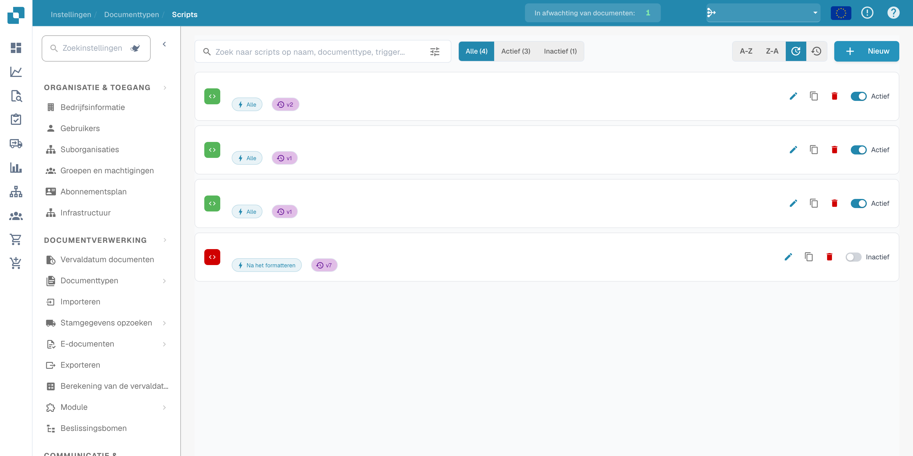

# Doel en gebruik

Scripts kunnen processen automatiseren in bedrijven van elke omvang en in vrijwel elke sector. Ze kunnen de efficiëntie verhogen en bijdragen aan nauwkeurige en consistente gegevens, zodat organisaties beter onderbouwde beslissingen kunnen nemen.

<figure><figcaption>
Scriptlijst met afgeschermde namen en datums.
</figcaption></figure>

**Belangrijke toepassingen van scripts voor procesautomatisering en nauwkeurige gegevens:**

**Gegevens opschonen:**

* Bedrijven verzamelen vaak grote hoeveelheden gegevens uit verschillende bronnen.
* Deze gegevens zijn regelmatig onvolledig, inconsistent of onjuist.
* Met scripts kunt u gegevens automatisch opschonen, ontbrekende waarden aanvullen, duplicaten verwijderen en fouten corrigeren.
* Dit verbetert de gegevenskwaliteit en maakt de gegevens eenvoudiger te analyseren en gebruiken.

**Bedrijfsregels toepassen:**

* Bedrijven hebben vaak specifieke regels die op de verwerkte gegevens moeten worden toegepast.
* Scripts kunnen deze regels uitvoeren en gegevens volgens de bedrijfsnormen verwerken.
* Dit kan variëren van invoervalidatie tot het toepassen van nalevingsregels.

**Gegevens met andere systemen integreren:**

* Gegevens uit verschillende bronnen moeten vaak in andere systemen worden opgenomen om informatie soepel door de organisatie te laten stromen.
* Scripts kunnen deze integratie automatiseren door gegevens uit een bron te halen, te transformeren en naar het doelsysteem te laden.
* Denk bijvoorbeeld aan verkoopgegevens in een CRM-systeem of klantfeedback in een analysetool.

**Terugkerende taken automatiseren:**

* Veel bedrijfstaken zijn routinematig en keren steeds terug.
* Scripts kunnen deze taken automatiseren en zo tijd en middelen besparen. Voorbeelden zijn rapporten genereren, databases bijwerken en periodiek onderhoud uitvoeren.

Scripts spelen een belangrijke rol bij procesautomatisering en nauwkeurige gegevens. Door terugkerende taken te automatiseren en bedrijfsregels consequent toe te passen, verhogen ze de efficiëntie, verminderen ze fouten en ondersteunen ze beslissingen op basis van betrouwbare gegevens.
