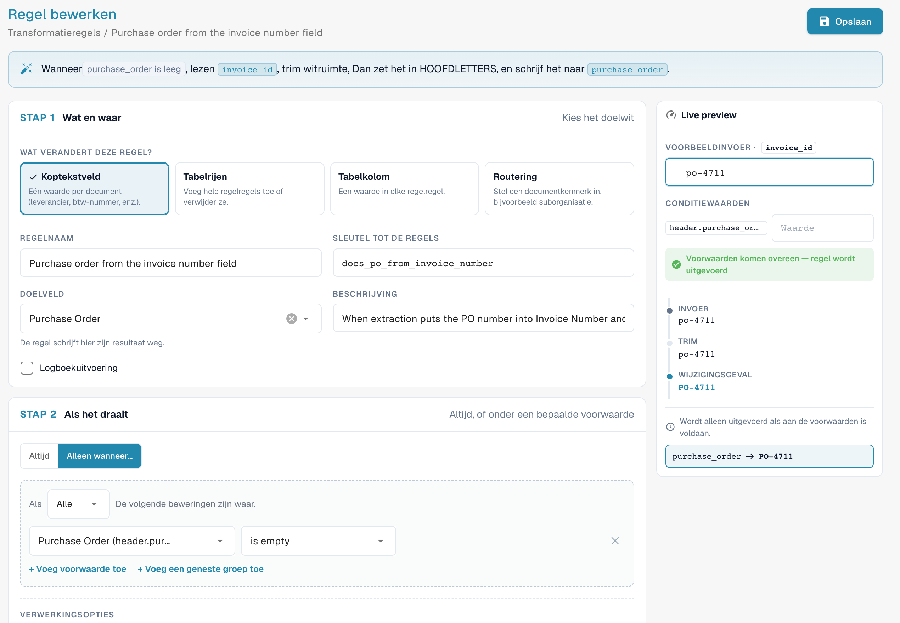
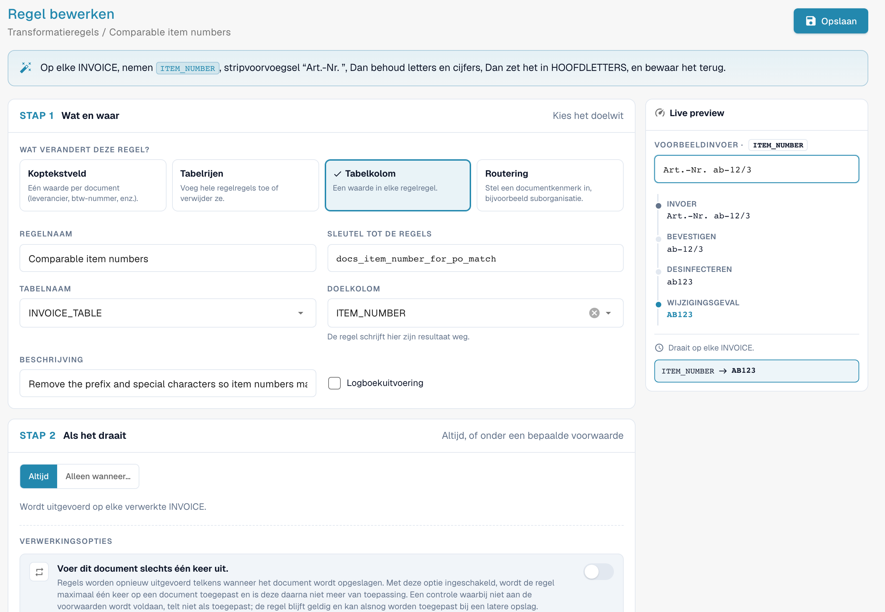

# Transformatieregels

## Overzicht

Transformatieregels maken geëxtraheerde gegevens **automatisch** schoon of herschrijven ze, telkens wanneer een document wordt verwerkt en telkens wanneer het wordt opgeslagen. Een regel kan het volgende wijzigen:

* een **headerveld** (factuurnummer, valuta, btw-nummer van de leverancier …),
* een **kolom** in elke rij van een tabel (eenheid, artikelnummer, prijsbasis …),
* de **rijen** van een tabel (wissen, een rij toevoegen),
* een **attribuut van het document** — momenteel de suborganisatie waartoe het behoort (**Routing**).

Elke regel **leest** een waarde, stuurt die door een korte **pijplijn** van stappen en **schrijft** het resultaat terug. Regels draaien **vóór** validatie, scripts en inkooporder-matching, zodat alles verderop in de keten al de gecorrigeerde waarden ziet.

Transformatieregels vervangen de meeste kleine scripts die organisaties vroeger schreven voor "dit veld altijd trimmen", "de eenheidscodes van deze leverancier mappen", "het voorvoegsel toevoegen dat ons ERP verwacht" of "de regels van deze leverancier samenvoegen tot één totaalregel" — met een formulier, een live voorbeeld en zonder code.

### Problemen die ze oplossen

| Vereiste | Regel |
| --- | --- |
| Een leverancier drukt het factuurnummer af zonder het voorvoegsel `INV-` dat ons ERP verwacht | Headerveld *Invoice Number*, alleen voor die leverancier: Trim → UPPERCASE → Bevestigen: voorvoegsel `INV-` toevoegen |
| Leveranciers sturen Duitse eenheidscodes (`STK`, `Std`), het ERP verwacht UN/ECE-codes (`PCE`, `HUR`) | Tabelkolom *UNIT*: Map values `STK → PCE`, `KG → KGM`, `Std → HUR` |
| Artikelnummers komen met een voorvoegsel zoals `Art.-Nr. 4711` | Tabelkolom *ITEM_NUMBER*: Bevestigen: voorvoegsel `Art.-Nr. ` verwijderen |
| Btw-nummers bevatten spaties en punten | Headerveld *Supplier Tax ID*: Desinfecteren, alfanumeriek behouden |
| Een leverancier wordt gematcht op het totaal, niet op regels | Tabelrijen: Clear all rows → Add a row met het nettobedrag |
| Alle documenten van bepaalde leveranciers horen bij een suborganisatie | Routing: de suborganisatie instellen wanneer *Supplier ID is one of …* |
| Datums moeten in een vast formaat in een vrij tekstveld worden geschreven | Headerveld: Reformat date `%d.%m.%Y` |
| Het PO-nummer staat in het verkeerde veld (bijvoorbeeld in *Invoice Number*) | Headerveld *Purchase Order*: lezen uit *Invoice Number*, alleen wanneer *Purchase Order is empty* |
| Het PO-nummer heeft voorloopnullen of een voorvoegsel die de inkooporder niet heeft | Headerveld *Purchase Order*: Trim `0` links, of Bevestigen: voorvoegsel verwijderen |
| Artikelnummers verschillen van de inkooporderregels in hoofdletters, spaties of voorvoegsels | Tabelkolom *ITEM_NUMBER*: Bevestigen: voorvoegsel verwijderen → Sanitise → UPPERCASE |


Zolang de functie in bèta is, verschijnen de hieronder beschreven instellingen alleen wanneer de instellingenpagina **Document Types** wordt geopend met `?beta=true` achter het adres.


## Transformatieregels inschakelen

Transformatieregels worden **per documenttype** ingeschakeld door een **organisatiebeheerder**.

1. Ga naar **Settings → Global Settings → Document Types**.
2. Klik op het **instellingen**-pictogram (tandwiel) op de kaart van het documenttype.
3. Open **Transformation Rules** en zet de schakelaar aan. Klik op **Manage transformation rules** om de lijst te openen.

<figure><figcaption>
De schakelaar Transformation Rules in de aanvullende instellingen van een documenttype
</figcaption></figure>

De kaart van het documenttype toont nu een link **Transformation Rules** en een link **Logs** voor de uitvoeringslogboeken.

## De regellijst

De lijst toont alle regels van het documenttype in de volgorde waarin ze draaien, elk met een samenvatting in één zin ("When invoice_id is abcd, take invoice_id, make it UPPERCASE, and save it back."), het bereik (**Header**, **Table**, **Column**, **Routing**), het aantal stappen, de bron en of **Logboekuitvoering** (Log execution) aan staat. Filter op bereik en op **Active / Inactive**, zoek, en gebruik het menu **⋮** om een regel te dupliceren of te verwijderen.

Regels komen uit drie bronnen, net als bij validatieregels: **System default**-regels die met DocBits worden meegeleverd (klik op **Customize** voor een bewerkbare kopie), **Customized** systeemregels (**Reset to Default** herstelt het origineel) en **Custom**-regels die u zelf hebt gemaakt.

## Een regel maken

Klik op **New rule**. De bouwer heeft links drie stappen en rechts een **Live preview**. Bovenaan vat hij de regel tijdens het bouwen samen in één zin.

<figure><figcaption>
Stap 1: wat de regel wijzigt. De zin bovenaan beschrijft de regel in gewone taal
</figcaption></figure>

### Stap 1 — Wat en waar

**Wat verandert deze regel?** (What does this rule change?) — het bereik:

| Bereik | Wijzigt | Doel | Draait |
| --- | --- | --- | --- |
| **Kopteksveld** (Header field) | één waarde per document | een headerveld, bijv. *Invoice Number* | één keer per document |
| **Tabelrijen** (Table rows) | hele regelitemrijen — wissen of rijen toevoegen | een tabel, bijv. `INVOICE_TABLE` | één keer per document |
| **Tabelkolom** (Table column) | een waarde in elke regelitemrij | een tabel en een kolom, bijv. `INVOICE_TABLE` / `UNIT` | één keer per rij |
| **Routering** (Routing) | een attribuut van het document — momenteel de suborganisatie | *suborganisatie* | één keer per document |

Voer vervolgens de **Regelnaam** in (de **Sleutel tot de regels** wordt hieruit gegenereerd), kies het **Doelveld** / de **Tabelnaam** / de **Doelkolom** en eventueel een **Beschrijving**. **Logboekuitvoering** schrijft per toepassing één logregel — handig terwijl u een regel afstemt.

### Stap 2 — Als het draait

* **Altijd** — de regel draait op elk document van het type.
* **Alleen wanneer…** — de regel draait alleen als een voorwaarde waar is, bijvoorbeeld *Supplier ID is HP0000278*. Bij regels van het type **Tabelkolom** kan de voorwaarde de kolommen van de huidige rij gebruiken en wordt zij rij voor rij gecontroleerd. Zie [Regelvoorwaarden (Applies when)](rule-conditions-applies-when.md) voor alle velden, operatoren en voorbeelden.

Twee opties onder **Verwerkingsopties** bepalen hoe vaak de regel wordt toegepast:

| Optie | Effect |
| --- | --- |
| **Voer dit document slechts één keer uit** (Run only once per document) | Normaal draaien regels bij elke keer opslaan opnieuw. Met deze optie wordt de regel **hooguit één keer** op een document toegepast en is hij daarna klaar met dat document. Een doorgang waarin de voorwaarden niet overeenkomen telt niet mee, zodat de regel bij een latere keer opslaan nog steeds kan worden toegepast. Nodig voor stappen die de waarde bij elke keer opslaan opnieuw zouden wijzigen (zie [Eenmalig uitvoeren en idempotentie](#eenmalig-uitvoeren-en-idempotentie)) en voor tabelregels die de regels niet opnieuw mogen opbouwen. |
| **Run after lookup population (before PO match)** | *(nieuwere versies)* Voert de regel uit in een extra doorgang nadat de lookupgegevens (bijvoorbeeld stamgegevens van leveranciers) zijn gevuld en vóór de inkooporder-matching. Gebruik dit wanneer de regel een waarde nodig heeft die een lookup levert. De regel draait nog steeds ook in de gebruikelijke fasen; een regel met eenmalige uitvoering en deze optie wacht op deze doorgang in plaats van direct na de extractie te draaien. |

### Stap 3 — De pijplijn

<figure><figcaption>
Read → Trim → Change case → Affix → Write, met de waarde na elke stap in de live preview
</figcaption></figure>

* **Read from** — **het veld (of de kolom) zelf**, of **een ander veld**. Door uit een ander veld te lezen, kunt u een veld vullen vanuit een ander veld, bijvoorbeeld het inkoopordernummer kopiëren uit een vrij tekstveld.
* **Steps** — de waarde doorloopt de stappen **van boven naar beneden**; de uitvoer van de ene stap is de invoer van de volgende. Voeg stappen toe met **+ Add a step**, wijzig de volgorde met de pijlen en verwijder ze met **✕**. Elke stap toont rechts de tussenwaarde van het voorbeeld.
* **Write to** — het doel uit stap 1. DocBits schrijft de opgeslagen waarde en ververst daarna automatisch de weergavewaarde.

### De stappen

<figure><figcaption>
Alle stappen, gegroepeerd per doel
</figcaption></figure>

| Stap | Instellingen | Voorbeeld invoer → uitvoer |
| --- | --- | --- |
| **Wijzigingsgeval** (Change case) | UPPERCASE, lowercase, Title Case, Capitalise first | `inv-4711` → `INV-4711` |
| **Trim** | zijde (beide, links, rechts); tekens (leeg = witruimte) | `  4711 ` → `4711`; met tekens `0` en zijde links: `004711` → `4711` |
| **Pad** | lengte, vulteken, zijde | lengte 10, `0`, links: `4711` → `0000004711` |
| **Truncate** | maximale lengte | 10: `ABCDEFGHIJKL` → `ABCDEFGHIJ` |
| **Bevestigen** (Affix) | voorvoegsel toevoegen, achtervoegsel toevoegen, voorvoegsel verwijderen, achtervoegsel verwijderen; tekst | voorvoegsel `INV-` toevoegen: `4711` → `INV-4711`; voorvoegsel `Art.-Nr. ` verwijderen: `Art.-Nr. 4711` → `4711` |
| **Desinfecteren** (Sanitise) | alleen behouden (alfanumeriek, letters, cijfers, alfanumeriek + spatie) of opgegeven tekens verwijderen | alfanumeriek behouden: `DE 123.456.789` → `DE123456789` |
| **Take a slice** | begin, lengte of einde | begin 0, lengte 4: `2026-09-29` → `2026` |
| **Extract** | patroon, capture group | patroon `PO[- ]?(\d+)`, groep 1: `Order PO-45001234` → `45001234` |
| **Find & replace** | patroon, vervangen door, aantal (0 = alles) | patroon `\s+`, vervangen door ` `: `ACME    GmbH` → `ACME GmbH` |
| **Map values** | mappings (van → naar), waarde bij geen overeenkomst (leeg = invoer behouden), hoofdletters negeren | `STK → PCE`: `stk` → `PCE` |
| **Reformat date** | uitvoerpatroon (`%d.%m.%Y`, `%m/%d/%Y`, `%Y-%m-%d`, `%d %b %Y`) | `%d.%m.%Y`: `2026-09-29` → `29.09.2026` |
| **Format number** | landinstelling (de_DE, en_US, en_GB, fr_FR), min. en max. decimalen | de_DE, 2 decimalen: `1234.5` → `1.234,50` |
| **Fix value** | de waarde | schrijft altijd de waarde, ongeacht wat het veld bevatte |
| **Clear** | – | maakt het veld leeg |

Regels van het type **Tabelrijen** gebruiken twee andere stappen, die op rijen werken in plaats van op waarden:

| Stap | Effect |
| --- | --- |
| **Clear all rows** | verwijdert elke geëxtraheerde rij. Rijen die door een latere stap worden toegevoegd blijven behouden. |
| **Add a row** | voegt één rij toe **na de laatste rij** of **vóór de eerste rij**. Kies voor elke kolom **Value** (een vaste waarde) of **Field** (de waarde van een headerveld). Kolommen die u weglaat blijven leeg. |


**Reformat date** verwacht de datum zoals DocBits die intern opslaat (`YYYY-MM-DD`). Pas de stap toe op het veld zelf, niet op een tekst die al een opgemaakte datum bevat.


### Live preview

De **Live preview** voert de regel tijdens het bouwen uit op een voorbeeldwaarde:

* **Voorbeeldinvoer** (Sample input) — typ een waarde zoals die uit het document zou komen. Voer voor tabelregels het aantal geëxtraheerde rijen in (**Sample table**) en waarden voor de velden die nieuwe rijen lezen (**Row source values**).
* **Conditiewaarden** (Condition values) — typ bij regels met een voorwaarde de waarden van de voorwaardevelden. De preview toont **Voorwaarden komen overeen — regel wordt uitgevoerd** of de melding dat de voorwaarden niet overeenkomen en de regel wordt overgeslagen.
* Daaronder ziet u de waarde na **elke stap** en het eindresultaat dat zou worden geschreven ("invoice_id → INV-230620-03A", of "unchanged").

Tijdens het gebruik van de preview wordt niets opgeslagen. Klik op **Opslaan** om de regel op te slaan.

## Voorbeelden

### Het factuurnummer van een leverancier opschonen

Headerveld **Invoice Number** · alleen wanneer *Supplier ID is HP0000278* · Trim → Wijzigingsgeval UPPERCASE → Bevestigen: voorvoegsel `INV-` toevoegen.
Voorbeeldwaarde `  230620-03a ` → `INV-230620-03A`. Zie de schermafbeelding van de pijplijn hierboven.

### Eenheidscodes mappen

Tabelkolom **INVOICE_TABLE / UNIT** · altijd · Trim → Map values `STK → PCE`, `KG → KGM`, `Std → HUR`, **Ignore case when matching** aan, waarde bij geen overeenkomst leeg (invoer behouden).

<figure><figcaption>
Map values op de kolom UNIT: <code>stk</code> wordt <code>PCE</code>
</figcaption></figure>

### Eén totaalregel voor een leverancier die op het totaal wordt gematcht

Tabelrijen **INVOICE_TABLE** · alleen wanneer *Supplier ID is HP0000278* · Clear all rows → Add a row met `POSITION` = waarde `001`, `QUANTITY` = waarde `1`, `NET_AMOUNT` = veld *Total Net Amount*.

<figure><figcaption>
Drie geëxtraheerde rijen worden vervangen door één rij met het nettobedrag
</figcaption></figure>

De volgorde is belangrijk: **Clear all rows** moet **vóór** **Add a row** komen. De bouwer waarschuwt u als dat niet zo is ("Clear all rows runs after Add a row …"), en ook als een stap **Add a row** niet wordt voorafgegaan door **Clear all rows**, omdat de regel dan bij elke keer opslaan nog een kopie van de rij zou toevoegen. Combineer deze regel met een matchingregel voor inkooporders op basis van het totaal die actief is voor documenten met één regel.

### De inkooporder vullen vanuit het veld factuurnummer

Headerveld **Purchase Order** · alleen wanneer *Purchase Order is empty* · **Read from** *Invoice Number* → Trim → Wijzigingsgeval UPPERCASE.

<figure><figcaption>
De regel en zijn live preview: <code>po-4711</code> wordt <code>PO-4711</code> in <code>purchase_order</code>. Voorbeeldregel op een testdocumenttype.
</figcaption></figure>

Sommige leveranciers drukken het ordernummer af op de plek waar de extractie het factuurnummer verwacht. Dan bevat **Invoice Number** het PO-nummer en is **Purchase Order** leeg, zodat de inkoopordermatcher niets heeft om te matchen. Deze regel kopieert de waarde over voordat de matching begint. In een test op een ontwikkelsysteem ging een document met precies dit probleem van *niet gematcht* naar *volledig gematcht* (2 van 2 regels) toen het met de regel werd opgeslagen. De regel draait alleen zolang **Purchase Order** leeg is, dus hij overschrijft nooit een nummer dat correct is geëxtraheerd.

### Artikelnummers vergelijkbaar maken voor inkooporder-matching

Tabelkolom **INVOICE_TABLE / ITEM_NUMBER** · altijd · Bevestigen: voorvoegsel `Art.-Nr. ` verwijderen → Desinfecteren: alfanumeriek behouden → Wijzigingsgeval UPPERCASE.

<figure><figcaption>
De live preview toont elke stap: <code>Art.-Nr. ab-12/3</code> wordt <code>AB123</code>
</figcaption></figure>

Als de factuur `Art.-Nr. ab-12/3` vermeldt en de inkooporder `AB123` heeft, komen de regels niet overeen. De regel brengt de factuurwaarde in de vorm van de inkooporder. Controleer in welke vorm uw inkooporders de nummers hebben en pas de stappen aan.

### Meer voorbeelden

| Doel | Bereik | Voorwaarde | Stappen |
| --- | --- | --- | --- |
| Spaties en punten uit het btw-nummer verwijderen | Header *Supplier Tax ID* | altijd | Desinfecteren: alfanumeriek behouden |
| Het artikelvoorvoegsel verwijderen | Kolom *ITEM_NUMBER* | altijd | Bevestigen: voorvoegsel `Art.-Nr. ` verwijderen |
| Leveranciersnummers van 10 cijfers | Header *Supplier ID* | altijd | Trim → Pad lengte 10 met `0`, links |
| Het PO-nummer uit een referentietekst halen | Header *Purchase Order*, gelezen uit een ander veld | alleen wanneer *Purchase Order is empty* | Extract `PO[- ]?(\d+)`, groep 1 |
| Voor een leverancier altijd één valuta gebruiken | Header *Currency* | alleen wanneer *Supplier ID is 10040* | Fix value `CHF` |
| Een verkeerd geëxtraheerde waarde verwijderen | Header *Discount Term* | alleen wanneer *Supplier ID is 20723* | Clear |
| Prijsbasis per eenheid | Kolom *UNIT_PRICE_PER* | alleen wanneer *row.UNIT_PRICE_PER is empty* | Fix value `1` |
| Leveranciers routeren naar een suborganisatie | Routing | *Supplier ID is one of* `10040, 10041` | een vaste suborganisatie toewijzen |
| Voorloopnullen uit het PO-nummer verwijderen | Header *Purchase Order* | altijd | Trim tekens `0`, zijde links |
| Alleen de cijfers van het PO-nummer behouden | Header *Purchase Order* | altijd | Desinfecteren: alleen cijfers behouden (`PO-45001234` → `45001234`) |
| Een te lange PO-referentie inkorten | Header *Purchase Order* | alleen wanneer *Supplier ID is 20723* | Truncate tot 10 tekens |
| Het voorvoegsel dat uw ERP verwacht aan het PO-nummer toevoegen | Header *Purchase Order* | alleen wanneer *Supplier ID is 10040* | Bevestigen: voorvoegsel `4500` toevoegen |
| Bedragen schrijven zoals uw ERP ze leest | Header *Total Amount* | altijd | Format number, landinstelling `de_DE`, 2 decimalen |
| Spaties in artikelnummers verwijderen | Kolom *ITEM_NUMBER* | altijd | Desinfecteren: de tekens ` ` (spatie) verwijderen |
| Hoofdletters gebruiken voor artikelnummers | Kolom *ITEM_NUMBER* | altijd | Wijzigingsgeval UPPERCASE |
| POs van één vestiging naar een suborganisatie sturen | Routing | *Purchase Order starts with* `4500` | een vaste suborganisatie toewijzen |

## Routingregels (suborganisatie)

Een **Routing**-regel wijzigt geen veld. Hij zet een attribuut op het document wanneer de voorwaarden overeenkomen — momenteel de **suborganisatie**. Kies **Assign a fixed sub-organisation** en selecteer die in de lijst, of **Map from a field** om waarden van een geëxtraheerd veld aan suborganisaties te koppelen. Het document hoort dan bij die suborganisatie, met haar gebruikers, machtigingen en instellingen. Een waarde die geen geldige suborganisatie is, wordt nooit geschreven.

## Wanneer regels draaien

* **Tijdens de verwerking**, na de extractie en vóór het opzoeken van stamgegevens, validatie, scripts en inkooporder-matching.
* Bij **elke keer opslaan** van het document waarbij de geëxtraheerde gegevens zijn gewijzigd. Regels zonder **Voer dit document slechts één keer uit** worden telkens opnieuw toegepast.
* Binnen één doorgang draaien regels bereik voor bereik in deze volgorde: **Kopteksveld → Routering → Tabelrijen → Tabelkolom**. Een kolomregel is dus ook van toepassing op rijen die een tabelregel zojuist heeft toegevoegd. Binnen een bereik draaien regels op prioriteit en daarna op sleutel.

### Eenmalig uitvoeren en idempotentie

De meeste stappen geven hetzelfde resultaat wanneer ze op hun eigen uitvoer draaien — een getrimde waarde trimmen, `PCE` opnieuw mappen, een voorvoegsel toevoegen dat er al staat. Dergelijke regels kunnen veilig bij elke keer opslaan draaien.

**Take a slice**, **Extract** en **Find & replace** zijn anders: wanneer ze opnieuw op hun eigen resultaat draaien, blijven ze het wijzigen (een slice neemt de eerste vier tekens van de eerste vier tekens …). DocBits laat u daarom geen regel opslaan die deze stappen op haar eigen doelveld toepast. Kies in dat geval een van beide:

* zet **Voer dit document slechts één keer uit** aan, of
* **Read from another field**, zodat de invoer ongewijzigd blijft.

## Transformatieregels en inkooporder-matching

Regels draaien **vóór** de inkooporder-matching, dus ze kunnen precies voorbereiden wat de matcher leest:

| De matcher leest | Een regel kan | Voorbeeld |
| --- | --- | --- |
| Het inkoopordernummer in de header | het uit een ander veld kopiëren, uit een tekst extraheren, voorvoegsels en voorloopnullen verwijderen | [De inkooporder vullen vanuit het veld factuurnummer](#de-inkooporder-vullen-vanuit-het-veld-factuurnummer) |
| De artikelnummers van de regels | voorvoegsels verwijderen, speciale tekens verwijderen, hoofdletters/kleine letters gelijktrekken | [Artikelnummers vergelijkbaar maken](#artikelnummers-vergelijkbaar-maken-voor-inkooporder-matching) |
| De eenheidscodes | de codes van de leverancier naar de uwe mappen | [Eenheidscodes mappen](#eenheidscodes-mappen) |
| Het aantal regels | de regels samenvoegen tot één totaalregel | [Eén totaalregel](#een-totaalregel-voor-een-leverancier-die-op-het-totaal-wordt-gematcht) |

Tabelregels en kolomregels wijzigen wat de PO-matcher ziet:

* Een tabelregel die regels **opnieuw opbouwt** (bijvoorbeeld alle rijen wissen en één totaalregel toevoegen) behoudt een bestaande inkoopordermatch zolang zij **opnieuw dezelfde regels** oplevert — waarden worden op betekenis vergeleken, dus `1.0` en `1.00` zijn dezelfde regel. De regels behouden hun identiteit en de match blijft bij elke keer opslaan behouden.
* Als een regel **gematchte regels vervangt of verwijdert**, kan de match niet worden behouden. Het document legt dan vast welke regel de match heeft laten vervallen, het scherm Purchase Order Matching toont dit als reden ("_The PO match could not be saved: the transformation rule "…" rebuilt the table_") en beheerders krijgen een link naar de regel. De **matchinggeschiedenis** van het document toont een stap _Transformatieregels_ vóór de eerste matchingfase met de regels die zijn uitgevoerd.
* Het aantal factuurregels na de transformatieregels is wat de [activeringsvoorwaarden](more-settings/purchase-order/purchase-order-matching-rules.md#activatievoorwaarden) van de matchingregels tellen. Een transformatieregel die een factuur samenvoegt tot **één** factuurregel is alleen zinvol in combinatie met een match-op-totaalregel die actief is voor documenten met één regel (`[[count(table_lines)]] >= 1`).

## Logboeken

Met **Logboekuitvoering** aan wordt elke toepassing van de regel weggeschreven naar **Document Types → (documenttype) → Logs**, met de uitkomst (toegepast, geen wijziging, overgeslagen), het document en — bij overgeslagen regels — het voorwaardespoor dat verklaart waarom. Zie [Het voorwaardespoor in de logboeken lezen](rule-conditions-applies-when.md#het-voorwaardespoor-in-de-logboeken-lezen).

## Best practices

* **Eén doel per regel.** "Factuurnummer opschonen" en "Eenheidscodes mappen" zijn twee regels, niet één.
* **Bouw met de live preview**, met echte waarden die uit documenten zijn gekopieerd, ook vreemde (spaties, kleine letters, voorvoegsels).
* **Beperk leverancierspecifieke regels met een voorwaarde** in plaats van ze op alles te laten draaien.
* **Geef de voorkeur aan idempotente stappen.** Gebruik eenmalige uitvoering alleen waar u die nodig hebt.
* **Houd de inkoopordermatch in de gaten** nadat u tabelregels hebt toegevoegd; controleer de matchinggeschiedenis van enkele documenten.
* **Zet Logboekuitvoering uit** zodra de regel werkt.

## Probleemoplossing

| Symptoom | Wat te controleren |
| --- | --- |
| De regel heeft niets gewijzigd | Is hij actief en is de functie ingeschakeld voor het documenttype? Is de voorwaarde waar voor dit document (exacte waarde, inclusief spaties en hoofdletters)? Is een regel met **run once** al op het document toegepast? Controleer het logspoor. |
| De waarde verandert bij elke keer opslaan opnieuw | De pijplijn bevat Take a slice, Extract of Find & replace. Zet **Voer dit document slechts één keer uit** aan of lees uit een ander veld. |
| Een tabel krijgt bij elke keer opslaan een extra rij | Een stap **Add a row** zonder **Clear all rows** ervoor. Voeg eerst de wisstap toe of zet eenmalige uitvoering aan. |
| De inkoopordermatch gaat verloren na het opslaan | Een tabelregel heeft de gematchte regels vervangen. De reden op het document noemt de regel; zorg dat de regel dezelfde regels reproduceert, of stel in dat hij eenmalig draait. |
| Een matchingregel draait nooit na de transformatie | De regel heeft het aantal regels gewijzigd; pas de activeringsvoorwaarde van de matchingregel aan. |
| De regel heeft een waarde uit de stamgegevens van de leverancier nodig, maar die is nog leeg | Zet **Run after lookup population (before PO match)** aan. |
| Een datum wordt niet opnieuw opgemaakt | Reformat date verwacht `YYYY-MM-DD` als invoer. |

## Gerelateerd

* [Regelvoorwaarden (Applies when)](rule-conditions-applies-when.md) — voorwaarden in detail
* [Aangepaste validatieregels](custom-validation-rules.md) — controleer de getransformeerde waarden
* [Lay-outselectieregels](layout-manager/layout-selection-rules.md) — kies de lay-out die een document gebruikt
* [Regels voor het Matchen van Inkooporders](more-settings/purchase-order/purchase-order-matching-rules.md)
