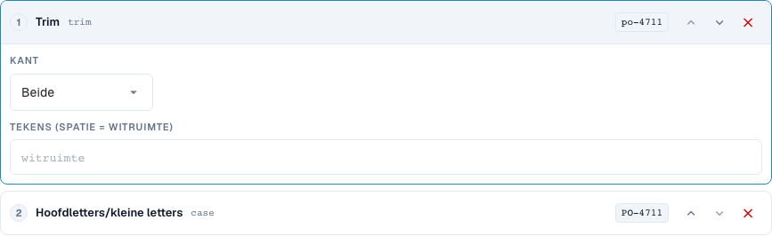
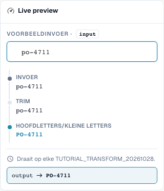
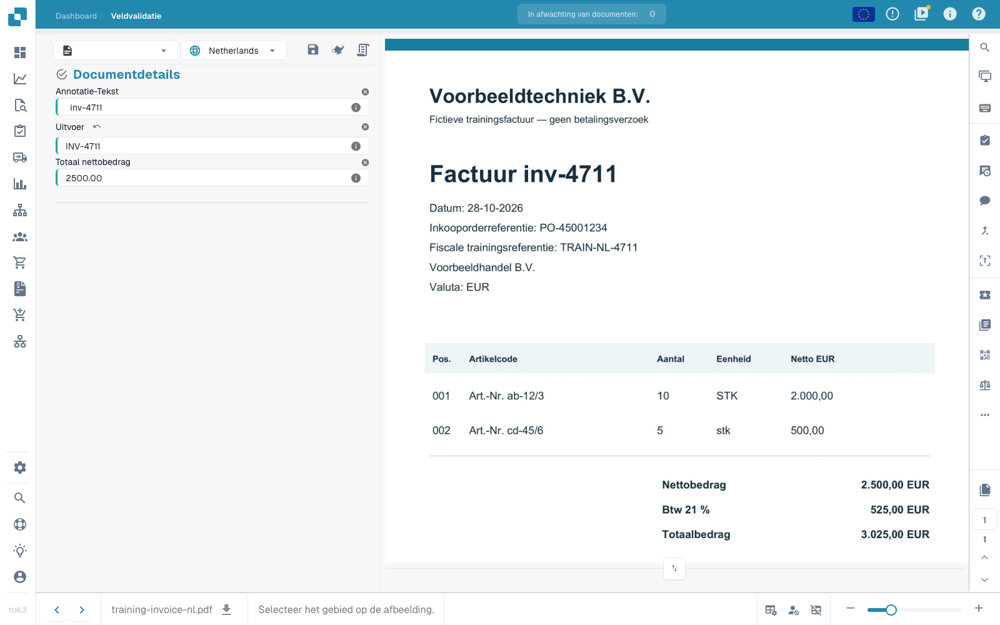

# Basisprincipes, toepassingsbereiken en veilige tests

[Terug naar het volledige praktijkoverzicht](complete-practical-guide.md)

Kopveld · Doelresultaat · Bron oorspronkelijke tekst · Trimmen → Hoofdletters → Prefix INV-.

## Zichtbare labels in de editor

Sommige labels in de huidige interface zijn onnauwkeurig vertaald. De tabel vermeldt de werkelijk weergegeven tekst om de juiste stap te vinden; de uitleg gebruikt de technische betekenis. De schermafbeeldingen tonen de ongewijzigde interface.

| Bewerking | Zichtbaar label |
| --- | --- |
| trim | Trim |
| case | Hoofdletters/kleine letters |

## Werkwijze in de editor

1. Maak in het geïsoleerde trainingsdocumenttype een nieuwe regel voor een **kopveld** aan. Kies als doel `output` en als afzonderlijke bron `header.input`; de feitelijke veldnamen van uw organisatie kunnen afwijken.
2. Voeg de stappen **Trimmen**, pagina beide, tekens leeg en daarna **Hoofd-/kleine letters wijzigen**, modus upper, toe. De volgorde moet Trimmen → Hoofdletters zijn.
3. Voer de testwaarde `  inv-4711  ` in. De laatste voorbeeldwaarde moet `INV-4711` luiden; de tussenwaarden tonen eerst `inv-4711`.
4. Activeer en sla de regel uitsluitend voor het trainingsbereik op. Open het item opnieuw en controleer bron, doel en beide stappen.
5. Sla het oefendocument op, laad het opnieuw en controleer beide velden: De bron bevat nog steeds de oorspronkelijke spaties, de uitvoer luidt `INV-4711`. Sla nogmaals op en herhaal dezelfde controle.

<figure><figcaption>
Stapconfiguratie. Daadwerkelijke interface in het Nederlands. De voorvertoning wijzigt geen opgeslagen documenten.
</figcaption></figure>


Stapconfiguratie. Daadwerkelijke interface in het Nederlands. De voorvertoning wijzigt geen opgeslagen documenten.


<figure><figcaption>
Live-voorvertoning met trainingswaarden. Daadwerkelijke interface in het Nederlands. De voorvertoning wijzigt geen opgeslagen documenten.
</figcaption></figure>


Live-voorvertoning met trainingswaarden. Daadwerkelijke interface in het Nederlands. De voorvertoning wijzigt geen opgeslagen documenten.


## 1. Toepassingsbereik

Een transformatie wijzigt reeds geëxtraheerde gegevens. Het vervangt geen tekstherkenning. In de editor kies ik eerst het toepassingsbereik. Een kopveld wordt eenmaal per document verwerkt. Een tabelkolom wordt voor elke rij verwerkt. Tabelregels wijzigen hele regelitems. Routing wijst het document toe aan een onderliggende organisatie. Deze vier taken hebben verschillende doelen en verschillende stappen. Ik leg mijn voorbeelden aan op een eigen testdocumenttype, zodat geen productieve facturen worden gewijzigd.

## 2. Bron en verwerking

Daarna kies ik het doelveld. De bron kan dit veld zelf of een ander veld zijn. De stappen lopen van boven naar beneden. Elke tussenwaarde wordt de invoer van de volgende stap. Mijn voorbeeld leest een factuurnummer, verwijdert buitenste spaties en schrijft hoofdletters. Uit een kleine letter wordt een hoofdletter. Met een voorwaarde beperk ik de regel tot de passende leverancier. Bij een tabelkolom kan de voorwaarde bovendien waarden van de huidige rij controleren. Meerdere voorwaarden kunnen worden gecombineerd met En, Of en groepen.

## 3. Werking controleren

De live-voorbeeldweergave slaat nog niets op. Ik controleer een passende waarde, een tegenvoorbeeld en een reeds gecorrigeerd resultaat. Vervolgens sla ik de regel op, open ik deze opnieuw en controleer ik de opgeslagen instellingen. Voor de feitelijke documentwerking heb ik aanvullend een testdocument, een opslaghandeling en het opnieuw geladen resultaat nodig. Een voorbeeldweergave bewijst noch een uitgevoerde export noch een succesvolle bestelafstemming. Uitvoeringslogboeken helpen mij toegepaste en overgeslagen voorwaarden uit elkaar te houden. In de volgende afleveringen doorlopen we de afzonderlijke transformaties en hun grenzen.

## Gecontroleerde voorbeelden en tegenvoorbeelden

Deze waarden zijn serverzijdig als droge test gecontroleerd. Een dergelijke test wijzigt geen opgeslagen documenten.

| Geval | Invoer | Serverresultaat |
| --- | --- | --- |
| copy | `  po-4711  ` | `PO-4711` |

## Acceptatie

Controleer een passend geval, een tegenvoorbeeld, een lege waarde en een reeds verwerkt resultaat. Herhaal de documentopslaghandeling. Controleer PO-afstemming en ERP-ontvangst aanvullend, indien deze tot het functionele doel behoren.

## Opgeslagen werking aan het oefendocument

<figure><figcaption>
De voorbereide oorspronkelijke waarde blijft behouden; uitvoer toont INV-4711. Twee native opslaghandelingen, opnieuw laden en een afzonderlijke serverquery bevestigen het stabiele resultaat. Dit bewijst de regelwerking op voorbereide testwaarden, niet de nauwkeurigheid van een automatische extractie.
</figcaption></figure>


De voorbereide oorspronkelijke waarde blijft behouden; uitvoer toont INV-4711. Twee native opslaghandelingen, opnieuw laden en een afzonderlijke serverquery bevestigen het stabiele resultaat. Dit bewijst de regelwerking op voorbereide testwaarden, niet de nauwkeurigheid van een automatische extractie.


## Videohandleiding


Configuratie, praktijkvoorbeelden en tegenvoorbeelden.


[Open de video met Nederlandse ondertitels en hoofdstukken](https://docbits-videos.fra1.cdn.digitaloceanspaces.com/settings-assistant/transformation-rules-01-foundations-preview-admin/v1/nl.html). Deze beoordelingsversie wacht op de inhoudelijke beoordeling en een volledige luistercontrole.
