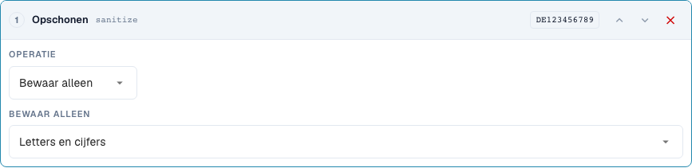
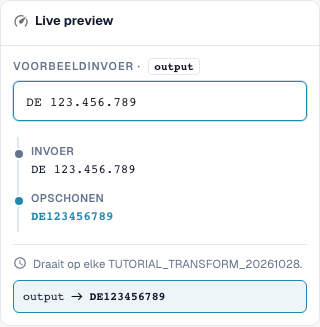

# Tekst opschonen: Schrijfwijze, trimmen en tekens

[Terug naar het volledige praktijkoverzicht](complete-practical-guide.md)

Kopveld · Doelresultaat · Stappen afzonderlijk testen: case, trim, sanitize.

## Zichtbare labels in de editor

Sommige labels in de huidige interface zijn onnauwkeurig vertaald. De tabel vermeldt de werkelijk weergegeven tekst om de juiste stap te vinden; de uitleg gebruikt de technische betekenis. De schermafbeeldingen tonen de ongewijzigde interface.

| Bewerking | Zichtbaar label |
| --- | --- |
| case | Hoofdletters/kleine letters |
| trim | Trim |
| sanitize | Opschonen |

## Werkwijze in de editor

1. Voor het trainings-kopveld een enkele stap **Hoofd-/kleine letters wijzigen** aanmaken. De modi upper, lower, title en capitalize achtereenvolgens met de voorbeelden van de tabel controleren.
2. Voor het factuurnummer een nieuwe pipeline met **Trimmen** beginnen. Beide zijden en een leeg tekenvak verwijderen buitenste witruimte; `47 11` moet zijn interne spatie behouden.
3. Als afzonderlijke tegenproef bij het trimmen links instellen en teken `0`: `004711` wordt `4711`, `000` wordt leeg. Deze stap niet ongecontroleerd voor echte identificaties overnemen.
4. Bij een belastingidentificatie **Tekens opschonen** met alfanumeriek behouden gebruiken. `DE 123.456.789` moet `DE123456789` opleveren. De overige behoudmodi met `DE-123` respectievelijk `ACME GmbH!` controleren.
5. Voor capitalize expliciet voorvertoning en server vergelijken: Bij de gecontroleerde `aCME GMBH` zijn deze resultaten verschillend. Het serverresultaat is `Acme gmbh`; een passende browserweergave alleen is niet voldoende.

<figure><figcaption>
Stapconfiguratie. Daadwerkelijke interface in het Nederlands. De voorvertoning wijzigt geen opgeslagen documenten.
</figcaption></figure>


Stapconfiguratie. Daadwerkelijke interface in het Nederlands. De voorvertoning wijzigt geen opgeslagen documenten.


<figure><figcaption>
Live-voorvertoning met trainingswaarden. Daadwerkelijke interface in het Nederlands. De voorvertoning wijzigt geen opgeslagen documenten.
</figcaption></figure>


Live-voorvertoning met trainingswaarden. Daadwerkelijke interface in het Nederlands. De voorvertoning wijzigt geen opgeslagen documenten.


## 1. Schrijfwijze

Hoofdlettergebruik verenigt bijvoorbeeld een factuurnummer. Kleine letters kunnen een technische vergelijkingssleutel verenigen. Title Case en de hoofdletter van het eerste teken kunnen ook de rest van het woord wijzigen. Uit een bedrijfsafkorting kan daardoor een andere schrijfwijze ontstaan. Voor eigennamen gebruik ik deze varianten alleen met een duidelijke inhoudelijke voorschrift. Bij de modus Capitalise first is er in de gecontroleerde stand een afwijking: De browservoorvertoning laat de overige schrijfwijze staan, terwijl de server de rest klein schrijft. Ik verlaat me hier dus niet alleen op de voorvertoning, maar vergelijk expliciet de serverwaarde.

## 2. Trimmen

Trimmen verwijdert tekens aan de rand. Beide zijden verwijdert buitenste spaties, maar geen spatie midden in een nummer. Links met het teken nul verwijdert alle voorloopnullen. Een waarde die alleen uit nullen bestaat, wordt daardoor leeg. Rechts werkt overeenkomstig aan het einde. Het veld Tekens is een verzameling afzonderlijke tekens en geen volledig prefix. Een vast artikelprefix verwijder ik daarom met Affix. Aanvullen en afkappen behandelen we in de volgende aflevering.

## 3. Tekens opschonen

Bij het opschonen kan ik alleen letters en cijfers, alleen letters, alleen cijfers of aanvullend spaties behouden. Een Duitse belastingidentificatie met spaties en punten wordt zo tot een aaneengesloten sleutel. Bij een artikelnummer kunnen koppeltekens echter inhoudelijk belangrijk zijn. Het verwijderen van dergelijke tekens moet passen bij de schrijfwijze in het doelsysteem. Het alternatieve tekensverwijderen werkt met een reguliere tekenklasse. Een koppelteken vereist daarin bijzondere aandacht. Voor mijn voorbeeld controleer ik daarom de daadwerkelijke serverwaarde aanvullend op de voorvertoning. Al opgeschoonde waarden en lege invoeren horen in elke test.

## Gecontroleerde voorbeelden en tegenvoorbeelden

Deze waarden zijn serverzijdig gecontroleerd als droge test. Een dergelijke test wijzigt geen opgeslagen documenten.

| Geval | Invoer | Serverresultaat |
| --- | --- | --- |
| case-upper | `inv-4711` | `INV-4711` |
| case-upper | `INV-4711` | `INV-4711` |
| case-lower | `INFO@BEISPIEL.DE` | `info@beispiel.de` |
| case-title | `acme gmbh` | `Acme Gmbh` |
| case-capitalize | `aCME GMBH` | `Acme gmbh` |
| trim | `  4711  ` | `4711` |
| trim | `47 11` | `47 11` |
| trim-zero | `004711` | `4711` |
| trim-zero | `000` | `` |
| sanitize | `DE 123.456.789` | `DE123456789` |
| sanitize-alpha | `DE-123` | `DE` |
| sanitize-numeric | `DE-123` | `123` |
| sanitize-space | `ACME GmbH!` | `ACME GmbH` |
| sanitize-strip | `ab-12/3.` | `ab123` |

## Acceptatie

Controleer een passend geval, een tegengeval, een lege waarde en een reeds verwerkt resultaat. Herhaal het document-opslagproces. Controleer PO-afstemming en ERP-ontvangst aanvullend, indien deze bij het inhoudelijke doel horen.

## Videohandleiding


Configuratie, praktijkvoorbeelden en tegenvoorbeelden.


[Open de video met Nederlandse ondertitels en hoofdstukken](https://docbits-videos.fra1.cdn.digitaloceanspaces.com/settings-assistant/transformation-rules-02-text-cleaning-preview-admin/v1/nl.html). Deze beoordelingsversie wacht op de inhoudelijke beoordeling en een volledige luistercontrole.
