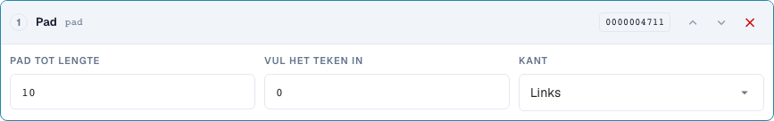
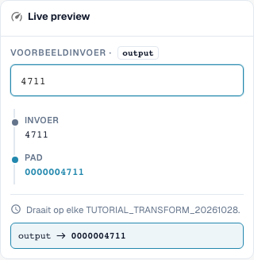

# Nummers vormen: Aanvullen, Inkorten, Prefix en Suffix

> Bekende beperking van het voorbeeld (gecontroleerd op 29 oktober 2026, versie 11.15.2): bij het toevoegen van het voorvoegsel `INV-` verandert het voorbeeld `INV-4711` ten onrechte in `INV-INV-4711`. De afzonderlijk gecontroleerde servertest behoudt `INV-4711`. Controleer herhaalde uitvoering daarom ook met een servertest; een correct voorbeeldresultaat bewijst op zichzelf niet de volledige uitvoering bij het opslaan.

[Terug naar het volledige praktijkoverzicht](complete-practical-guide.md)

Kopveld · pad: lengte 10, teken 0, links; truncate: lengte 10; affix: exacte prefix-/suffixoperatie.

## Zichtbare labels in de editor

Sommige labels in de huidige interface zijn onnauwkeurig vertaald. De tabel vermeldt de werkelijk weergegeven tekst om de juiste stap te vinden; de uitleg gebruikt de technische betekenis. De schermafbeeldingen tonen de ongewijzigde interface.

| Bewerking | Zichtbaar label |
| --- | --- |
| pad | Pad |
| truncate | Inkorten |
| affix | Voor-/achtervoegsel |

## Werkwijze in de editor

1. Selecteer de opvulstap voor het nummer. Stel minimumlengte 10 in, vulteken `0`, en zijde links. `4711` moet `0000004711` worden.
2. Met een reeds elfcijferige invoer controleren: Aanvullen mag niets afsnijden. Voor aanvullingen rechts afzonderlijk lengte 6, teken `_` en invoer `ABC` testen.
3. In een eigen regel **Inkorten** met maximumlengte 10 instellen. `ABCDEFGHIJKL` wordt `ABCDEFGHIJ`, `ABC` blijft behouden. Controleren of verschillende invoeren hierdoor dezelfde identificatie zouden kunnen opleveren.
4. **Affix** met prefix toevoegen `INV-` testen. Vervolgens `INV-4711` als invoer controleren: Het exact aanwezige prefix mag niet opnieuw worden aangevuld.
5. De andere affix-varianten afzonderlijk configureren: suffix toevoegen `-DE`, prefix verwijderen `Art.-Nr. ` en suffix verwijderen ` EUR`. Bij het verwijderen ook een niet-passende rand en afwijkende hoofdlettergebruik testen.
6. De uitvoer opnieuw als invoer gebruiken. Met name bij het verwijderen van meervoudig voorkomende affixen kan een tweede doorloop verder wijzigen.

<figure><figcaption>
Stapconfiguratie. Daadwerkelijke interface in het Nederlands. De voorvertoning wijzigt geen opgeslagen documenten.
</figcaption></figure>


Stapconfiguratie. Daadwerkelijke interface in het Nederlands. De voorvertoning wijzigt geen opgeslagen documenten.


<figure><figcaption>
Live-voorvertoning met trainingswaarden. Daadwerkelijke interface in het Nederlands. De voorvertoning wijzigt geen opgeslagen documenten.
</figcaption></figure>


Live-voorvertoning met trainingswaarden. Daadwerkelijke interface in het Nederlands. De voorvertoning wijzigt geen opgeslagen documenten.


## 1. Lengte

Aanvullen vult links of rechts een enkel vul teken aan tot de minimumlengte. Met tien posities en nul links wordt uit een viercijferig nummer een tiencijferige identificatie. Een reeds langer nummer blijft langer. Aanvullen is dus geen lengtecontrole. Inkorten behoudt daarentegen alleen de eerste tekens tot de gekozen maximumlengte. Deze informatie gaat verloren. Voor een ERP-inzet controleer ik of verschillende nummers na het inkorten identiek zouden kunnen worden. Korte waarden blijven ongewijzigd.

## 2. Prefix en Suffix

De volgende resultaten van de affixbewerkingen beschrijven de gecontroleerde uitvoering op de server.

Affix biedt vier varianten: prefix toevoegen, suffix toevoegen, prefix verwijderen en suffix verwijderen. Een toegevoegd prefix wordt niet nogmaals aangevuld, als de waarde er reeds exact mee begint. Dat geldt overeenkomstig voor een suffix. Verwijderen controleert daarentegen exact het begin of het einde. Een afwijkend hoofdlettergebruik wordt niet automatisch gelijkgesteld. Staat de tekst midden in de waarde, dan blijft deze behouden. Voor willekeurige vindplaatsen gebruik ik zoeken en vervangen.

## 3. Herhaalde toepassing

Ook een eenvoudige pipeline heeft een herhalingstest nodig. Verwijder ik een prefix van een dubbel voorgeplaatst prefix, dan blijft na de eerste doorloop er nog één over. Bij de volgende doorloop zou ook deze verdwijnen. Daarom controleer ik de gehele regel en niet alleen elke stap afzonderlijk. De typische factuurnummerspipeline luidt: trimmen, hoofdlettergebruik, prefix aanvullen. Ik test een ruw nummer, een reeds afgerond nummer en een afwijkende leverancier. De voorwaarde zorgt ervoor dat alleen de overeengekomen situatie wordt gewijzigd.

## Gecontroleerde voorbeelden en tegenvoorbeelden

Deze waarden zijn serverzijdig als droge test gecontroleerd. Een dergelijke test wijzigt geen opgeslagen documenten.

| Geval | Invoer | Serverresultaat |
| --- | --- | --- |
| pad | `4711` | `0000004711` |
| pad | `12345678901` | `12345678901` |
| pad-right | `ABC` | `ABC___` |
| truncate | `ABCDEFGHIJKL` | `ABCDEFGHIJ` |
| truncate | `ABC` | `ABC` |
| prefix-add | `4711` | `INV-4711` |
| prefix-add | `INV-4711` | `INV-4711` |
| suffix-add | `4711` | `4711-DE` |
| suffix-add | `4711-DE` | `4711-DE` |
| prefix-strip | `Art.-Nr. 4711` | `4711` |
| prefix-strip | `ART.-NR. 4711` | `ART.-NR. 4711` |
| prefix-strip | `Art.-Nr. Art.-Nr. 4711` | `Art.-Nr. 4711` |
| suffix-strip | `123 EUR` | `123` |
| suffix-strip | `123 EUR netto` | `123 EUR netto` |

## Acceptatie

Controleer een passend geval, een tegenvoorbeeld, een lege waarde en een reeds verwerkt resultaat. Herhaal het documentopslagproces. Controleer PO-afstemming en ERP-ontvangst aanvullend, indien deze tot het functionele doel behoren.

## Videohandleiding


Configuratie, praktijkvoorbeelden en tegenvoorbeelden.


[Open de video met Nederlandse ondertitels en hoofdstukken](https://docbits-videos.fra1.cdn.digitaloceanspaces.com/settings-assistant/transformation-rules-03-numbers-and-affixes-preview-admin/v1/nl.html). Deze beoordelingsversie wacht op de inhoudelijke beoordeling en een volledige luistercontrole.
