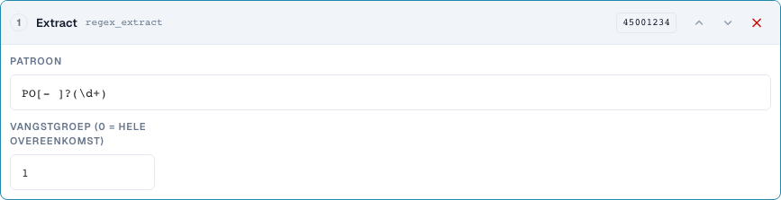
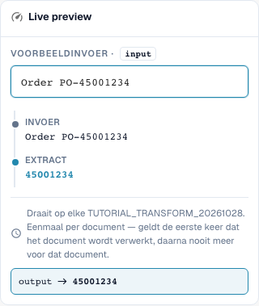

# Deelstukken en patronen: knippen, extraheren, vervangen

[Terug naar het volledige praktijkoverzicht](complete-practical-guide.md)

Kopveld · Bron header.input · Doel output · regex_extract: PO[- ]?(\d+), Groep 1. Bron en doel blijven gescheiden.

## Zichtbare labels in de editor

Sommige labels in de huidige interface zijn onnauwkeurig vertaald. De tabel vermeldt de werkelijk weergegeven tekst om de juiste stap te vinden; de uitleg gebruikt de technische betekenis. De schermafbeeldingen tonen de ongewijzigde interface.

| Bewerking | Zichtbaar label |
| --- | --- |
| substring | Neem een plakje |
| regex_extract | Extract |
| regex_replace | Zoeken en vervangen |

## Werkwijze in de editor

1. Voor alle drie de stappen een doel zoals `output` en een **gescheiden originele bron** zoals `header.input` kiezen. Ook „Alleen eenmaal per document" staat geen zelfbron toe.
2. Voor **Deelstuk** eerst Start 0 en Lengte 4 instellen: `2026-10-28` levert `2026`. Daarna Start 3 en Einde 7 met `DE-4711-X` controleren; het einde telt niet mee.
3. Als eigen variant Start −4 zonder Lengte/Einde testen: `INV-4711` levert `4711`. Een kortere invoer is een noodzakelijk tegengeval.
4. Voor **Extraheren** patroon `PO[- ]?(\d+)` en Vanggroep 1 gebruiken. `Order PO-45001234` levert `45001234`; `Invoice 4711` levert leeg. Groep 0 levert daarentegen de volledige treffer.
5. Voor **Zoeken en vervangen** patroon `\s+`, vervanging een spatie en Aantal 0 configureren. `ACME    GmbH` moet `ACME GmbH` opleveren. Daarna patroon `-`, vervanging `/`, Aantal 1 met `AB-CD-EF` controleren: Alleen het eerste koppelteken wordt vervangen.
6. De concrete patronen ook serverzijdig testen. Een succesvol browserpatroon alleen bewijst bij complexe uitdrukkingen geen identieke serververwerking.

<figure><figcaption>
Stapconfiguratie. Daadwerkelijke interface in het Nederlands. De voorvertoning wijzigt geen opgeslagen documenten.
</figcaption></figure>


Stapconfiguratie. Daadwerkelijke interface in het Nederlands. De voorvertoning wijzigt geen opgeslagen documenten.


<figure><figcaption>
Live-voorvertoning met trainingswaarden. Daadwerkelijke interface in het Nederlands. De voorvertoning wijzigt geen opgeslagen documenten.
</figcaption></figure>


Live-voorvertoning met trainingswaarden. Daadwerkelijke interface in het Nederlands. De voorvertoning wijzigt geen opgeslagen documenten.


## 1. Deelstuk

Een deelstuk wordt via Start en Lengte of via Start en Einde bepaald. De eerste index is nul. Het einde behoort niet meer tot het resultaat. Een negatieve start telt vanaf de rechterrand. Voor de laatste vier tekens gebruik ik een start van min vier en geen einde. Ik kies een andere bron dan het doel. Zo leest elke verwerking weer de oorspronkelijke tekst. De server wijst deze stappen op het eigen doelveld af, omdat de waarde anders bij herhaalde verwerking steeds verder zou worden gewijzigd. Alleen eenmaal uitvoeren vervangt hier deze gescheiden bron niet.

## 2. Extraheren

Extraheren zoekt de eerste treffer van een reguliere expressie. Mijn patroon herkent de letters P en O, optioneel een koppelteken of een spatie en daarna cijfers. Groep één levert alleen de cijfers, groep nul de volledige treffer. Zonder treffer komt een lege tekenreeks terug. Ik stel daarom een passende voorwaarde in of controleer bewust of een lege doelwaarde in dit geval gewenst is. Meerdere bestelnummers in een tekst worden niet automatisch meerdere resultaten.

## 3. Vervangen

Zoeken en vervangen verwerkt treffers van een patroon. Met een aantal van nul worden alle treffers vervangen. Eén wijzigt alleen de eerste treffer. Meerdere spaties kan ik door een enkele spatie vervangen. Ook hier gebruik ik een aparte originele bron. De voorbeeldweergave in de browser en de verwerking op de server kunnen bij veeleisende reguliere expressies verschillende regels gebruiken. Daarom test ik eerst eenvoudige patronen en vergelijk daarna de werkelijke serverwaarde. Een passend geval, geen treffer en meerdere treffers vormen mijn minimumcontrole.

## Gecontroleerde voorbeelden en tegengevallen

Deze waarden zijn serverzijdig als droge test gecontroleerd. Een dergelijke test wijzigt geen opgeslagen documenten.

| Geval | Invoer | Serverresultaat |
| --- | --- | --- |
| substring | `2026-10-28` | `2026` |
| substring | `AB` | `AB` |
| substring-end | `DE-4711-X` | `4711` |
| substring-negative | `INV-4711` | `4711` |
| regex-extract | `Order PO-45001234` | `45001234` |
| regex-extract | `Invoice 4711` | `` |
| regex-replace | `ACME    GmbH` | `ACME GmbH` |
| regex-count | `AB-CD-EF` | `AB/CD-EF` |

## Acceptatie

Controleer een passend geval, een tegengeval, een lege waarde en een reeds verwerkt resultaat. Herhaal het documentopslagproces. Controleer PO-afstemming en ERP-ontvangst aanvullend, indien deze bij het functionele doel horen.

## Videohandleiding


Configuratie, praktijkvoorbeelden en tegenvoorbeelden.


[Open de video met Nederlandse ondertitels en hoofdstukken](https://docbits-videos.fra1.cdn.digitaloceanspaces.com/settings-assistant/transformation-rules-04-substrings-and-patterns-preview-admin/v1/nl.html). Deze beoordelingsversie wacht op de inhoudelijke beoordeling en een volledige luistercontrole.
