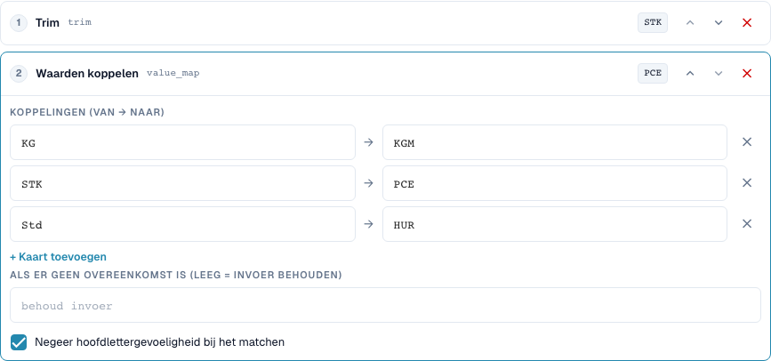
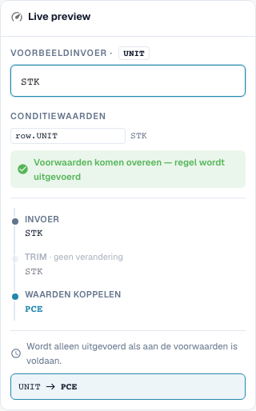

# Waarde-toewijzingen en regels per tabelrij

[Terug naar het volledige praktijkoverzicht](complete-practical-guide.md)

Tabelkolom UNIT · Trimmen → value_map: STK→PCE, KG→KGM, Std→HUR · Hoofdlettergebruik negeren.

## Zichtbare labels in de editor

Sommige labels in de huidige interface zijn onnauwkeurig vertaald. De tabel vermeldt de werkelijk weergegeven tekst om de juiste stap te vinden; de uitleg gebruikt de technische betekenis. De schermafbeeldingen tonen de ongewijzigde interface.

| Bewerking | Zichtbaar label |
| --- | --- |
| trim | Trim |
| value_map | Waarden koppelen |

## Werkwijze in de editor

1. Geldigheidsbereik **Tabelkolom**, tabel `INVOICE_TABLE` en doelkolom `UNIT` selecteren. Hier wordt elke tabelrij afzonderlijk verwerkt.
2. **Trimmen** vóór **Waarden toewijzen** plaatsen. Paren `STK→PCE`, `KG→KGM` en `Std→HUR` vastleggen en hoofdlettergebruik negeren activeren.
3. Het veld voor de vervanging zonder treffer leeg laten, zodat onbekende codes behouden blijven. `stk` moet `PCE` opleveren, `BOX` moet `BOX` blijven.
4. Een voorvertoning met passende rijvoorwaarde en met niet-passende voorwaarde controleren. De voorwaarde mag de andere rijen niet onbedoeld vastleggen.
5. Voor een echte meerrijige test uitgangswaarden `STK`, `STK`, `BOX` voorbereiden. In de gecontroleerde servertest ontstaat `PCE`, `PCE`, `BOX`; hoeveelheid en prijs blijven vakinhoudelijk afzonderlijk te controleren.
6. Elke doelcode opnieuw als invoer controleren. Een globale vervanging zoals `C62` en gekoppelde toewijzingen kunnen onbekende waarden verbergen of bij latere doorlopen verder wijzigen.

<figure><figcaption>
Stapconfiguratie. Daadwerkelijke interface in het Nederlands. De voorvertoning wijzigt geen opgeslagen documenten.
</figcaption></figure>


Stapconfiguratie. Daadwerkelijke interface in het Nederlands. De voorvertoning wijzigt geen opgeslagen documenten.


<figure><figcaption>
Live-voorvertoning met trainingswaarden. Daadwerkelijke interface in het Nederlands. De voorvertoning wijzigt geen opgeslagen documenten.
</figcaption></figure>


Live-voorvertoning met trainingswaarden. Daadwerkelijke interface in het Nederlands. De voorvertoning wijzigt geen opgeslagen documenten.


## 1. Waardeparen

Een waarde-toewijzing vertaalt volledige invoerwaarden. Mijn voorbeeld wijst Stuk toe aan de code P C E, Kilogram aan de code K G M en Uren aan de code H U R toe. Ik voer de werkelijke leverancierscodes en de verwachte doelcodes als paren in. Met genegeerd hoofdlettergebruik wordt ook een klein geschreven code herkend. Dit verwijdert nog geen spaties. Daarom plaats ik een trimstap vóór de toewijzing. Een onbekende code test ik expliciet.

## 2. Zonder treffer

Een leeg veld voor de waarde zonder treffer betekent: invoer behouden. Het betekent niet: invoer verwijderen. Een vast ingevoerde vervangingswaarde vervangt daarentegen elke onbekende code. Dit kan fouten verbergen. Bij vakinhoudelijk verschillende eenheden zou ik geen globale vervangingscode toekennen. Een toewijzing is ook niet automatisch in elke combinatie herhaalbaar. Wanneer de uitvoer van een paar tegelijkertijd de invoer van een ander paar is, kan een latere doorloop verder toewijzen. Ik test daarom ook elke doelcode als nieuwe invoer.

## 3. Per tabelrij

Voor tabellen selecteer ik de concrete tabel en de doelkolom. De pipeline wordt dan voor elke rij uitgevoerd. Een voorwaarde kan de eenheidscode van de huidige rij verbinden met een leverancierskenmerk uit de kop. In het voorbeeld worden twee passende rijen gewijzigd, terwijl een onbekende eenheidscode behouden blijft. Dit wijzigt geen hoeveelheden of prijzen door een eenheidconversie. Een tekenreeks hernoemen is geen wiskundige omrekening. De werkelijke bestelafstemming en een export controleer ik afzonderlijk van de transformatie.

## Gecontroleerde voorbeelden en tegenvoorbeelden

Deze waarden zijn serverzijdig gecontroleerd als droge test. Een dergelijke test wijzigt geen opgeslagen documenten.

| Geval | Invoer | Serverresultaat |
| --- | --- | --- |
| map | `stk` | `PCE` |
| map | `PCE` | `PCE` |
| map | `BOX` | `BOX` |
| map-fallback | `BOX` | `C62` |
| item-pipeline | `Art.-Nr. ab-12/3` | `AB123` |

## Acceptatie

Controleer een passend geval, een tegenvoorbeeld, een lege waarde en een reeds verwerkt resultaat. Herhaal het documentopslagproces. Controleer PO-afstemming en ERP-ontvangst aanvullend, wanneer deze tot het vakinhoudelijke doel behoren.

## Videohandleiding


Configuratie, praktijkvoorbeelden en tegenvoorbeelden.


[Open de video met Nederlandse ondertitels en hoofdstukken](https://docbits-videos.fra1.cdn.digitaloceanspaces.com/settings-assistant/transformation-rules-05-value-mapping-preview-admin/v1/nl.html). Deze beoordelingsversie wacht op de inhoudelijke beoordeling en een volledige luistercontrole.
