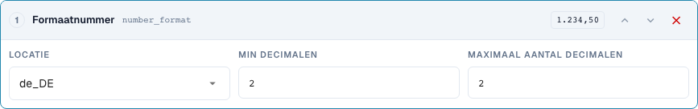
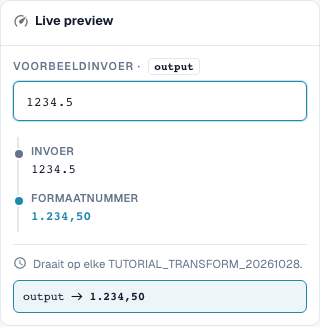

# Datum en getallen correct formatteren

[Terug naar het volledige praktijkoverzicht](complete-practical-guide.md)

Tekstdoel · date_format: %d.%m.%Y; number_format: de_DE, min. 2, max. 2 decimalen.

## Zichtbare labels in de editor

Sommige labels in de huidige interface zijn onnauwkeurig vertaald. De tabel vermeldt de werkelijk weergegeven tekst om de juiste stap te vinden; de uitleg gebruikt de technische betekenis. De schermafbeeldingen tonen de ongewijzigde interface.

| Bewerking | Zichtbaar label |
| --- | --- |
| date_format | Datum opnieuw formatteren |
| number_format | Formaatnummer |

## Werkwijze in de editor

1. Gebruik voor een goed leesbare eerste poging een **tekstdoel** en de stap **Datum formatteren**. Stel uitvoerpatroon `%d.%m.%Y` en invoer `2026-10-28` in; verwacht wordt `28.10.2026`.
2. Vergelijk de varianten `%m/%d/%Y`, `%Y-%m-%d` en `%d %b %Y` steeds met dezelfde unieke invoer. De patronen zijn geen betrouwbare herkenning van elk willekeurig datumformaat.
3. Controleer met `kein Datum` en een dubbelzinnige invoer. Controleer bij een echt DATE-kopveld aanvullend de opgeslagen ISO-waarde en de zichtbare weergave afzonderlijk.
4. Kies in een eigen regel **Getal formatteren**, taalregio `de_DE`, minimale en maximale decimalen respectievelijk 2. De serverinvoer `1234.5` moet `1234,50` opleveren.
5. Controleer met `en_US` dezelfde invoer: serverresultaat `1234.50`. Het duizendtalscheidingsteken van de gecontroleerde browservoorvertoning wordt serverzijdig niet geschreven.
6. Controleer nul, een negatief bedrag en extra decimalen. Verwerk de uitvoer vervolgens opnieuw en controleer de daadwerkelijk opgeslagen waarde.

<figure><figcaption>
Stapconfiguratie. Daadwerkelijke interface in het Nederlands. De voorvertoning wijzigt geen opgeslagen documenten.
</figcaption></figure>


Stapconfiguratie. Daadwerkelijke interface in het Nederlands. De voorvertoning wijzigt geen opgeslagen documenten.


<figure><figcaption>
Live-voorvertoning met trainingswaarden. Daadwerkelijke interface in het Nederlands. De voorvertoning wijzigt geen opgeslagen documenten. Het zichtbare duizendtalscheidingsteken behoort tot de browservoorvertoning; het geverifieerde serverresultaat is 1234,50.
</figcaption></figure>


Live-voorvertoning met trainingswaarden. Daadwerkelijke interface in het Nederlands. De voorvertoning wijzigt geen opgeslagen documenten. Het zichtbare duizendtalscheidingsteken behoort tot de browservoorvertoning; het geverifieerde serverresultaat is 1234,50.


## 1. Datum en gegevenstype

Datum opnieuw formatteren schrijft een datum volgens het gekozen patroon. Een unieke ISO-datum is een goede testinvoer. Dag, maand en jaar kunnen bijvoorbeeld met punten worden weergegeven. Bij een echt datumskopveld kan de interne waarde in ISO-formaat blijven, terwijl de weergave wijzigt. Een tekstveld of een tabelcel kan daarentegen de geformatteerde tekst bevatten. Daarom vergelijk ik niet alleen het zichtbare veld, maar ook de opgeslagen waarde en het latere gebruik.

## 2. Onleesbare en dubbelzinnige gegevens

Een onleesbare datum wordt niet zomaar verzonnen. In mijn servertest blijft de tekst ongewijzigd, en het resultaat noemt de reden. Dubbelzinnige aanduidingen zoals dag en maand met kleine getallen hebben een eenduidig afgesproken context nodig. Een geformatteerde datum mag bij de volgende keer opslaan niet als een andere dag worden gelezen. Ik controleer daarom een tweede doorloop. Uit een willekeurige tekst zonder geldige datum kan deze transformatie geen betrouwbare datum maken.

## 3. Getalformaat

Getallen formatteren gebruikt een taalregio en een minimaal en maximaal aantal decimalen. Dat wijzigt weergave en eventueel afronding, maar geen wisselkoers en geen hoeveelheidseenheid. Voor mijn invoer duizendtweehonderdvierendertig komma vijf levert de huidige server met twee decimalen een Duitse kommaschrijfwijze of een Engelse puntschrijfwijze. Een duizendtalscheidingsteken is niet aanwezig in het gecontroleerde serverresultaat. Ik neem daarom geen fraaiere browserweergave over als bewijs voor de export. Nul, negatieve bedragen, extra decimalen en de opgeslagen resultaatwaarde hebben eigen tests nodig.

## Gecontroleerde voorbeelden en tegenvoorbeelden

Deze waarden zijn serverzijdig als droge test gecontroleerd. Een dergelijke test wijzigt geen opgeslagen documenten.

| Geval | Invoer | Serverresultaat |
| --- | --- | --- |
| date | `2026-10-28` | `28.10.2026` |
| date | `kein Datum` | `kein Datum` |
| number-de | `1234.5` | `1234,50` |
| number-us | `1234.5` | `1234.50` |

## Acceptatie

Controleer een passend geval, een tegenvoorbeeld, een lege waarde en een reeds verwerkt resultaat. Herhaal het documentopslagproces. Controleer PO-afstemming en ERP-ontvangst aanvullend, indien deze bij het functionele doel horen.

In de gecontroleerde staat verschillen getallenvoorvertoning en server bij duizendtalscheidingstekens. De tabel noemt de daadwerkelijke serverwaarde.

## Videohandleiding


Configuratie, praktijkvoorbeelden en tegenvoorbeelden.


[Open de video met Nederlandse ondertitels en hoofdstukken](https://docbits-videos.fra1.cdn.digitaloceanspaces.com/settings-assistant/transformation-rules-06-dates-and-numbers-preview-admin/v1/nl.html). Deze beoordelingsversie wacht op de inhoudelijke beoordeling en een volledige luistercontrole.
