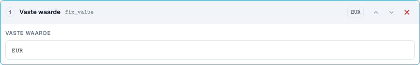
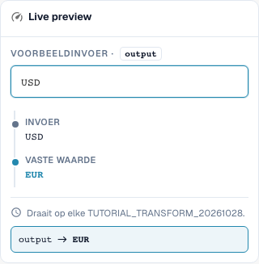
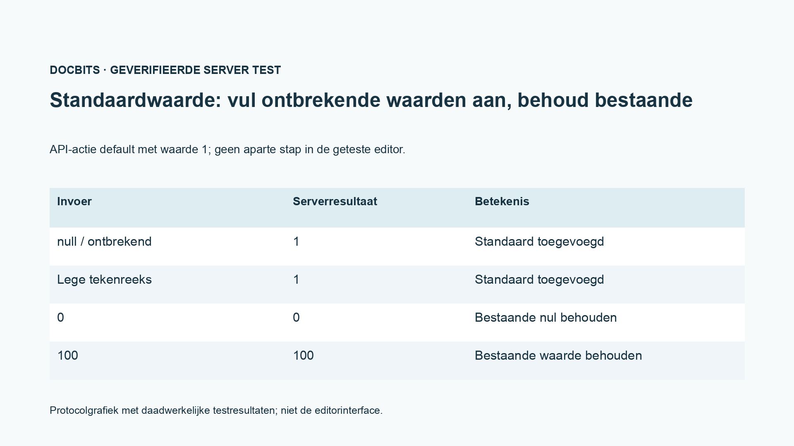

# Velden overnemen, vaste waarden, leegmaken en standaardwaarden

[Terug naar het volledige praktijkoverzicht](complete-practical-guide.md)

Doel Resultaat · Bron Oorspronkelijke tekst voor veldovername; vaste waarde alleen onder strikte voorwaarde; leegmaken afzonderlijk testen.

## Zichtbare labels in de editor

Sommige labels in de huidige interface zijn onnauwkeurig vertaald. De tabel vermeldt de werkelijk weergegeven tekst om de juiste stap te vinden; de uitleg gebruikt de technische betekenis. De schermafbeeldingen tonen de ongewijzigde interface.

| Bewerking | Zichtbaar label |
| --- | --- |
| trim | Trim |
| case | Hoofdletters/kleine letters |
| fix_value | Vaste waarde |
| clear | Wissen |

## Werkwijze in de editor

1. Voor een **veldovername** een ander bronveld dan het doelveld kiezen. In de oefenomvang is het doel `output`, de bron `header.input`.
2. De stappen Trimmen → Hoofdletters configureren en `  po-4711  ` testen. De uitvoer wordt `PO-4711`; de oorspronkelijke bron mag daarbij niet worden leeggemaakt.
3. Voor een productief bestelnummer een aanvullende voorwaarde gebruiken die alleen bij leeg doelveld van toepassing is. Een reeds aanwezige correcte doelwaarde als tegenvoorbeeld testen.
4. In een eigen regel **vaste waarde** met `EUR` aanmaken. Ook een invoer `USD` wordt daardoor overschreven; dit is geen valutaomrekening.
5. **Leegmaken** afzonderlijk met `Altwert` controleren. De uitvoer is de lege tekenreeks. Let op het functionele verschil tussen bewust leegmaken en een ontbrekende uitvoerwaarde.
6. De interface-stap `default` alleen via het daarvoor bestemde API-contract testen; in het gecontroleerde normale stappenmenu is daarvoor geen eigen vermelding aanwezig. Het protocoldiagram toont: ontbrekend en leeg worden aangevuld, `0` en `100` blijven behouden.

<figure><figcaption>
Stapconfiguratie. Daadwerkelijke interface in het Nederlands. De voorvertoning wijzigt geen opgeslagen documenten.
</figcaption></figure>


Stapconfiguratie. Daadwerkelijke interface in het Nederlands. De voorvertoning wijzigt geen opgeslagen documenten.


<figure><figcaption>
Live-voorvertoning met trainingswaarden. Daadwerkelijke interface in het Nederlands. De voorvertoning wijzigt geen opgeslagen documenten.
</figcaption></figure>


Live-voorvertoning met trainingswaarden. Daadwerkelijke interface in het Nederlands. De voorvertoning wijzigt geen opgeslagen documenten.


## 1. Veldovername

Voor een veldovername kies ik eerst het doelveld en vervolgens een andere bron. Wanneer het bestelnummer in het verkeerde veld staat, kan ik het uit dat veld lezen, trimmen en in het juiste doelveld opslaan. Een voorwaarde doel is leeg beschermt een reeds aanwezig bestelnummer. De bron blijft behouden. Dit is een kopie met verwerking en geen verplaatsing. Ik controleer een leeg doel, een reeds gevuld doel en een lege bron.

## 2. Vaste waarde en leegmaken

Een vaste waarde negeert de bestaande inhoud. Stel ik de valuta in op Euro, dan overschrijft de regel ook een aanwezige andere valuta. Daarvoor heb ik een strikte functionele voorwaarde nodig. Leegmaken schrijft een lege tekenreeks in het doelveld. Het is geen verwijdering van het gehele veld of document. In de voorbeeldweergave controleer ik vooral het tegenvoorbeeld, zodat de regel geen geldige waarden verwijdert. Het opslaan van de regel alleen bewijst nog geen wijziging van een document.

## 3. Standaardwaarden

De serverinterface ondersteunt aanvullend een standaardwaarde-actie. Deze vult een waarde alleen aan bij ontbrekende of lege invoer. Een aanwezige nul blijft nul. Deze actie is in de gecontroleerde stapselectie van de normale editor niet als eigen stap aanwezig. In de editor kan ik het gewenste standaardgeval vaak met de voorwaarde doel is leeg en een vaste waarde weergeven. Ik toon dit onderscheid openlijk en beweer geen extra menu-item. Een standaardwaarde is altijd een functionele beslissing, met name bij prijsbasis, hoeveelheid of valuta.

## Gecontroleerde voorbeelden en tegenvoorbeelden

Deze waarden zijn serverzijdig als droge test gecontroleerd. Een dergelijke test wijzigt geen opgeslagen documenten.

| Geval | Invoer | Serverresultaat |
| --- | --- | --- |
| fixed | `USD` | `EUR` |
| fixed | `null` | `EUR` |
| clear | `Altwert` | `` |
| clear | `` | `` |
| default-api | `null` | `1` |
| default-api | `` | `1` |
| default-api | `0` | `0` |
| default-api | `100` | `100` |
| copy | `  po-4711  ` | `PO-4711` |

## Acceptatie

Controleer een passend geval, een tegenvoorbeeld, een lege waarde en een reeds verwerkt resultaat. Herhaal het documentopslagproces. Controleer PO-afstemming en ERP-ontvangst aanvullend, wanneer deze bij het functionele doel horen.

<figure><figcaption>
Daadwerkelijke server- en persistentietestresultaten weergegeven als protocolgrafiek. Dit is geen gerecreëerde editorinterface.
</figcaption></figure>


Daadwerkelijke server- en persistentietestresultaten weergegeven als protocolgrafiek. Dit is geen gerecreëerde editorinterface.


## Videohandleiding


Configuratie, praktijkvoorbeelden en tegenvoorbeelden.


[Open de video met Nederlandse ondertitels en hoofdstukken](https://docbits-videos.fra1.cdn.digitaloceanspaces.com/settings-assistant/transformation-rules-07-field-copy-and-defaults-preview-admin/v1/nl.html). Deze beoordelingsversie wacht op de inhoudelijke beoordeling en een volledige luistercontrole.
