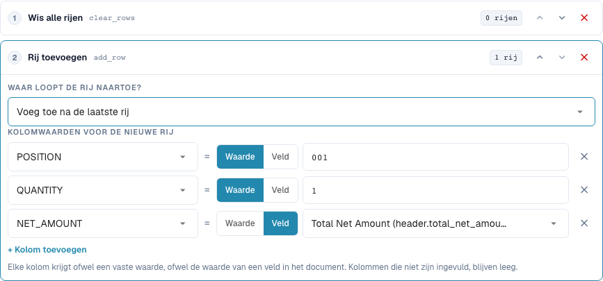
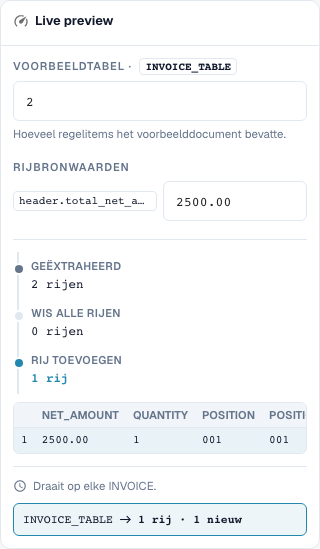

# Tabelrijen opnieuw opbouwen

[Terug naar het volledige praktijkoverzicht](complete-practical-guide.md)

Tabel INVOICE_TABLE · clear_rows → add_row aan het einde · POSITION=001, QUANTITY=1, NET_AMOUNT uit header.total_net_amount.

## Zichtbare labels in de editor

Sommige labels in de huidige interface zijn onnauwkeurig vertaald. De tabel vermeldt de werkelijk weergegeven tekst om de juiste stap te vinden; de uitleg gebruikt de technische betekenis. De schermafbeeldingen tonen de ongewijzigde interface.

| Bewerking | Zichtbaar label |
| --- | --- |
| clear_rows | Wis alle rijen |
| add_row | Rij toevoegen |

## Werkwijze in de editor

1. Kies het toepassingsgebied **Tabelrijen** en de specifieke tabel `INVOICE_TABLE`. Een passende leveranciersvoorwaarde beperkt de volledige herbouw.
2. Configureer eerst **Alle rijen verwijderen**, daarna **Rij toevoegen**. Stel voor de nieuwe rij vaste waarden `POSITION=001`, `QUANTITY=1` en voor `NET_AMOUNT` de bron `header.total_net_amount` in.
3. Test met kopbedrag `2500.00` en twee bestaande rijen: er blijft precies de nieuw gedefinieerde totaalrij over. Controleer ook een ontbrekend kopbedrag voordat de regel actief wordt.
4. Vergelijk bij het toevoegen de positie vóór de eerste rij respectievelijk na de laatste rij. Verwijder voor deze positietest het voorafgaande verwijderen of test dit afzonderlijk, anders is er geen bestaande rij als referentie.
5. Controleer de omgekeerde volgorde **Toevoegen → Verwijderen** expres als tegenvoorbeeld: het resultaat is leeg. Herstel daarna weer de beoogde volgorde.
6. Controleer tweemaal opslaan. Toevoegen zonder voorafgaand verwijderen kan rijen vermenigvuldigen; een herbouw kan leveranciersposities inhoudelijk onherroepelijk uit het werkresultaat verwijderen. Neem de bestellingsafstemming afzonderlijk af.

<figure><figcaption>
Stapconfiguratie. Daadwerkelijke interface in het Nederlands. De voorvertoning wijzigt geen opgeslagen documenten.
</figcaption></figure>


Stapconfiguratie. Daadwerkelijke interface in het Nederlands. De voorvertoning wijzigt geen opgeslagen documenten.


<figure><figcaption>
Live-voorvertoning met trainingswaarden. Daadwerkelijke interface in het Nederlands. De voorvertoning wijzigt geen opgeslagen documenten.
</figcaption></figure>


Live-voorvertoning met trainingswaarden. Daadwerkelijke interface in het Nederlands. De voorvertoning wijzigt geen opgeslagen documenten.


## 1. Rijen opbouwen

Alle rijen verwijderen verwijdert de bestaande rijen van de geselecteerde tabel. Rij toevoegen bouwt vervolgens een nieuwe rij op. Voor elke kolom kies ik ofwel een vaste waarde of de waarde van een kopveld. In mijn voorbeeld ontstaat een totaalpositie met hoeveelheid één en een nettobedrag uit de factuurkop. Niet gevulde kolommen blijven leeg. De nieuwe rij kan aan het begin of aan het einde staan. Dit is geen automatische groepering of sommering van geselecteerde bestaande posities.

## 2. Stapvolgorde

De volgorde is beslissend. Verwijderen en daarna toevoegen levert de gewenste nieuwe rij op. Toevoegen en daarna verwijderen verwijdert ook de zojuist aangemaakte rij. Zonder voorafgaand verwijderen zou een volgende doorloop nog een rij toevoegen. Daarvoor vereist de regel een passende eenmalige uitvoering. Een voorbeeldweergave met een rijtal controleert de structuur, maar vervangt nog geen test met een echt geëxtraheerde tabel. Ik controleer de kolomwaarden en het rijtal na het opslaan.

## 3. Bestellingsafstemming afzonderlijk controleren

Een tabelregel wordt uitgevoerd vóór de kolomregels. Een navolgende kolomregel kan daarom ook nieuw toegevoegde rijen opschonen. Het opnieuw opbouwen van posities kan bestaande rijidentificaties en bestellingskoppelingen wijzigen. Voor een factuur die bewust op het totaalbedrag wordt afgestemd, heb ik bovendien de passende bestellingsafstemmingsregel nodig. De transformatie alleen bevestigt geen volledige afstemming. Ik test dit alleen met een geïsoleerd document en controleer na opnieuw opslaan het rijtal en de afstemmingsstatus afzonderlijk.

## Afname

Controleer een passend geval, een tegenvoorbeeld, een lege waarde en een reeds verwerkt resultaat. Herhaal het documentopslagproces. Controleer PO-afstemming en ERP-ontvangst bovendien, wanneer deze bij het inhoudelijke doel horen.

## Videohandleiding


Configuratie, praktijkvoorbeelden en tegenvoorbeelden.


[Open de video met Nederlandse ondertitels en hoofdstukken](https://docbits-videos.fra1.cdn.digitaloceanspaces.com/settings-assistant/transformation-rules-08-table-rows-preview-admin/v1/nl.html). Deze beoordelingsversie wacht op de inhoudelijke beoordeling en een volledige luistercontrole.
