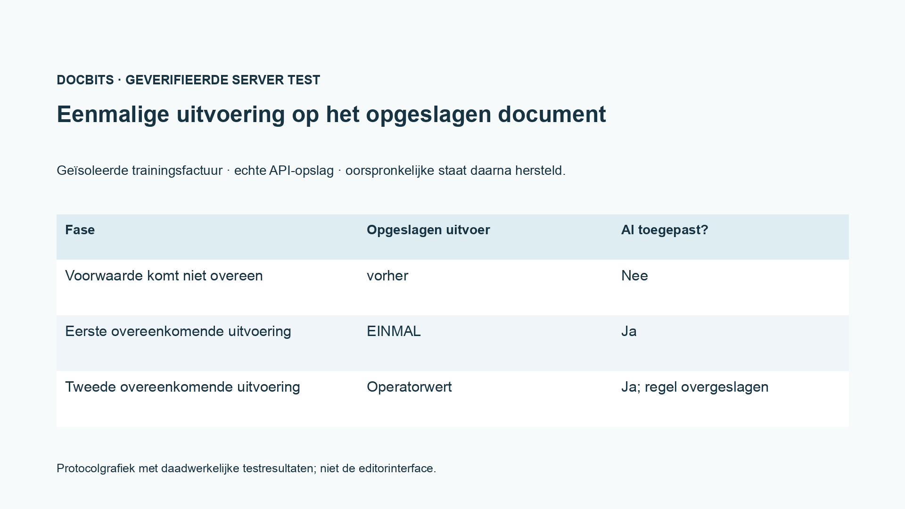
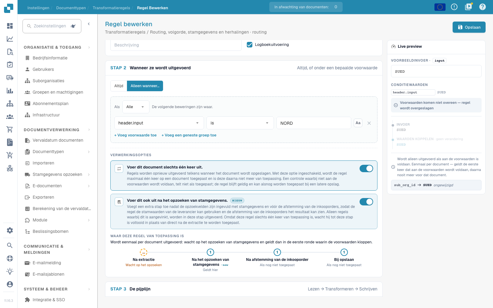

# Routing, volgorde, stamgegevens en herhalingen

[Terug naar het volledige praktijkoverzicht](complete-practical-guide.md)

Routing · Doel onderorganisatie · bestaand doel gebruiken; voorwaarden, uitvoeringsfasen en herhaling afzonderlijk controleren.

In de video-opname zijn naam en interne kenmerking van het bestaande routingdoel verborgen. Voor de eigen configuratie moet het doel afkomstig zijn uit de daadwerkelijk beschikbare onderorganisatieselectie.

## Werkwijze in de editor

1. Voor **Routing** het aangeboden documentattribuut `sub_org_id` kiezen. Uitsluitend een daadwerkelijk bestaande onderorganisatie als vast doel of als resultaat van een waardetoewijzing gebruiken.
2. Een passende leveranciers- of kenmerkingsvoorwaarde toevoegen. In het oefenvoorbeeld moet `NORD` aan de voorwaarde voldoen en `SUED` deze overslaan. De opname toont alleen de voorvertoning en verplaatst geen productieve documenten.
3. De fasenweergave vergelijken met het verloop kopveld → Routing → tabelrijen → tabelkolom. Prioriteit en regelsleutel ordenen alleen binnen hetzelfde bereik.
4. **Ook na de stamgegevenszoekactie uitvoeren** activeren en de aanvullende fase vóór de bestellingsafstemming in acht nemen. Een bron die pas uit stamgegevens komt, vereist een passende doorloop.
5. **Slechts één keer per document** eerst controleren met niet-passende voorwaarde, vervolgens eerst passend uitvoeren. In het geverifieerde trainingsgeval verbruikt de eerste overgeslagen doorloop de toepassing niet.
6. Na de eerste passende toepassing een operatorwaarde invoeren en opnieuw opslaan. De test moet aantonen dat de eenmalige regel deze waarde niet opnieuw overschrijft; voorwaarde, resultaat, fase en toepassingsbewijs in het logboek controleren.

## 1. Onderorganisatie

Routing schrijft momenteel de onderorganisatie van het document. Ik kan een vast doel uit de bestaande selectie instellen of een bronwaarde toewijzen aan een onderorganisatie. Een passende leveranciersvoorwaarde beperkt de toewijzing. Dit is noch een gebruikersautorisatie noch een vrijgavebeslissing. Ik gebruik alleen geldige bestaande onderorganisaties en controleer het tegengestelde geval. In deze aflevering blijft het routingvoorbeeld een voorvertoning; het verplaatst geen productieve documenten.

## 2. Uitvoeringsfasen

De geldigheidsbereiken lopen in de volgorde kopveld, Routing, tabelrijen en tabelkolom. Binnen een bereik gelden prioriteit en regelsleutel. Een opgeschoonde kopbron kan daarom al door Routing worden gelezen. Met de aanvullende uitvoering na de stamgegevenslookup kan een regel waarden gebruiken die pas uit stamgegevens worden aangevuld. Deze optie voegt een doorloop toe vóór de bestellingsafstemming. Het verschuift niet alle andere uitvoeringen daarnaartoe.

## 3. Eenmalige regels en bewijs

Slechts één keer per document uitvoeren beperkt een daadwerkelijk toegepaste regel. Een niet-vervulde voorwaarde verbruikt deze uitvoering nog niet. Samen met de lookup-optie wacht de regel bij de eerste extractiedoorloop op de latere fase. Voor deelstukken en reguliere expressies blijft de gescheiden bron desondanks vereist. Ik controleer een eerste toepassing, een niet-passend geval en een herhaald opslaan. In het logboek zoek ik naar voorwaarde, resultaat en uitvoeringsfase. Pas een nieuw geladen document toont het opgeslagen effect. Een ERP-ontvangst en een bestellingsafstemming vereisen elk hun eigen bewijs.

## Afname

Controleer een passend geval, een tegengesteld geval, een lege waarde en een al verwerkt resultaat. Herhaal het documentopslagproces. Controleer PO-afstemming en ERP-ontvangst aanvullend, indien deze bij het functionele doel horen.

<figure><figcaption>
Daadwerkelijke server- en persistentietestresultaten weergegeven als protocolgrafiek. Dit is geen gerecreëerde editorinterface.
</figcaption></figure>


Daadwerkelijke server- en persistentietestresultaten weergegeven als protocolgrafiek. Dit is geen gerecreëerde editorinterface.


In de opgeslagen integratietest verbruikte een niet-passende voorwaarde de eenmalige uitvoering niet. Bij het eerste passende opslaan werd EINMAL geschreven. Bij het tweede passende opslaan bleef de voorbereide operatorwaarde behouden, en het opgeslagen toepassingsbewijs was nog steeds ingesteld. Het testdocument werd vervolgens hersteld. De droge servertest kan nog steeds een hypothetisch resultaat berekenen; controleer daarom aanvullend de melding `already_applied` en het daadwerkelijk opgeslagen document.

<figure><figcaption>
Eenmalige uitvoering en de aanvullende opzoekfase in de daadwerkelijke editor. De niet-overeenkomende voorbeeldvoorwaarde wordt overgeslagen; interne routeringsdoelidentificaties zijn verborgen. Deze opties zijn een niet-opgeslagen voorvertoning.
</figcaption></figure>


Eenmalige uitvoering en de aanvullende opzoekfase in de daadwerkelijke editor. De niet-overeenkomende voorbeeldvoorwaarde wordt overgeslagen; interne routeringsdoelidentificaties zijn verborgen. Deze opties zijn een niet-opgeslagen voorvertoning.


## Videohandleiding


Configuratie, praktijkvoorbeelden en tegenvoorbeelden.


[Open de video met Nederlandse ondertitels en hoofdstukken](https://docbits-videos.fra1.cdn.digitaloceanspaces.com/settings-assistant/transformation-rules-09-routing-and-execution-preview-admin/v1/nl.html). Deze beoordelingsversie wacht op de inhoudelijke beoordeling en een volledige luistercontrole.
