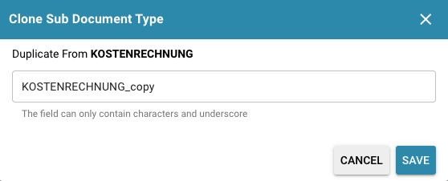

# Acties gebruiken

Hier leest u hoe u de acties "Copy" en "Delete" gebruikt om subtypen efficiënt te beheren:

## **Een subtype kopiëren:**

* Open de instellingen voor subtypebeheer in uw documentbeheersysteem.
* Selecteer het subtype dat u wilt kopiëren, klik op "Copy" en voer zo nodig een nieuwe naam in voor het gekopieerde subtype.
* Bevestig de actie. Het systeem maakt een kopie van het geselecteerde subtype met alle bestaande instellingen, velden, lay-outs en scripts.

<figure><figcaption></figcaption></figure>

## Een subtype verwijderen:

* Open de instellingen voor subtypebeheer en selecteer het subtype dat u wilt verwijderen.
* Klik op het prullenbakpictogram rechts in het actiemenu.
* Bevestig het verwijderen als er een bevestigingsmelding verschijnt.
* Houd er rekening mee dat bij het verwijderen van een subtype alle bijbehorende documenten en gegevens onherroepelijk kunnen worden verwijderd. Neem de noodzakelijke voorzorgsmaatregelen en controleer vooraf of het subtype niet meer nodig is.

Met deze acties beheert u subtypen efficiënt. Door te kopiëren kunt u bestaande configuraties hergebruiken voor nieuwe subtypen; door te verwijderen ruimt u overbodige subtypen op. Ga voorzichtig te werk bij het verwijderen om gegevensverlies te voorkomen.\
\\
