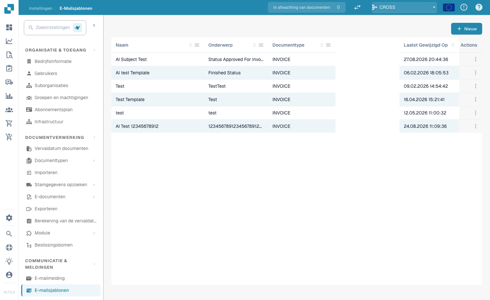
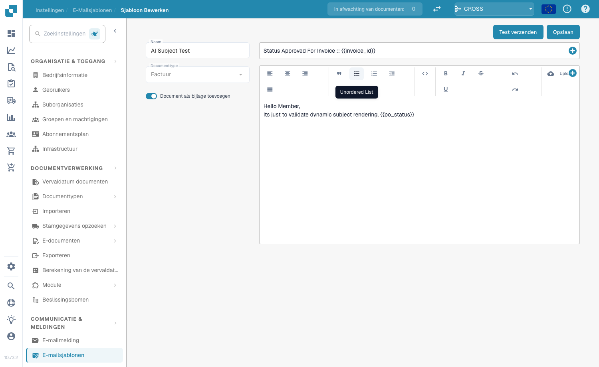
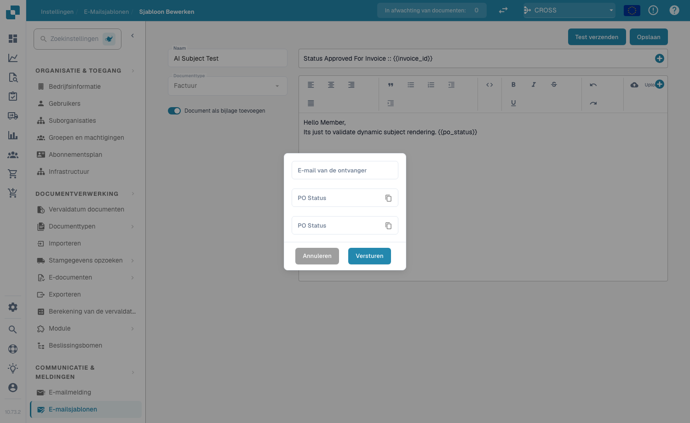

# E-Mail-templates

## **Overzicht**

Met e-mailtemplates past u de geautomatiseerde e-mails aan die DocBits verzendt — bijvoorbeeld goedkeuringsherinneringen of foutmeldingen. Een template definieert de onderwerpregel en de berichttekst en kan dynamische velden (bijv. `{{InvoiceNumber}}`), afbeeldingen en opmaak met rijke tekst bevatten.

## **Toegang tot e-mailtemplates**

Ga naar **Settings → Communication & Notifications → Email Templates**. De lijst toont elke template met de **Name**, het **Subject**, het **Document Type**, de datum **Last Modified** en **Actions** (bewerken of verwijderen).

<figure><figcaption>
De lijst met e-mailtemplates
</figcaption></figure>

## **Een template maken**

1. Klik rechtsboven op **+ New**.
2. Vul de velden in:
   * **Name** — een beschrijvende naam (bijv. "Document Error Notification").
   * **Document Type** — het documenttype waarop de template van toepassing is (bijv. `INVOICE`).
   * **Include Document As Attachment** — schakel deze optie in om het brondocument als bijlage aan de e-mail toe te voegen.
   * **Subject** — de onderwerpregel van de e-mail. Klik op de knop **+** naast het veld om een dynamisch veld in te voegen, of typ `{{FieldID}}` rechtstreeks.
3. Ontwerp de berichttekst in de editor voor rijke tekst — maak tekst op (vet, cursief, lijsten, uitlijning), voeg afbeeldingen in met **Upload**, bewerk ruwe HTML met de knop `<>` en gebruik de knop **+** om dynamische velden in te voegen.
4. Klik op **Save**.

<figure><figcaption>
De templateditor — naam, documenttype, schakelaar voor bijlage, onderwerp en berichttekst met rijke tekst
</figcaption></figure>

## **Dynamische velden**

Dynamische velden worden bij het verzenden van de e-mail vervangen door documentgegevens. Voeg ze in met de knop **+**, of typ ze handmatig met dubbele accolades:

* `{{invoice_id}}` — het factuurnummer
* `{{supplier_name}}` — de naam van de leverancier
* `{{total_amount}}` — het totaalbedrag
* `{{status}}` — de huidige documentstatus

## **Een test-e-mail verzenden**

Klik in de editor op **Send Test**, voer een **Receiver Email**-adres in en klik op **Send**. DocBits verstuurt een voorbeeld van de template, zodat u de opmaak kunt controleren en vóór het opslaan kunt nagaan of de dynamische velden correct worden ingevuld.

<figure><figcaption>
Het dialoogvenster Send Test
</figcaption></figure>

## **Templates gebruiken in meldingen**

Opgeslagen templates kunnen worden gekoppeld aan [**E-mailmelding**](email-notification/)-workflows — bijvoorbeeld goedkeuringsherinneringen of statuswijzigingen.
