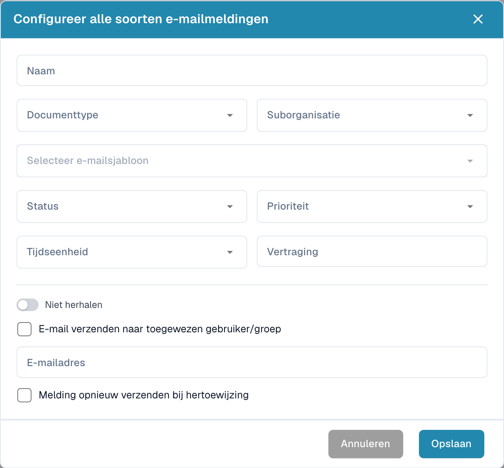

# E-mailmeldingen configureren

Open de instellingen voor e-mailmeldingen en maak een nieuwe configuratie. Bepaal het verzendmoment en de bedoelde ontvangers.

<figure><figcaption>
Configuratievenster voor een e-mailmelding.
</figcaption></figure>

1. Voer een naam in en kies het documenttype en zo nodig de suborganisatie.
2. Selecteer de e-mailsjabloon en documentstatus.
3. Stel prioriteit, tijdseenheid en vertraging in.
4. Controleer of de melding moet worden herhaald.
5. Kies de toegewezen gebruiker of groep, of voer het bedoelde e-mailadres in.
6. Controleer of een nieuwe toewijzing opnieuw tot verzending moet leiden.

Controleer ontvangers, vertragingen en berichten voordat u opslaat. De afbeelding toont een lege, niet-opgeslagen configuratie en bewijst geen verzonden e-mail.
