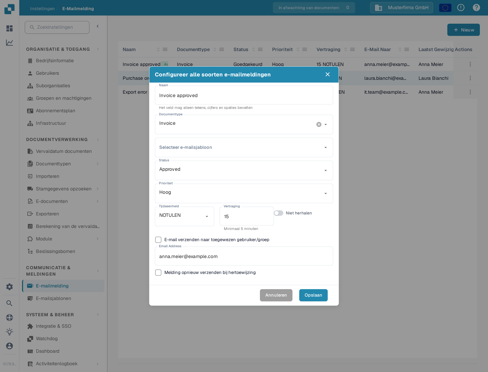
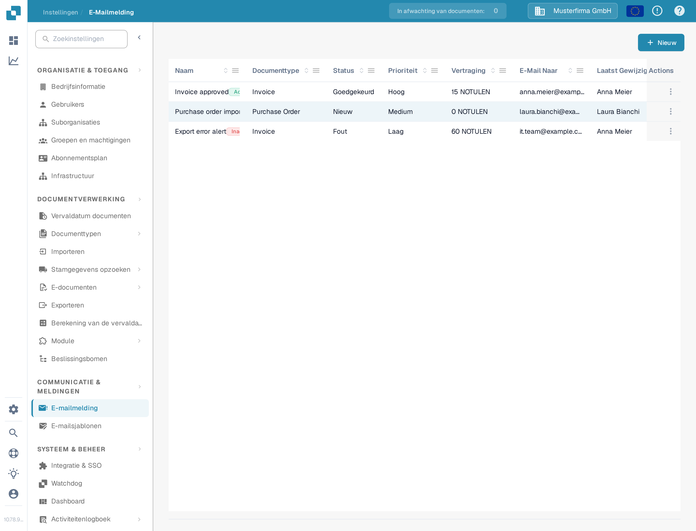
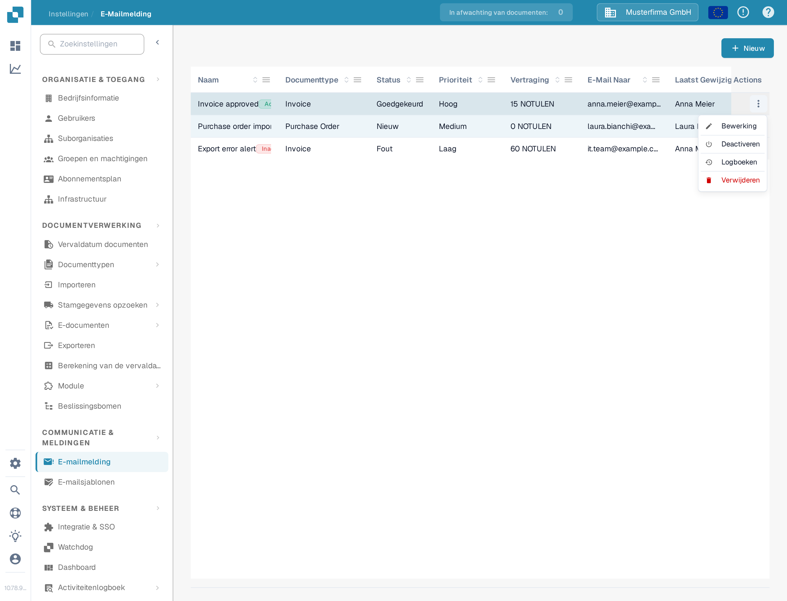

# Meldingen beheren

Open **Instellingen → E-Mailmelding** om de regels van je organisatie te bekijken. Een regel verbindt een documentstatus met een e-mailsjabloon en een ontvanger. Het onderstaande voorbeeld gebruikt een demonstratieregel voor facturen en blijft in de DocBits Sandbox **inactief**.

## Voorbeeld: een factuur is klaar voor validatie

Maak voordat je een regel aanmaakt een e-mailsjabloon voor het documenttype **Invoice** aan onder **Instellingen → E-mailsjablonen**. In dit voorbeeld heet het sjabloon **Docs Demo Invoice Notification**. Het sjabloon levert het onderwerp en de tekst van de e-mail.

1. Selecteer **Nieuw** op de pagina **E-Mailmelding**.
2. Voer een naam in, in dit voorbeeld **Docs Demo Invoice Validation**, selecteer **Invoice** als documenttype en kies het voorbereide sjabloon onder **Selecteer e-mailsjabloon**.
3. Kies de status en de prioriteit, in dit voorbeeld **Approved** en **Hoog**. Zet **Tijdseenheid** op **NOTULEN** en vul bij **Vertraging** het aantal minuten in; de app vermeldt **Minimaal 5 minuten**. Zet **Niet herhalen** aan als het bericht maar één keer mag worden verzonden.
4. Selecteer **E-mail verzenden naar toegewezen gebruiker/groep**, controleer ontvanger en timing en selecteer **Opslaan**.

<figure><figcaption>
De opgeslagen voorbeeldregel, geopend om te bewerken. De waarden tonen wanneer en naar wie de melding zou worden verzonden.
</figcaption></figure>

De regel verschijnt nu in de lijst. De voorbeeldlijst toont de kolommen **Naam**, **Documenttype**, **Status**, **Prioriteit**, **Vertraging**, **E-Mail Naar**, **Laatst Gewijzigd Door** en **Laatst Gewijzigd Op**. Controleer naam, documenttype, status, vertraging en ontvanger in je eigen lijst voordat je een regel activeert.

<figure><figcaption>
De opgeslagen voorbeelden geven je regels om in de lijst te vinden en te beheren.
</figcaption></figure>

## Regel bewerken, activeren of verwijderen

Open het menu **Actions** van de regel. **Bewerking** opent de regel met de huidige waarden. **Deactiveren** schakelt een actieve regel uit; een inactieve regel biedt **Activeren** in plaats daarvan. **Logboeken** opent de meldingsgeschiedenis van de regel. **Verwijderen** verwijdert de regel; de app vraagt dan **Weet je het zeker? Als je het record wilt verwijderen, druk dan op Delete.** Controleer ontvanger en timing voordat je een regel activeert of wijzigt.

<figure><figcaption>
De beschikbare acties hangen ervan af of de regel actief is.
</figcaption></figure>

Als de lijst **No Record Found!** toont, maak dan eerst een regel aan. Als de lijst **Documenttype** of de lijst met e-mailsjablonen leeg is, configureer dan eerst een actief documenttype en een passend sjabloon voordat je naar dit formulier terugkeert.

Zie voor de eerste configuratie [Meldingen configureren](configuring-notifications.md). Als e-mails niet aankomen zoals verwacht, zie [Problemen oplossen](troubleshooting.md).
