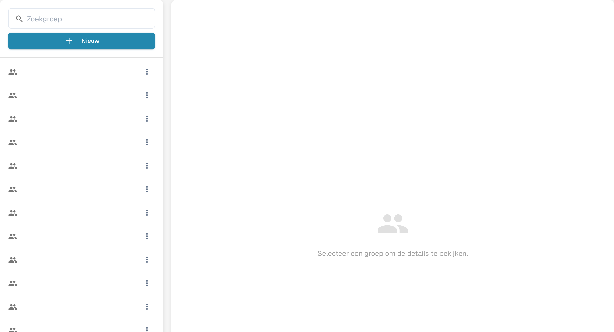

# Groepen, gebruikers en machtigingen

## Een groep maken en documenttoegang testen

Maak, terwijl groepsrechten al zijn ingeschakeld, een beoordelaarsgroep en voeg een testgebruiker zonder beheerdersrechten toe. Sta het tonen in de lijst, bekijken en bewerken van toegewezen facturen toe; laat verwijderen, bulkupdates en goedkeuringen uitgeschakeld. Sla op, open de instellingen opnieuw en meld u aan als gewone gebruiker: de toegewezen factuur is zichtbaar en het niet-toegewezen controledocument ontbreekt.

Deze instellingen beantwoorden drie verschillende vragen: wie zich kan aanmelden, in welke suborganisatie iemand werkt en wat de groep van die persoon mag doen.

| Als u wilt… | Open… |
| --- | --- |
| Het account van een persoon toevoegen of bewerken | **Instellingen** → **Gebruikers**; lees vervolgens [Gebruikers](users/README.md). |
| Toegang organiseren over bedrijfsonderdelen heen | **Instellingen** → **Suborganisaties**; lees vervolgens [Suborganisaties](sub-organizations/README.md). |
| Toegang per groep beheren | **Instellingen** → **Groepen en machtigingen**; lees vervolgens [Groepen en machtigingen](groups-and-permissions/README.md). |

<figure><figcaption>
Paneel voor groepsselectie.
</figcaption></figure>

Als een gebruiker een document of actie niet kan zien, controleer dan eerst het account en de organisatie van die gebruiker. Controleer daarna de betreffende groepsmachtigingen. Gebruik een testaccount zonder beheerdersrechten om te bevestigen welke toegang een gewone gebruiker daadwerkelijk heeft, voordat u een live organisatie wijzigt.
