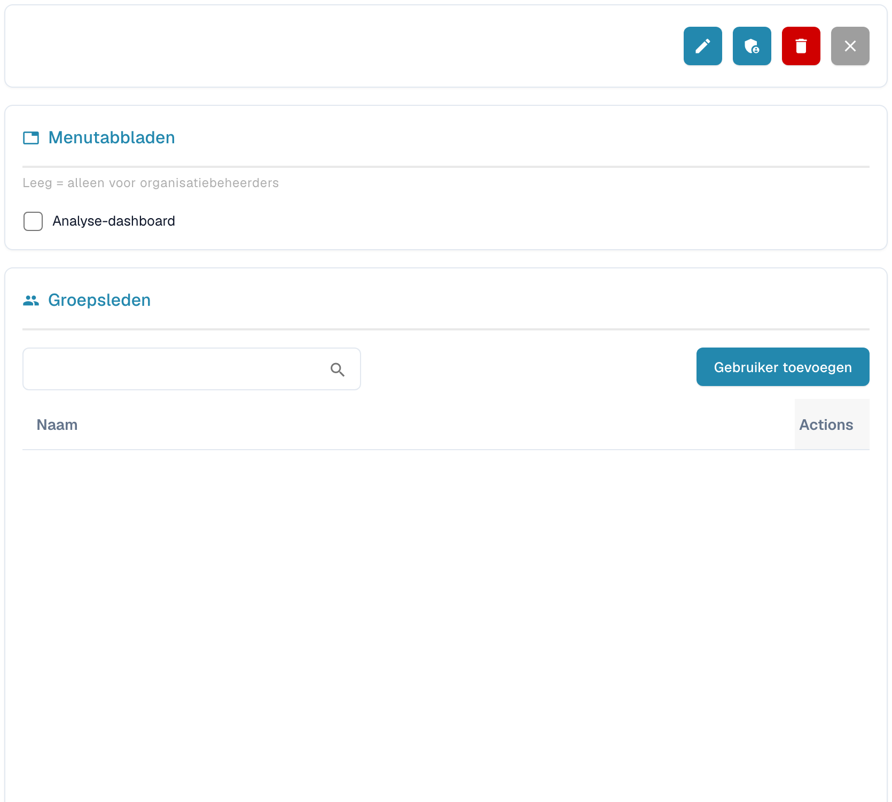

# Groepen en machtigingen


DocBits Zelfstudie Groepen en machtigingen: gebruikersrollen en toegangsrechten instellen en uw werkruimte beveiligen


<figure><figcaption>
Details van de geselecteerde groep; persoonsgegevens zijn afgeschermd.
</figcaption></figure>

Met groepen en machtigingen bepaalt u welke gebruikers toegang hebben tot bepaalde documenttypen en welke acties zij mogen uitvoeren.

## Groepen en machtigingen activeren/deactiveren

Gebruik de schakelaar bovenaan de pagina om het systeem van groepen en machtigingen in of uit te schakelen. Wanneer het systeem is uitgeschakeld, gebruikt het een eenvoudiger toegangsmodel zonder groepsgebonden beperkingen.

## Groepenlijst

De tabel toont alle geconfigureerde groepen met:

| Kolom | Beschrijving |
|--------|-------------|
| **Groepsnaam** | De naam van de groep. |
| **Groepsbeschrijving** | Een korte beschrijving van het doel van de groep. |
| **Acties** | Menu met opties om de groep te bewerken of te verwijderen. |

Gebruik de zoekbalk **Zoekopdracht** om groepen op naam te vinden. Klik op **+ New** om een nieuwe groep te maken.

## Groepsmachtigingen configureren

Wanneer u een groep selecteert (via het menu Actions → Edit), verschijnt een machtigingentabel waarin u de toegang per documenttype configureert:

| Machtiging | Beschrijving |
|------------|-------------|
| **Weergave** | Machtiging om documenten van dit type te bekijken. |
| **Bijwerken** | Machtiging om documenten van dit type te wijzigen. |
| **Verwijderen** | Machtiging om documenten van dit type te verwijderen. |
| **Eerste goedkeuring** | Machtiging om de eerste goedkeuring uit te voeren. |
| **Tweede goedkeuring** | Machtiging om een tweede goedkeuringsniveau uit te voeren (indien van toepassing). |

Elke rij in de machtigingentabel vertegenwoordigt een documenttype (bijv. Invoice, Credit Note, Delivery Note). Schakel de selectievakjes in of uit om machtigingen aan die groep te verlenen of in te trekken.

## Een nieuwe groep maken

1. Klik rechtsboven op **+ New**.
2. Voer een **Groepsnaam** en een optionele **Beschrijving** in.
3. Configureer de machtigingen voor elk documenttype.
4. Wijs gebruikers aan de groep toe.
5. Klik op **Opslaan** om toe te passen.
