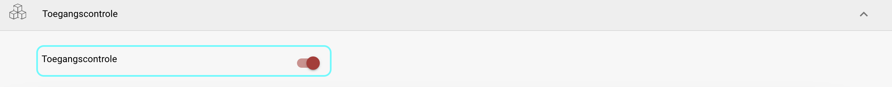
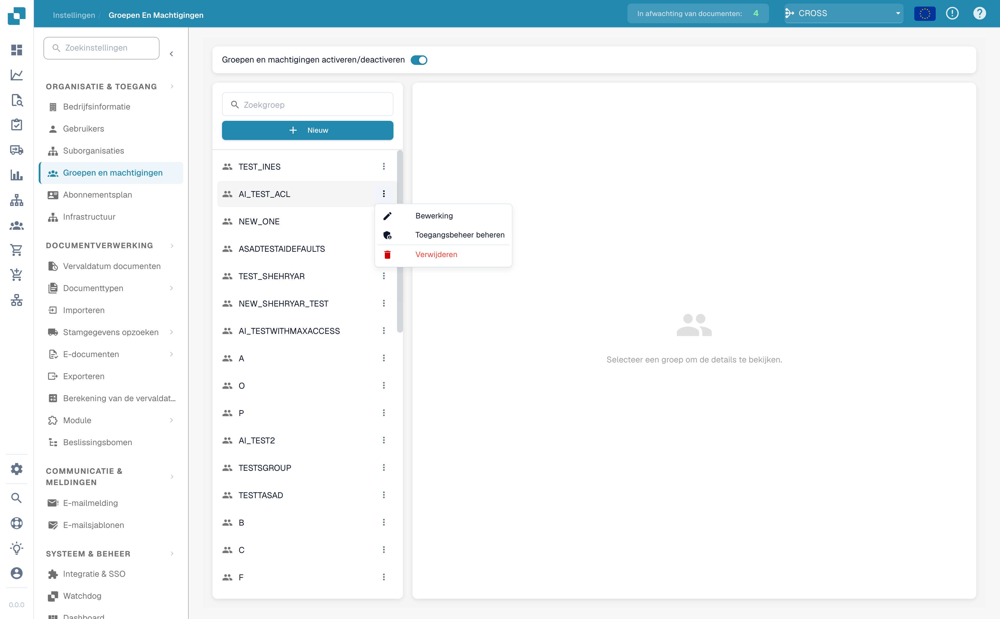
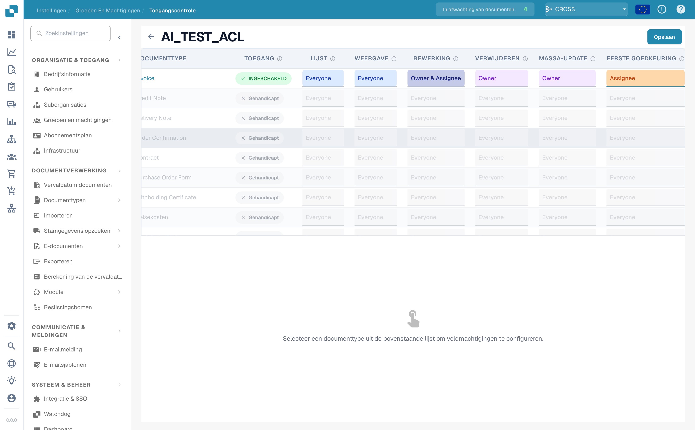
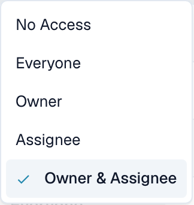
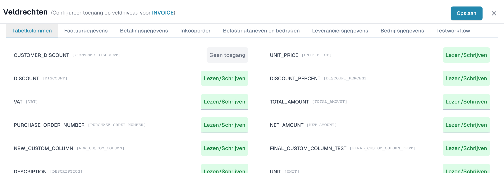

# Toegangscontrole

## Overzicht

Toegangscontrole bepaalt voor één enkele **groep** (rol) precies wat haar leden mogen doen — zowel op **documenttype-niveau** (welke documenttypen ze zien en welke acties ze mogen uitvoeren) als op **veldniveau** (welke afzonderlijke velden ze mogen lezen of bewerken).

Machtigingen worden altijd **per groep** geëvalueerd. Een gebruiker erft de machtigingen van elke groep waartoe hij behoort.


Toegangscontrole wordt alleen toegepast wanneer het systeem **Groepen & Machtigingen** is ingeschakeld (zie [Machtigingen activeren](activating-permissions.md)). **Beheerders omzeilen Toegangscontrole altijd** en kunnen alles zien en doen, ongeacht de instellingen op deze pagina.


Elke groep kan worden geconfigureerd voor:

* **Documenttoegang** — of de groep een documenttype mag gebruiken.
* **Actiemachtigingen** — welke acties (weergeven in lijst, bekijken, bewerken, verwijderen, bulkupdate, goedkeuren) de groep mag uitvoeren en _voor welke documenten_.
* **Veldmachtigingen** — of elk afzonderlijk veld van een documenttype bewerkbaar, alleen-lezen of verborgen is.

## Activering

1. Ga naar **Instellingen**.
2. Selecteer **Documentverwerking**.
3. Selecteer **Module.**
4. Activeer **Toegangscontrole** door de schuifregelaar in te schakelen.

<figure><figcaption></figcaption></figure>

## De Toegangscontrole van een groep openen

1. Ga naar **Instellingen**.
2. Ga naar **Globale Instellingen**.
3. Selecteer **Groepen, Gebruikers en Machtigingen**.
4. Selecteer **Groepen en Machtigingen**.
5. Om de machtigingen van een groep te beheren (bijvoorbeeld PROCUREMENT\_DIRECTOR), klikt u op de drie puntjes aan de rechterkant.
6. Selecteer **Toegangscontrole beheren**.

<figure><figcaption>
Open op de pagina 'Groepen en Machtigingen' het <strong>⋮</strong>-menu van een groep en kies <strong>Toegangscontrole beheren</strong>.
</figcaption></figure>

## Hoe een machtiging wordt geëvalueerd

Wanneer een gebruiker iets met een document probeert te doen, controleert DocBits, in volgorde:

1. **Is het systeem Groepen & Machtigingen ingeschakeld en is de gebruiker geen beheerder?** Indien uit, of de gebruiker is beheerder → volledige toegang.
2. **Is het documenttype ingeschakeld voor een van de groepen van de gebruiker?** Indien uitgeschakeld → de gebruiker kan dat documenttype niet zien of gebruiken.
3. **Welk toegangsbereik is ingesteld voor de actie?** (bijvoorbeeld _Bewerken = Owner_). Het bereik wordt vergeleken met de relatie van de gebruiker tot _dit specifieke document_ — is hij de eigenaar, de toegewezene, beide of geen van beide?
4. **Welke veldmachtiging geldt?** Zelfs wanneer een gebruiker een document mag openen, kunnen afzonderlijke velden nog steeds verborgen of vergrendeld zijn.

## Machtigingen op documenttype-niveau

Elke rij van de matrix is een documenttype (Invoice, Credit Note, Purchase Order, …).

De eerste kolom is een schakelaar **Ingeschakeld / Uitgeschakeld**. Schakel hem uit en de groep kan dat documenttype helemaal niet gebruiken — het verdwijnt uit hun dashboard. Schakel hem in en de zeven actiekolommen worden bewerkbaar.

| Actie                  | Bepaalt of de groep kan…                       |
| ---------------------- | ---------------------------------------------- |
| **Lijst**              | het documenttype in de dashboardlijst zien.    |
| **Bekijken**           | een document openen en de details bekijken.    |
| **Bewerken**           | veldwaarden van een document wijzigen.         |
| **Verwijderen**        | een document verwijderen.                      |
| **Bulkupdate**         | meerdere documenten tegelijk bijwerken.        |
| **Eerste Goedkeuring** | de goedkeuring van het eerste niveau verlenen. |
| **Tweede Goedkeuring** | de goedkeuring van het tweede niveau verlenen. |

### Toegangsbereiken

Elke actiekolom is een vervolgkeuzelijst. De gekozen waarde beantwoordt de vraag _'voor welke documenten mag de groep dit doen?'_. De namen van de bereiken verschijnen in het Engels in de interface:

| Bereik               | Wie is toegestaan                                                      | Effect op een document                                                                                     |
| -------------------- | ---------------------------------------------------------------------- | ---------------------------------------------------------------------------------------------------------- |
| **No Access**        | Niemand in de groep.                                                   | De actie is geblokkeerd voor iedereen in de groep — de knop is verborgen of uitgeschakeld.                 |
| **Everyone**         | Elk lid van de groep.                                                  | Elk groepslid kan de actie uitvoeren op **elk** document van dit type.                                     |
| **Owner**            | Alleen de gebruiker die het document heeft **aangemaakt / geüpload**.  | De actie werkt alleen op documenten die de gebruiker zelf heeft geüpload.                                  |
| **Assignee**         | Alleen de gebruiker (of groep) aan wie het document is **toegewezen**. | De actie werkt alleen op documenten die zijn toegewezen aan de gebruiker of een groep waartoe hij behoort. |
| **Owner & Assignee** | De eigenaar **of** de toegewezene.                                     | De actie werkt als de gebruiker _ofwel_ de uploader _ofwel_ de toegewezene is.                             |


**Owner** en **Assignee** hangen af van de _relatie tussen de gebruiker en elk afzonderlijk document_, dus twee leden van dezelfde groep kunnen verschillende rechten hebben op dezelfde factuur — zie het uitgewerkte voorbeeld hieronder.


<figure><figcaption>
De matrix met machtigingen per documenttype. Hier is het type <strong>Invoice</strong> ingeschakeld en hebben de acties verschillende toegangsbereiken; de andere typen zijn uitgeschakeld.
</figcaption></figure>

<figure><figcaption>
Elke actiekolom biedt dezelfde vijf toegangsbereiken.
</figcaption></figure>

### Goedkeuring vereist ook Bewerken

Het goedkeuren van een document veroorzaakt op de achtergrond **twee acties**: DocBits **slaat** eerst het document op en zet het daarna op de goedgekeurde status. De opslagstap vereist de machtiging **Bewerken**, dus de twee machtigingen zijn gekoppeld.

Een gebruiker die alleen **Eerste Goedkeuring** of **Tweede Goedkeuring** krijgt — maar _niet_ **Bewerken** — krijgt een machtigingsfout bij de opslagstap en kan het document niet goedkeuren.


Telkens wanneer u **Eerste Goedkeuring** of **Tweede Goedkeuring** verleent, verleen dan ook **Bewerken** (en **Bekijken**) voor hetzelfde documenttype. Een goedkeuringsmachtiging op zichzelf is niet voldoende.


## Machtigingen op veldniveau

Klik op een documenttype-rij om eronder het paneel **Veldmachtigingen** te openen. Velden zijn georganiseerd in tabbladen (bijvoorbeeld _Tabelkolommen_, _Factuurgegevens_, _Betalingsgegevens_, _Belastingen en bedragen_). Elk veld heeft zijn eigen toegangsniveau:

| Niveau              | Effect op het veld                                                                                |
| ------------------- | ------------------------------------------------------------------------------------------------- |
| **Lezen/Schrijven** | Het veld is zichtbaar **en** bewerkbaar.                                                          |
| **Alleen-lezen**    | Het veld is zichtbaar maar **kan niet worden bewerkt** (grijs).                                   |
| **Goedkeuring**     | Het veld kan worden bewerkt, maar de wijziging moet eerst een **goedkeuringsworkflow** doorlopen. |
| **Geen toegang**    | Het veld is **volledig verborgen** — de gebruiker ziet het nooit.                                 |


Veldregels gelden gelijk voor **alle** leden van de groep — ze hangen niet af van eigenaar/toegewezene. Gebruik ze om gevoelige velden (bijvoorbeeld een korting of een totaalbedrag) voor een hele groep te verbergen of te vergrendelen.


<figure><figcaption>
Het paneel 'Veldmachtigingen' voor het type Invoice. <code>CUSTOMER_DISCOUNT</code> is verborgen (Geen toegang) terwijl de andere velden op Lezen/Schrijven blijven.
</figcaption></figure>

## Uitgewerkt voorbeeld: wat Toegangscontrole doet bij een echte factuur

Stel dat u een groep **AP\_CLERK** aanmaakt voor uw crediteurenadministratie en het documenttype **Invoice** als volgt configureert:

**Documenttype-machtigingen voor Invoice**

| Actie              | Bereik           |
| ------------------ | ---------------- |
| Ingeschakeld       | ✅ Aan            |
| Lijst              | Everyone         |
| Bekijken           | Everyone         |
| Bewerken           | Owner & Assignee |
| Verwijderen        | No Access        |
| Bulkupdate         | No Access        |
| Eerste Goedkeuring | Assignee         |
| Tweede Goedkeuring | No Access        |

**Veldmachtigingen voor Invoice**

| Veld                   | Niveau          |
| ---------------------- | --------------- |
| `TOTAL_AMOUNT`         | Alleen-lezen    |
| `CUSTOMER_DISCOUNT`    | Geen toegang    |
| _(alle andere velden)_ | Lezen/Schrijven |

Volg nu één concreet document — de factuur **INV-4711**, die **Maria heeft geüpload** en die is **toegewezen aan Maria**. Zowel Maria als haar collega Tom zitten in de groep **AP\_CLERK**.

**Maria (eigenaar&#x20;**_**en**_**&#x20;toegewezene van INV-4711):**

* ✅ Ziet INV-4711 in de dashboardlijst _(Lijst = Everyone)_.
* ✅ Opent het _(Bekijken = Everyone)_.
* ✅ Bewerkt de leveranciersnaam en regels _(Bewerken = Owner & Assignee — zij is de eigenaar)_.
* 🔒 Ziet `TOTAL_AMOUNT`, maar het veld is grijs en ze kan het niet wijzigen _(Alleen-lezen)_.
* 🚫 Ziet het veld `CUSTOMER_DISCOUNT` nooit _(Geen toegang)_.
* 🚫 De knop **Verwijderen** is verborgen _(Verwijderen = No Access — niemand in de groep mag verwijderen)_.
* ✅ Kan de **eerste goedkeuring** verlenen _(Eerste Goedkeuring = Assignee — zij is de toegewezene)_.

**Tom (zelfde groep, maar heeft INV-4711&#x20;**_**niet**_**&#x20;geüpload en het is&#x20;**_**niet**_**&#x20;aan hem toegewezen):**

* ✅ Ziet het in de lijst en ✅ opent het _(Lijst en Bekijken = Everyone)_.
* 🚫 Kan niets bewerken — het document opent **alleen-lezen** _(Bewerken = Owner & Assignee — Tom is geen van beide)_.
* 🔒 / 🚫 Ziet exact dezelfde veldzichtbaarheid als Maria: `TOTAL_AMOUNT` vergrendeld, `CUSTOMER_DISCOUNT` verborgen _(veldregels gelden voor de hele groep)_.
* 🚫 Kan de eerste goedkeuring niet verlenen _(Eerste Goedkeuring = Assignee — niet Tom)_.
* 🚫 Kan niet verwijderen _(No Access)_.

**Wat dit voorbeeld laat zien**

* **Everyone** opent een document voor alle groepsleden; **Owner / Assignee** beperkt een actie tot de personen die met dat specifieke document verbonden zijn.
* **No Access** verwijdert een actie (Verwijderen) of verbergt een veld (`CUSTOMER_DISCOUNT`) voor de hele groep.
* **Alleen-lezen** houdt een veld zichtbaar ter referentie (`TOTAL_AMOUNT`) maar voorkomt wijzigingen.
* Twee personen in **dezelfde groep** kunnen **verschillende rechten op dezelfde factuur** hebben, puur door wie hem heeft geüpload en aan wie hij is toegewezen.
