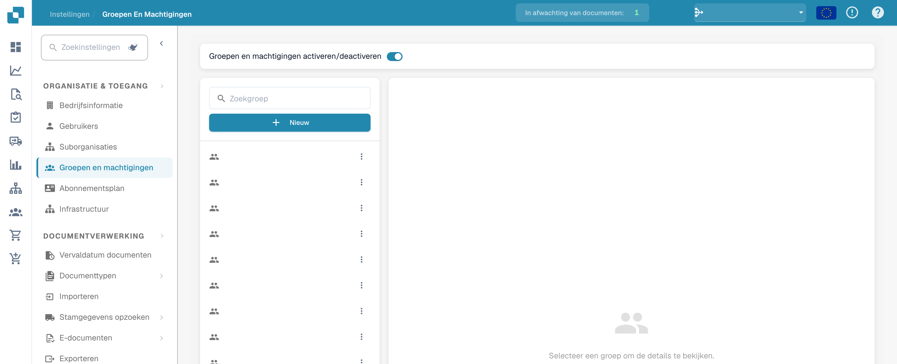
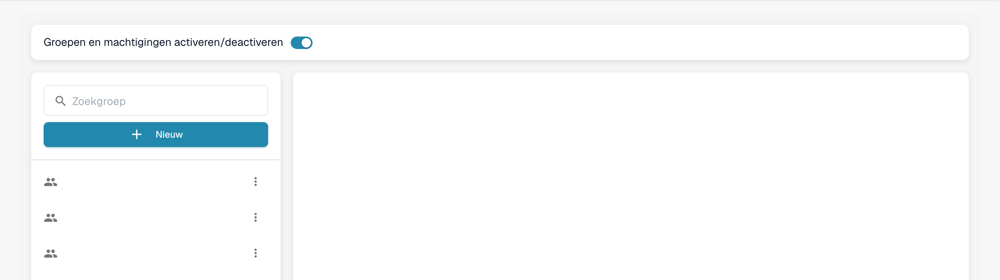
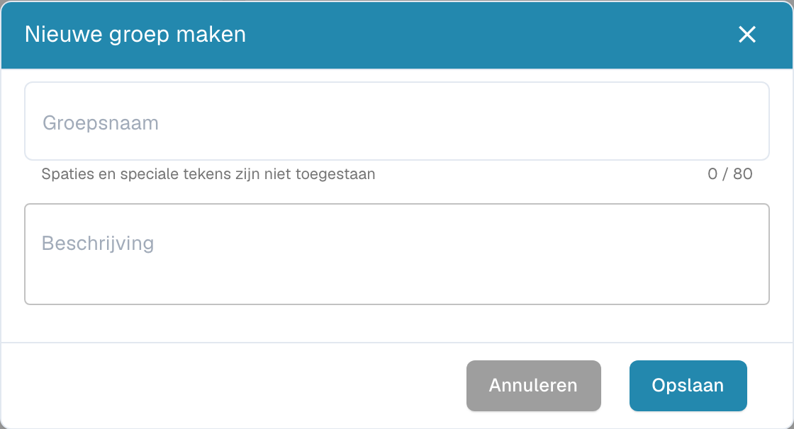
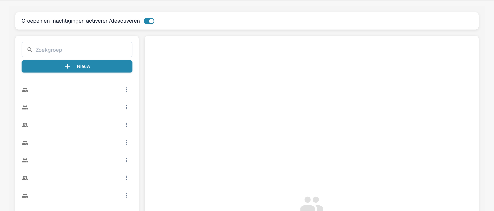

# Groepen toevoegen en bewerken


DocBits-beheerdershandleiding: gebruikers, groepen en rechten beheren (volledige uitleg)


## Een groep toevoegen of de rechten van een bestaande groep wijzigen

* **Groepsinstellingen openen:** meld u aan met uw beheerdersaccount en open de groepsinstellingen in het beheerpaneel.

<figure><figcaption>
Toegang tot instellingen voor groepen en rechten.
</figcaption></figure>

Het volgende venster wordt geopend:

<figure><figcaption>
Groepslijst met afgeschermde namen.
</figcaption></figure>

* **Op de knop + New klikken:** klik op + New om een nieuwe groep toe te voegen.

<figure><figcaption>
Venster voor een niet-opgeslagen nieuwe groep.
</figcaption></figure>

* **Het formulier invullen:** voer de groepsnaam en een beschrijving van de groep in.
* **Gegevens opslaan:** klik na het invullen van de groepsnaam en beschrijving op de knop "Save" om op te slaan.

<figure><figcaption>
Beheer van groepen en rechten.
</figcaption></figure>

## Groepen bewerken:

* **Groepen bewerken:** klik op "edit" om de groepsnaam te wijzigen.

<figure><figcaption></figcaption></figure>

<figure><figcaption></figcaption></figure>

* **Groepen en rechten inschakelen:** schakel "Groups & permissions" in om de groep zichtbaar te maken.

<figure><figcaption></figcaption></figure>

* **Resultaat controleren:** controleer na het opslaan of de groep correct is toegevoegd, bewerkt of bijgewerkt.
