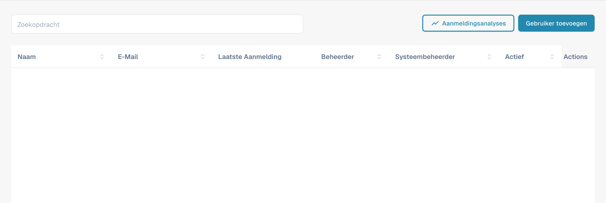
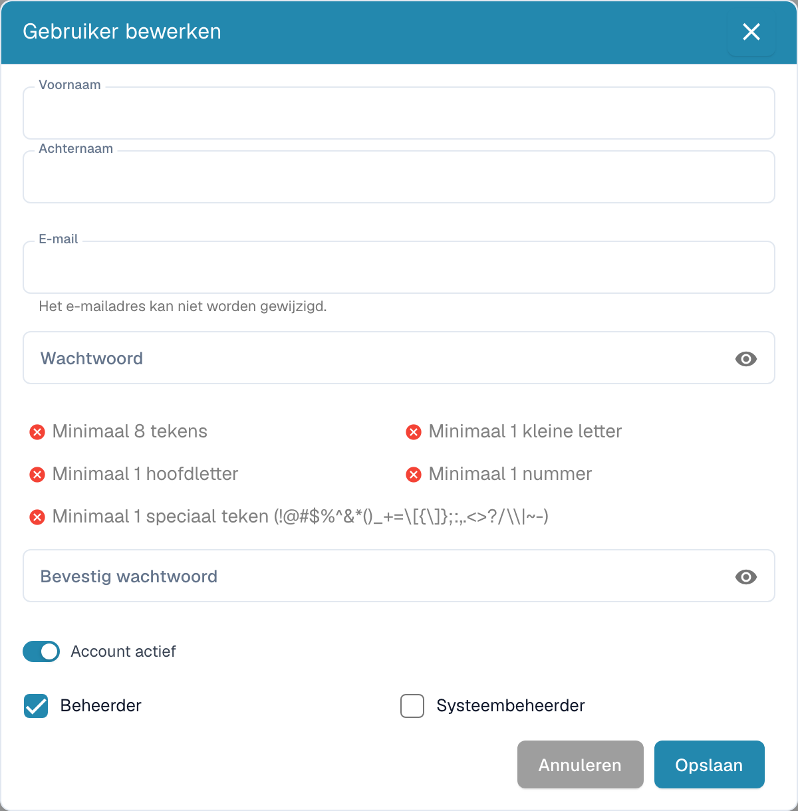

# Gebruikersgegevens wijzigen

Open als bevoegde beheerder het gebruikersbeheer en zoek de bedoelde gebruiker. Controleer zorgvuldig het account voordat u een bewerkactie opent.

<figure><figcaption>
Gebruikersbeheer met afgeschermde persoonsgegevens.
</figcaption></figure>

Open de bewerkingsdialoog van de bedoelde gebruiker.

<figure><figcaption>
Bewerkformulier voor een gebruiker; waarden zijn afgeschermd.
</figcaption></figure>

## Gegevens en rechten controleren

Controleer de getoonde naam, het e-mailadres en de beschikbare rollen of beheerdersopties. De bewerkbare eigenschappen hangen af van uw rechten en het account. Wijzig uitsluitend de bedoelde gegevens en controleer het formulier voordat u opslaat. De afbeelding bevat afgeschermde voorbeeldwaarden en bewijst geen opgeslagen wijziging.

Controleer na een wijziging van rollen of de gebruiker de bedoelde toegang heeft. Laat vereiste gebruikersmeldingen via het afgesproken proces verlopen; het openen of opslaan van dit formulier bewijst geen verzonden bericht.

## Toegang verwijderen

Controleer vóór verwijdering welke taken en documenten aan het account zijn toegewezen. Draag verantwoordelijkheden over aan de bedoelde opvolger en controleer het geselecteerde account opnieuw. Gebruik pas daarna de beschikbare verwijderactie en de getoonde bevestiging. Controleer het resultaat en de resterende toegang. De schermafbeelding toont geen uitgevoerde verwijdering.

Zie [Gebruikers](README.md) en [Beheerdersrechten](admin-privileges.md) voor de toepasselijke rollen en beperkingen.
