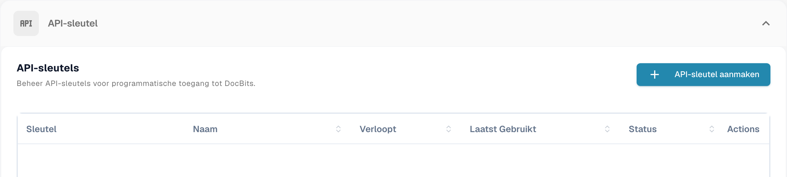
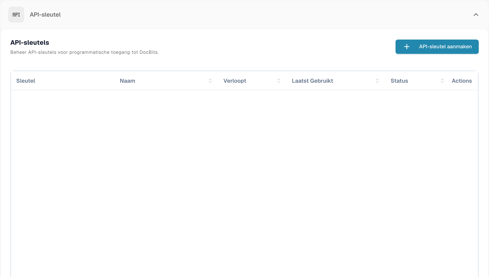
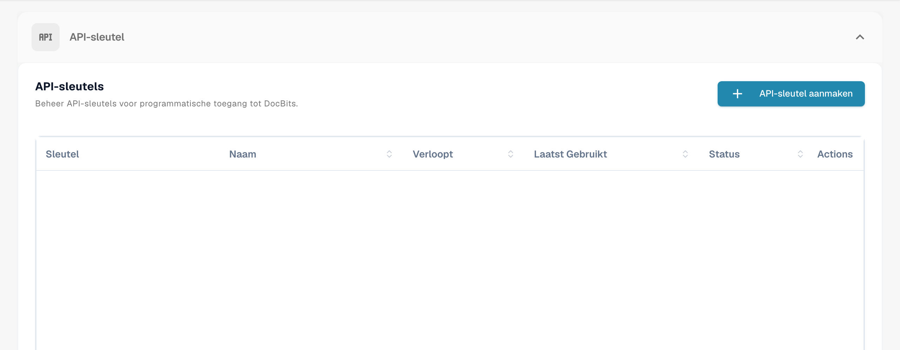
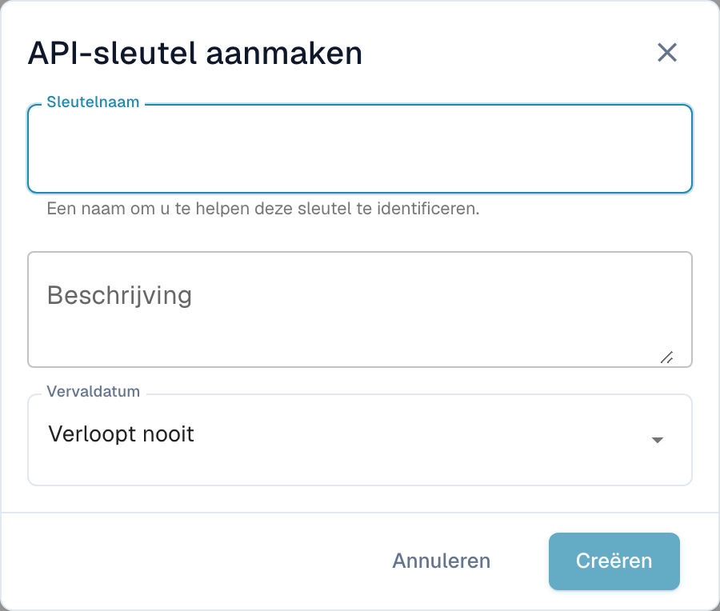

# API Key Management

Met een API key kan een ander systeem — uw ERP, een script of een partnerapplicatie — met DocBits praten zonder dat een gebruiker inlogt. Uw organisatie kan zoveel sleutels aanhouden als u nodig hebt, en elke sleutel wordt apart beheerd: geef die een eigen naam, bepaal of die verloopt, en trek die afzonderlijk in als die ooit wordt blootgesteld.

Doordat elke integratie een eigen sleutel kan hebben, kunt u er één uitschakelen zonder de andere te storen.

## Het beheer van API keys openen

Ga naar **Instellingen** en selecteer **Integratie & SSO** onder **Systeem & Beheer**.

<figure><figcaption>
Toegang tot API-sleutelbeheer.
</figcaption></figure>

De sectie **API-sleutel** bovenaan de pagina toont elke sleutel die uw organisatie heeft.

<figure><figcaption>
API-sleutellijst zonder sleutels of bijbehorende namen.
</figcaption></figure>

## De lijst begrijpen

<figure><figcaption>
API-sleutellijst; sleutels en accountgegevens zijn afgeschermd.
</figcaption></figure>

| Kolom | Wat die u vertelt |
| --- | --- |
| **Sleutel** | De eerste tekens van de sleutel, gevolgd door `****`. De rest wordt na het aanmaken nooit meer getoond — zie [Een API-sleutel aanmaken](#een-api-sleutel-aanmaken). |
| **Naam** | De naam die u de sleutel hebt gegeven, met de beschrijving eronder. |
| **Verloopt** | De datum waarop de sleutel stopt met werken, of **Nooit** als u er geen hebt ingesteld. |
| **Laatst gebruikt** | Wanneer er voor het laatst een verzoek met deze sleutel binnenkwam. **Nooit gebruikt** betekent dat nog geen enkel systeem die heeft gebruikt — handig om sleutels op te sporen die u veilig kunt verwijderen. |
| **Status** | **Actief** betekent dat de sleutel werkt. Een ingetrokken sleutel is permanent uitgeschakeld. |
| **Acties** | Het menu met drie puntjes, waar u de sleutel kunt intrekken. |

Als u meer sleutels hebt dan er op één pagina passen, gebruik dan de paginabesturing onderaan de lijst.


**Laatst gebruikt** is de snelste manier om sleutels te vinden die niemand meer nodig heeft. Een sleutel die nooit is gebruikt, of al maanden niet, is een goede kandidaat om in te trekken.


## Een API-sleutel aanmaken

1. Klik op **+ Create API Key** rechtsboven in de sectie API Keys.
2. Vul het dialoogvenster in:

<figure><figcaption>
Venster om een API-sleutel te maken, zonder op te slaan.
</figcaption></figure>

| Veld | Wat in te vullen |
| --- | --- |
| **Sleutelnaam** | Verplicht. Noem die naar het systeem dat die gaat gebruiken — `M3 Production`, `Invoice Import Script` — zodat u later kunt zien bij welke integratie een sleutel hoort. |
| **Beschrijving** | Optioneel. Ruimte voor een notitie over waar de sleutel voor is of wie die heeft ingesteld. |
| **Vervaldatum** | Kies een vervaldatum, of laat die op **Verloopt nooit** staan. Een vervaldatum is de veiligere keuze: de sleutel trekt zichzelf terug als de integratie ooit wordt vergeten. |

3. Klik op **Creëren**. DocBits toont u de nieuwe sleutel:

4. Kopieer de sleutel met het kopieerpictogram en plak die rechtstreeks in het systeem dat die gaat gebruiken, of in uw wachtwoordmanager.
5. Vink **Ik heb deze sleutel gekopieerd en opgeslagen.** aan en klik op **Done**.


**De volledige sleutel wordt maar één keer getoond.** DocBits slaat een eenrichtingshash van de sleutel en een kort herkenningsvoorvoegsel op. Uw beheerders en DocBits-support kunnen de oorspronkelijke volledige sleutel niet uit die hash ophalen. Raakt u de sleutel kwijt, trek deze dan in en maak een nieuwe aan.


Behandel de sleutel als een wachtwoord. Wie die heeft, kan handelen met de documenten en gegevens van uw organisatie.

Zie [Veilige opslag van inloggegevens](../../../../security/secure-storage-of-credentials.md).

De volledige API-sleutel verschijnt slechts eenmaal na het aanmaken. Kopieer de sleutel naar de goedgekeurde veilige opslag en controleer dit voordat u het venster sluit. De lijst toont de volledige geheime sleutel niet opnieuw.
