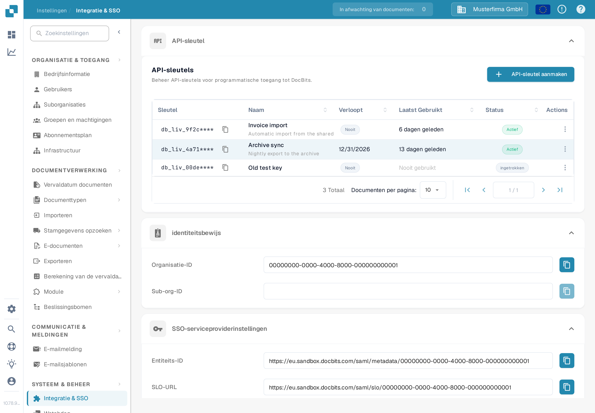

# API-sleutel

<figure><figcaption>
Instellingen → Integratie &amp; SSO → API-sleutel. De voorbeeldsleutels tonen een prefix gevolgd door afgeschermde tekens.
</figcaption></figure>

De sectie **API-sleutel** bovenaan de pagina Integratie & SSO toont elke API-sleutel die uw organisatie heeft aangemaakt. Met een API-sleutel kan een ander systeem — uw ERP, een script of een partnerapplicatie — toegang krijgen tot DocBits zonder dat een gebruiker inlogt. Voor stapsgewijze instructies raadpleegt u [API-sleutelbeheer](api-key-management.md).

### API-sleutellijst

* **Sleutel:** De eerste tekens van de sleutel, gevolgd door `****`. De volledige sleutel wordt slechts één keer getoond, bij het aanmaken, en kan daarna niet meer worden bekeken. Het kopieerpictogram naast de sleutel kopieert het zichtbare prefix naar uw klembord.
* **Naam / Verloopt / Laatst gebruikt / Status:** Elke rij toont de naam van de sleutel, wanneer deze stopt met werken, wanneer een verzoek deze voor het laatst heeft gebruikt en of deze nog actief is.
* **API-sleutel aanmaken:** Opent een dialoogvenster om een nieuwe sleutel voor een integratie aan te maken. Zie [API-sleutelbeheer](api-key-management.md) voor de velden en de eenmalige weergave van de sleutel.
* **Actions (menu met drie puntjes):** Opent de acties voor een sleutel, waar u de naam kunt bewerken, de sleutel kunt intrekken of een reeds ingetrokken sleutel kunt verwijderen. Intrekken schakelt de sleutel permanent uit.

### SSO (Single Sign-On) serviceproviderinstellingen

Dit zijn de waarden die uw identiteitsprovider nodig heeft om gebruikers met uw bedrijfsaanmelding te laten inloggen op DocBits. Voor de volledige installatiegids raadpleegt u [Configuring Single Sign-On (SSO)](configuring-single-sign-on-sso/).

* **Entiteits-ID:** De identificatie van DocBits als serviceprovider in de SSO-configuratie. Het kopieerpictogram kopieert de waarde naar uw klembord.
* **SLO-URL (Single Logout):** Het eindpunt van de SAML-service voor Single Logout van DocBits. Het kopieerpictogram kopieert de waarde.
* **SSO-URL:** Het Assertion Consumer Service-eindpunt (ACS) van DocBits ontvangt SAML-antwoorden van de identiteitsprovider. Gebruik dit als antwoord-URL (ACS-URL) in de configuratie van de identiteitsprovider. Het kopieerpictogram kopieert de waarde.
* **Certificaat downloaden:** Downloadt het beveiligingscertificaat dat uw identiteitsprovider nodig heeft om DocBits te vertrouwen.
* **Metagegevens downloaden:** Downloadt het SAML-metadatabestand dat direct in de meeste identiteitsproviders kan worden geïmporteerd.

### Identiteitsserviceproviderinstellingen

Configureer DocBits om uw externe identiteitsprovider (IdP) voor het inloggen te gebruiken. Voor de volledige gids raadpleegt u [Identity Service Provider Configuration](identity-service-provider-configuration.md).

* **Huurder-ID:** De tenant-identificatie van uw identiteitsprovider, gebruikt wanneer DocBits integreert met clouddiensten die toegang per tenant beheren.
* **Bestand uploaden:** Selecteer het XML-metadatabestand dat uw identiteitsprovider heeft verstrekt.
* **Configure:** Selecteer eerst het XML-bestand en klik daarna op Configure om het te uploaden en de configuratie van de identiteitsprovider op te slaan.
