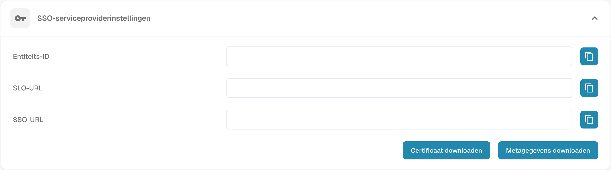

# Single Sign-On (SSO) configureren

Configureer DocBits als SAML-serviceprovider (SP) en koppel uw identiteitsprovider (IdP). U hebt beheerderstoegang nodig tot de betreffende instellingen in beide systemen.

## De SSO-instellingen openen

Meld u als beheerder aan bij DocBits en open Single Sign-On in de integratie-instellingen.

<figure><figcaption>
Instellingen van de SSO-serviceprovider: organisatiegegevens verborgen; er is geen configuratie opgeslagen.
</figcaption></figure>

## De waarden van de DocBits-serviceprovider bekijken

DocBits toont Entity ID, SSO URL en SLO URL als alleen-lezen waarden. Kopieer deze waarden of gebruik de SP-metadata om de DocBits-toepassing bij uw IdP te configureren. Vul geen vervangende waarden in deze DocBits-velden in. Entity ID identificeert de serviceprovider. Gebruik de getoonde eindpunten volgens de SAML-vereisten van uw IdP.

## Het SP-certificaat en de metadata downloaden

Gebruik Download Certificate en de metadatadownload in de serviceproviderinstellingen van DocBits. Deze downloads beschrijven DocBits als SP. Geef de SP-metadata en, indien nodig, het gedownloade SP-certificaat aan uw IdP. Dit certificaat staat los van de IdP-metadata die u naar DocBits uploadt.

## De identiteitsprovider configureren

1. Configureer DocBits bij uw IdP met de SP-waarden die DocBits toont of met de gedownloade SP-metadata.
2. Gebruik de DocBits Tenant ID als uw provider deze vereist. Controleer de tenant- en providercontext in de identiteitsproviderinstellingen van DocBits.
3. Haal de SAML-XML-metadata voor de geconfigureerde toepassing op bij uw IdP en upload deze IdP-XML-metadata naar DocBits. Gebruik hiervoor niet de eerder gedownloade DocBits-SP-metadata.
4. Sla de configuratie op met de actie Configure/Save in de identiteitsproviderinstellingen van DocBits.

## Aanmelden en ondersteund afmelden testen

Controleer of een gebruiker zich via de geconfigureerde IdP bij DocBits kan aanmelden. Test Single Log-Out alleen als DocBits en de IdP dit ondersteunen en het aan beide kanten is geconfigureerd. Afmelden bij DocBits garandeert op zichzelf niet dat de gebruiker ook bij alle andere gekoppelde toepassingen wordt afgemeld.
